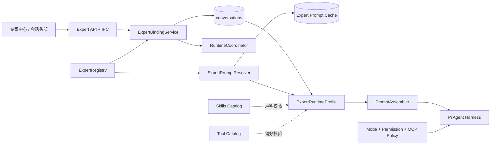
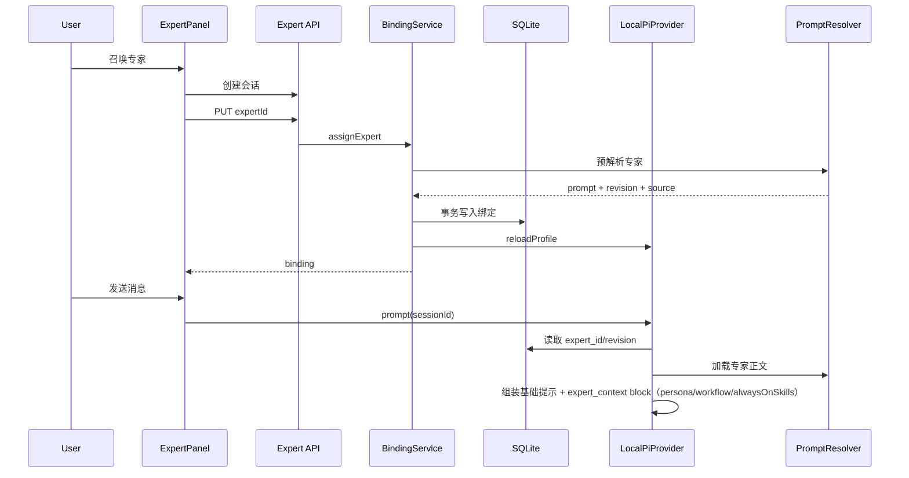

# 18 — 专家系统架构设计

> 状态：会话运行时、本地专家创建/编辑/卸载闭环、多业务技能组合与 Prompt Runtime v2 已实施；远端市场与自动路由仍持续演进
> 日期：2026-08-14
> 首期范围：会话级专家激活  
> 输入参考：`README (1).md` 的专家系统思路、`code.py` 的专家包伪代码，以及当前项目已有实现

## 1. 目标

在现有 Agent、Skills、MCP、会话和权限体系之上，建立一个可恢复、可校验、可观测的会话级专家系统。

专家不是另一个 Agent，也不是单个 Skill。专家是作用于整个会话的领域配置覆盖层，负责改变 Agent 的领域视角、默认方法和输出规范，但不能绕过核心系统提示、权限策略或工具安全边界。

首期完成以下闭环：

1. 用户从专家中心创建专家会话，或为未运行的现有会话切换专家。
2. 后端校验专家、保存会话绑定，并让会话运行时加载对应专家。
3. 核心 Prompt Pack 始终保留，专家内容通过 `ExpertSource` 作为结构化 controlled extension 注入同一 Snapshot。
4. 会话重启、应用重启或重新打开后，根据 `expert_id` 恢复同一专家。
5. 专家声明的技能和工具作为能力提示与一致性校验依据；首期不动态绕过或重写工具权限。

首期会话运行时不包含专家市场安装、用户自定义专家编辑、多专家协作、自动领域路由及专家级动态工具卸载；后续增量已补充本地专家创建与注册闭环，仍不包含远端市场和编辑器。

## 2. 历史实现基线（已由 Prompt Runtime v2 替代）

项目已经具备专家系统的部分骨架：

| 层级 | 已有能力 | 主要文件 |
|---|---|---|
| 专家目录 | 内置专家、远端专家元数据、提示词缓存与降级 | `src/agent/experts.ts`、`src/agent/expert_center.json` |
| 会话数据 | `conversations.expert_id` 字段 | `src/infra/db.ts` |
| API / IPC | 查询专家、给会话绑定专家 | `application.electron.ts`、`src/electron/ipc-handlers.ts` |
| Agent 运行时 | 创建会话时读取 `expert_id` 并加载专家提示 | `src/agent/provider.ts` |
| 前端 | 专家中心、专家卡片、创建专家会话 | `frontend/src/components/ExpertPanel.tsx`、`frontend/src/store/useSkillStore.ts` |
| 自动化 | 自动化任务可记录 `expertId` | `src/domains/automation/node/store.ts` |

当前还不是完整闭环，存在以下缺口：

1. **专家提示替换了基础提示。** `provider.ts` 把专家提示作为 `basePrompt` 传入 `buildSystemPrompt`，会丢失核心身份、工具规范、文件安全、Visualizer 和交付规则。正确行为应是追加专家覆盖层。
2. **绑定接口缺少完整校验。** 未知 `expertId` 仍可能写入数据库，会话不存在时也没有明确的 404 语义。
3. **运行时切换不会可靠生效。** 已创建的 `SessionEntry` 会被复用，仅更新数据库不能重建系统提示。
4. **会话 DTO 不携带专家状态。** 列表和当前会话无法稳定展示已激活专家。
5. **专家只包含提示词。** `skills`、`preferred_tools`、行为准则和风险边界没有统一的专家包契约。
6. **远端提示缺少供应链边界。** 缺少超时、大小、内容类型、来源、版本和哈希校验。
7. **缺少可观测性。** 无法区分专家缓存命中、降级加载、绑定变更和运行时刷新失败。

## 3. 方案比较

### 方案 A：会话级专家覆盖层（已采用）

在现有单 Agent 会话模型上增加 `ExpertRegistry`、`ExpertPromptResolver`、`ExpertBindingService` 和结构化 `ExpertRuntimeProfile`。专家以会话元数据形式持久化，由 Prompt Runtime v2 的 `ExpertSource` 注入；工具和技能声明只参与受控上下文与校验，不反向修改 Tool Policy。

优点：复用当前 UI、SQLite、Provider 和权限体系；改动集中；能最快形成可靠闭环。  
缺点：首期还不能实现真正的专家级工具池切换。

### 方案 B：专家包即插件运行时

每个专家自带提示词、Skills、MCP、工具策略和资源目录，激活时动态装配完整运行时。

优点：最接近生产级专家市场，隔离和扩展能力强。  
缺点：需要先解决包签名、版本、依赖、权限升级和卸载一致性，超出当前首期范围。

### 方案 C：每轮自动专家路由

用户不显式选择专家，由路由器根据每条消息自动选择或组合专家。

优点：使用门槛低，适合多领域任务。  
缺点：行为不可预测，增加一次分类调用和路由误判；也与当前“一个会话通常激活一个专家”的产品模型冲突。

首期采用方案 A，同时让专家包数据结构保留向方案 B 演进的字段。

## 4. 设计原则

1. **叠加而非替换。** 专家永远不能替换基础系统提示。
2. **单会话单专家。** 一个会话最多激活一个专家，也允许无专家状态。
3. **权限优先。** 专家只能表达工具偏好，不能扩大当前模式、会话权限或 MCP 选择允许的工具范围。
4. **会话可复现。** 专家标识和解析版本写入会话；恢复时能说明当前使用了哪个专家来源。
5. **失败可降级。** 远端提示不可用时使用已验证缓存，再降级到内置摘要；不得静默切换到另一个专家。
6. **切换有边界。** 运行中的会话禁止切换；空闲会话切换后重建运行时，保留历史消息。
7. **数据与运行时分离。** 专家目录负责“有哪些专家”，会话绑定负责“选了谁”，运行时配置负责“本轮如何生效”。

## 5. 总体架构



核心关系：

- `ExpertRegistry` 只管理专家元数据和查询。
- `ExpertPromptResolver` 只解析专家正文和缓存来源。
- `ExpertBindingService` 只处理会话绑定、切换校验和持久化。
- `RuntimeCoordinator` 负责使数据库变更与内存 `SessionEntry` 一致。
- `PromptAssembler` 负责按稳定顺序组装基础提示、记忆、技能、专家和运行模式。
- 工具权限仍由 `toolsForConversation` 和权限钩子决定，专家无权直接修改。

## 6. 专家包模型

### 6.1 对外摘要

专家列表接口只返回展示与选择需要的信息，避免一次返回全部提示正文。

```typescript
interface ExpertSummary {
  id: string;
  name: string;
  expertType: "agent";
  nickname?: string;
  categoryId: string;
  description: string;
  icon: string;
  tags: string[];
  quickPrompts: string[];
  badge?: string;
  catalogSource: "builtin" | "installed" | "catalog";
  revision: string;
  available: boolean;
}
```

### 6.2 内部专家清单

```typescript
interface ExpertManifest extends ExpertSummary {
  prompt: {
    inline?: string;
    remotePath?: string;
    sha256?: string;
    maxBytes: number;
  };
  guidelines: string[];
  capabilityHints: {
    preferredTools: string[];
    bundledSkills: string[];
  };
  installedSkills?: InstalledExpertSkill[];
  outputPolicy?: string[];
  riskNotes?: string[];
}

/** 已安装专家包内的本地 Skill（包内安全加载，不依赖全局同名 Skill）。 */
interface InstalledExpertSkill {
  name: string;
  root: string;
  body: string;
  revision: string;
}
```

字段约束：

- `id` 使用稳定的不透明标识，不从显示名称推导。
- `revision` 表示专家清单版本；已安装专家由 plugin.json、主 Agent 正文与技能清单的哈希生成。
- `inline` 与 `remotePath` 至少存在一个；远端失败时允许回退 `inline`。已安装专家的 `inline` 即 `agents/<agentName>.md` 全文。
- `installedSkills` 仅已安装专家携带：包内 Skill 的 `body` 是 SKILL.md 去掉 frontmatter 的正文。正文不常驻 system prompt，只在模型按需读取时使用（详见 8.3 的循序加载设计）。
- `preferredTools` 和 `bundledSkills` 必须经过现有目录校验，未知名称只记录诊断，不自动安装。
- `riskNotes` 只能收紧行为，不能降低核心权限等级。

## 7. 后端组件

### 7.1 ExpertRegistry

职责：

- 加载并规范化 `expert_center.json` 和内置专家。
- 按 `id` 去重，内置定义作为离线兜底。
- 返回 `ExpertSummary`，不暴露完整提示词。
- 在启动时完成结构校验并记录诊断。

已按此结构拆出独立模块（`experts.ts` 保留为对外门面，汇总 Registry、Binding 与安装管理入口）：

```text
src/agent/experts/
├── types.ts               # ExpertSummary / ExpertManifest / ExpertBinding / InstalledExpertSkill
├── registry.ts            # 内置专家 + expert_center.json + installed overlay 合并与去重
├── prompt_resolver.ts     # 缓存/远端/inline 三级解析，校验与原子写入
├── binding_service.ts     # 会话绑定、切换校验与持久化（createExpertBindingService）
├── runtime_profile.ts     # ExpertRuntimeProfile（persona/workflow/alwaysOnSkills）
├── revision_resolver.ts   # 会话绑定的 revision 解析与兜底
├── observability.ts       # 结构化事件与诊断
├── installed_catalog.ts   # 扫描 marketplace 已注册专家包（plugin.json v2 + 主 Agent）
├── installed_skill.ts     # 包内 Skill 安全加载（防穿越/符号链接/预算）
└── installed_management.ts # 卸载、编辑草稿等安装生命周期管理
```

### 7.2 ExpertPromptResolver

解析顺序：

1. 读取与 `expertId + revision` 匹配的已验证缓存。
2. 如有远端路径，使用固定可信基地址下载。
3. 校验 HTTP 状态、`content-type`、字节上限和可选 SHA-256。
4. 原子写入缓存正文和元数据。
5. 下载失败时使用最近一次已验证缓存。
6. 无缓存时使用 `inline` 提示；仍不可用则返回结构化错误。

缓存键必须包含 revision，避免远端专家更新后复用旧正文；revision 目录名归一化为 `rev-<sha256(revision)>` 摘要（`normalizeRevision`），避免特殊字符与重名冲突：

```text
<appData>/expert_prompts/<expertId>/rev-<digest>/prompt.md
<appData>/expert_prompts/<expertId>/rev-<digest>/metadata.json
```

metadata.json 记录 `expertId`、`revision`、`sha256`（读取时重新摘要校验，不一致视为未命中）、`fetchedAt`。写入采用临时目录整目录替换（`.tmp` 写入 + `.bak` 备份），避免半文件。

解析器不得把网络错误直接吞掉；应返回 `promptSource: cache | remote | inline` 和诊断信息，由调用方决定是否允许降级。`promptSource` 表示正文来自哪里，与专家目录的 `catalogSource` 是两个不同概念。

### 7.3 ExpertBindingService

公开操作：

```typescript
assignExpert(conversationId: string, expertId: string): Promise<ExpertBinding>
clearExpert(conversationId: string): Promise<void>
getBinding(conversationId: string): Promise<ExpertBinding | null>
```

绑定流程：

1. 校验会话存在。
2. 校验专家存在且可用。
3. 校验会话状态为非运行态。
4. 预解析专家提示，确保至少有一种可用来源。
5. 记录旧绑定并开启事务，更新会话绑定与更新时间。
6. 调用 `RuntimeCoordinator` 使内存运行时失效；该动作只移除可重建的内存配置，不创建新模型调用。
7. 运行时失效成功后提交事务并返回当前绑定摘要；失败则回滚旧绑定。

失败时数据库保持原绑定；不会出现“数据库已切换但运行时仍是旧专家”的半完成状态。

### 7.4 RuntimeCoordinator

当前 `LocalPiProvider` 会缓存 `SessionEntry`，因此需要新增“刷新会话配置”语义，而不是复用永久销毁语义：

```typescript
interface AgentProvider {
  // 已有方法省略
  reloadProfile(sessionId: string): Promise<void>;
}
```

`reloadProfile` 的行为：

- 只允许会话空闲时执行。
- 中止并移除旧 harness 的内存实例，但不删除 SQLite 消息和 Core JSONL 历史。
- 增加 session generation，防止旧初始化异步回写。
- 下次 prompt 时从数据库重新读取模型、专家、工作区和类别。
- 保留事件监听器，让前端不必重新订阅。

如果切换发生在正在生成的会话，API 返回 `409 EXPERT_SWITCH_BUSY`，不隐式中止用户任务。

## 8. Prompt Runtime v2 中的 Expert 注入

### 8.1 单一调用链

每轮重新解析绑定并构建唯一 Envelope：

```text
SessionIntent（active expert binding）
  → Mode / Category Tool Policy
  → Skill Resources
  → ExpertPromptResolver
  → ExpertRuntimeProfile（persona/workflow/alwaysOnSkills）
  → ExpertSource
  → PromptContextSnapshot
  → PromptEnvelope
  → PromptAwareHarness
```

ExpertContext 是类型化数据，而不是可闭合外围标签的 addon：

```typescript
interface ExpertContext {
  expertId: string;
  revision: string;
  persona: string;         // agents/<agentName>.md 全文（主入口，含技能地图）
  workflow: string;        // manifest.guidelines 按行拼接
  alwaysOnSkills: SkillRef[]; // 依赖技能清单（循序加载：只引用，不承载正文）
}

interface SkillRef {
  name: string;        // 技能名
  description: string; // 何时使用（与 SKILL.md frontmatter 一致）
  location: string;    // SKILL.md 绝对路径，模型按需读取
}
```

`alwaysOnSkills` 只携带**清单引用**（name/description/location），不再承载 `InstalledExpertSkill.body` 全文——正文按需读取，见 8.3 的循序加载设计。

### 8.2 权限边界

`RuntimeProfileResolver` 先确定 Mode/Category 工具与 Skill Resources，再把最终 `activeToolNames` 和 `skillNames` 提供给 Expert resolver 做提示校验。Expert resolver 只能返回 Expert 引用和结构化内容，API 上没有修改工具、MCP 或 Permission 的返回通道。Manifest 同时记录 route、active tools、resources 和 permission summary。

### 8.3 Skills 与 Tools 的实际语义

技能采用**循序加载**（按需读取）设计，对齐 pi-agent-core 原生技能规范（agentskills.io）：系统提示只注入技能**清单**，正文由模型在任务匹配时通过文件工具读取。专家包内技能共三层：

| 层 | 内容 | 常驻系统提示？ | 体积量级 |
|---|------|--------------|---------|
| 层 1 主入口 | `agents/<agentName>.md` 全文 → `persona`，含技能地图（声明依赖技能 + 触发场景） | 是（专家会话核心人格） | ~10KB |
| 层 2 技能清单 | `alwaysOnSkills`（SkillRef：name/description/location），并入 `skill_context`，经 `formatSkillsForSystemPrompt` 渲染 | 是（只有引用，无正文） | ~1KB/技能 |
| 层 3 技能正文 | `SKILL.md` 全文（`InstalledExpertSkill.body`） | 否——模型看到清单后按 `location` 读取 | 按需 |

- **`installedSkills` → `alwaysOnSkills`（清单引用）**：已安装专家包内的每个 Skill 只以 `SkillRef`（name/description/location）进入 `expert_context.alwaysOnSkills`，再并入 `skill_context` 用 pi 原生 `formatSkillsForSystemPrompt` 渲染——正文绝不自动进入 system prompt，模型按 "Read the full skill file when the task matches its description" 指引按需读取。技能地图（各技能的触发场景）已随 persona 常驻，模型据此决定何时读取哪份正文。
- **`bundledSkills`（能力提示）**：仅以 `bundled-skill:<name>` 标记进入 `capability_context`，不承载正文；远端目录专家无包内技能时以此为能力提示。
- `preferredTools` 表示执行偏好，不会让不可用工具突然出现。
- 实际工具集合只由 Ask / Plan / Craft、会话类别和用户显式选择的 MCP 决定；Permission 是执行 hook，与工具可见性正交。
- 若专家声明的 Skill 或 Tool 不存在，记录诊断并省略该提示，不使会话初始化失败。
- 专家无法开启未由用户连接的 MCP，也无法把 L1/L2 权限提升为 L3。
- **预算控制（循序加载后）**：system prompt 上限 `PROMPT_BYTE_BUDGETS.systemBytes = 64KB`。循序加载前，persona + 全部 SKILL.md 正文 + baseline 直接叠加，大技能专家包（如 frontend-developer 捆绑 5 技能共 ~72KB 正文 + 10KB persona）实测 109KB > 64KB，触发 `PROMPT_FRAGMENT_BUDGET_EXCEEDED`。循序加载后正文不再常驻，72KB 正文降为 ~5KB 清单，frontend-developer 专家在最大能力组下总 system prompt 实测 32.6KB，回落到预算内（余量 ~31KB）；层 3 正文单份读取时仍受 prompt 片段预算约束（`fragmentBytes = 12KB`，超限技能按片段截断策略处理）。

## 9. 数据模型

会话绑定保留 `conversations.expert_id`，实际表已扩展 8 个专家相关列：

```sql
ALTER TABLE conversations ADD COLUMN expert_id TEXT;
ALTER TABLE conversations ADD COLUMN expert_revision TEXT;
ALTER TABLE conversations ADD COLUMN expert_catalog_source TEXT;
ALTER TABLE conversations ADD COLUMN expert_operation TEXT;         -- create | edit（专家创建/编辑会话）
ALTER TABLE conversations ADD COLUMN expert_target_id TEXT;         -- 编辑目标专家
ALTER TABLE conversations ADD COLUMN expert_target_revision TEXT;   -- 编辑目标版本
ALTER TABLE conversations ADD COLUMN expert_draft_root TEXT;        -- 编辑草稿根目录（内部字段，绝不进入渲染层 DTO）
ALTER TABLE conversations ADD COLUMN expert_notice TEXT;            -- uninstalled（专家被卸载后的会话提示）
```

会话 DTO 补充：

```typescript
interface Conversation {
  // 现有字段
  expertId?: string | null;
  expertRevision?: string | null;
  expertCatalogSource?: string | null;
  expertOperation?: "create" | "edit" | null;
  expertTargetId?: string | null;
  expertTargetRevision?: string | null;
  expertNotice?: "uninstalled" | null;
  // expertDraftRoot 是内部字段，RendererConversation 显式剔除
}
```

规则：

- `expert_id = NULL` 表示普通会话。
- `expert_revision` 保存绑定时解析到的版本。
- `expert_catalog_source` 保存 `builtin | installed | catalog`，不保存远端 URL；每次解析正文得到的 `promptSource` 只进入诊断日志，不作为固定绑定属性。
- 读取旧数据时字段缺失按无专家或当前可用 revision 兼容。
- 会话分叉时继承专家绑定和 revision，保证分支上下文一致。
- `expert_id` 与 `category` 正交：专家会话仍沿用普通 `assistant` 对话链路，不能通过 `category === "expert"` 判断专家是否生效；`expert_creator` 类别只用于创建/编辑专家本身。
- 绑定读写通过 `expert_binding_store.ts`（createExpertBindingStore）封装，卸载专家时批量清理相关会话绑定并写入 `expert_notice`。

不新增独立 `expert_bindings` 表；单会话单专家用列模型足够。未来需要切换历史和审计时，再新增事件表。

## 10. API 与 IPC 契约

### 10.1 查询专家

```http
GET /api/experts
```

返回 `ExpertSummary[]`，支持前端本地搜索。完整 Prompt 不对前端开放。

```http
GET /api/experts/:id
```

返回专家摘要、能力提示和可用状态，不返回远端原始凭据。

```http
GET /api/experts/installed
```

刷新并列出 my-experts 已注册专家：`{ experts: ExpertSummary[], diagnostics, refreshed }`。每次调用重新扫描 marketplace，合法包原子替换 installed overlay；marketplace 不可用时保留上一份有效快照。

### 10.2 绑定、切换与停用

```http
PUT /api/conversations/:id/expert
Content-Type: application/json

{ "expertId": "SoftwareCompany" }
```

成功返回：

```json
{
  "ok": true,
  "binding": {
    "expertId": "SoftwareCompany",
    "revision": "2026-08-11",
    "catalogSource": "catalog"
  }
}
```

停用专家：

```http
DELETE /api/conversations/:id/expert
```

错误码：

| HTTP | code | 含义 |
|---|---|---|
| 400 | `INVALID_EXPERT_ID` | 标识格式不合法 |
| 404 | `CONVERSATION_NOT_FOUND` | 会话不存在 |
| 404 | `EXPERT_NOT_FOUND` | 专家不存在 |
| 404 | `EXPERT_NOT_REGISTERED` | 已安装专家未注册（edit-session） |
| 409 | `EXPERT_SWITCH_BUSY` | 会话正在执行任务 |
| 422 | `EXPERT_UNAVAILABLE` | 专家元数据存在，但提示无可用来源 |
| 500 | `EXPERT_BINDING_FAILED` | 持久化或运行时刷新失败 |

IPC 与 HTTP 一一对应：`expert.list`、`expert.listInstalled`、`expert.get`、`expert.assign`、`expert.clear`、`expert.createEditSession`、`expert.openFolder`、`expert.uninstall`。兼容期保留旧 `POST /api/conv/:id/expert` 路由，内部转调 `ExpertBindingService`。

已实施的其他专家路由：

```http
POST   /api/experts/:id/edit-session   # 创建隔离编辑会话（expert_creator + edit 元数据 + 草稿目录）
POST   /api/experts/:id/open-folder    # 打开已安装专家包目录
DELETE /api/experts/:id                # 卸载：释放运行时会话、清绑定、注销 marketplace、刷新 overlay
```

卸载会批量清理绑定该专家的会话绑定并写入 `expert_notice = "uninstalled"`，前端据此提示用户；会话本身不被删除。

## 11. 用户交互

### 11.1 创建专家会话

```text
点击“召唤”
  → 创建普通空会话
  → 绑定专家
  → 加载会话列表
  → 选中新会话
  → 会话头部展示专家身份
  → 首次发送消息时创建专家运行时
```

现有“绑定失败则删除新会话”的补偿逻辑可以保留，但后端必须保证绑定错误具有稳定错误码。

### 11.2 切换已有会话

- 只允许空闲会话切换。
- 切换前显示目标专家名称；成功后更新会话头部和列表标记。
- 切换只影响后续消息，不重写历史消息。
- 用户可以停用专家，后续消息恢复普通 Agent。
- 对话历史中可插入一条本地系统事件：“专家已从 A 切换为 B”，但不作为 LLM 对话消息发送。

### 11.3 状态展示

会话头部显示专家头像、名称和“已激活”状态；悬浮说明专家只影响当前会话。若使用缓存或内置降级，可在详情中显示，不需要在每轮对话中提示。

## 12. 核心数据流

### 12.1 新专家会话



### 12.2 应用重启恢复

```text
打开历史会话
  → Conversation DTO 返回 expertId/revision
  → 首次 prompt 创建 SessionEntry
  → Provider 从 SQLite 读取绑定
  → Resolver 使用匹配 revision 的缓存或安全降级
  → PromptAssembler 重建专家覆盖层
```

## 13. 一致性与并发

- 同一会话的专家绑定操作串行执行。
- 会话为 `running`、`pending` 或正在初始化时拒绝切换。
- `reloadProfile` 使用 generation 防止旧异步初始化覆盖新配置。
- 数据库事务成功、运行时刷新失败时，应回滚旧绑定；若无法回滚，返回错误并强制下次 prompt 重新读取数据库，同时记录严重日志。
- Prompt 缓存写入使用临时文件加原子替换，避免半文件。
- 同一专家的并发下载共用一个 in-flight Promise，避免重复请求。

## 14. 安全边界

1. 专家提示属于低于核心系统规则的受控配置，不可覆盖安全、权限、文件边界和用户明确指令。
2. 远端地址只能由受信任基地址和清单中的相对路径拼接；禁止任意 URL。
3. 限制提示正文大小，建议首期 128 KiB；拒绝二进制和非文本类型。
4. Frontmatter 只解析允许字段，不执行脚本或动态表达式。
5. 专家不得直接安装 Skill、连接 MCP 或升级权限。
6. 法律、医疗、金融等高风险专家必须在 `riskNotes` 中声明边界，并由核心提示保留最终免责声明策略。
7. 日志不记录完整专家提示和用户敏感内容，只记录 expertId、revision、source、耗时和结果。

## 15. 错误处理与降级

| 场景 | 行为 |
|---|---|
| 专家 ID 不存在 | 拒绝绑定，不写数据库 |
| 远端不可用，有匹配缓存 | 使用缓存并记录 `cache_fallback` |
| 远端和缓存不可用，有 inline | 使用内置提示并记录 `inline_fallback` |
| 所有来源不可用 | 返回 `EXPERT_UNAVAILABLE`，保持旧绑定 |
| 声明的 Skill 不存在 | 忽略该能力提示，记录 warning |
| 会话运行中切换 | 返回 409，不中止当前任务 |
| Prompt 组装失败 | 不启动模型调用，向前端返回初始化错误 |
| 历史会话的专家已从目录移除 | 使用匹配缓存；无缓存则提示用户停用或更换专家 |

## 16. 可观测性

新增结构化事件：

- `expert.registry.loaded`
- `expert.prompt.cache_hit`
- `expert.prompt.remote_loaded`
- `expert.prompt.fallback`
- `expert.binding.changed`
- `expert.runtime.reloaded`
- `expert.runtime.reload_failed`

建议字段：`conversationId`、`expertId`、`revision`、`catalogSource`、`promptSource`、`durationMs`、`result`、`errorCode`。不记录提示正文。

## 17. 实施分层

### Phase 1：正确性闭环

- 定义统一 `ExpertManifest` / `ExpertSummary`。
- 修复 Prompt Assembly，专家改为追加而非替换。
- 为绑定 API 增加会话、专家和状态校验。
- Conversation DTO 返回专家状态。
- 新增 `reloadProfile`，支持空闲会话切换和恢复。
- 会话分叉继承专家绑定。

### Phase 2：可靠缓存与体验

- 缓存加入 revision、元数据、超时、大小和哈希校验。
- 前端展示当前专家、切换和停用入口。
- 增加结构化错误码、日志与诊断。
- 专家能力清单与现有 Skill / Tool 目录做一致性校验。

### Phase 3：专家包演进（本地创建闭环已实施）

- 已实施：本地专家包创建、校验、注册、打包和“我的专家”列表。
- 待实施：可视化编辑、导入和完整版本管理。
- 签名专家市场与更新策略。
- 经用户授权的工具池和 Skill Bundle 动态装配。
- 自动路由、多专家协作和专家评测体系。

## 18. 预计代码变更边界

| 文件/模块 | 状态 |
|---|---|
| `src/agent/experts.ts` | ✅ 已拆出 Registry / Resolver / BindingService，文件保留为对外门面 |
| `src/agent/prompt-runtime/` | ✅ Profile、ExpertSource、Snapshot、Envelope 与 Manifest 已实施 |
| `src/agent/engine.ts` | ✅ 只构建 Harness，执行运行时 Permission / 安全 hooks |
| `src/agent/provider.ts` | ✅ 保留队列和 Session 生命周期；每轮委托 Prompt Runtime；`reloadProfile` 已实施 |
| `src/domains/session/node/store.ts` | ✅ Conversation 映射 8 个专家字段；绑定、分叉继承、卸载通知 |
| `src/infra/db.ts` | ✅ 迁移已实施（addColumn 系列） |
| `application.electron.ts` | ✅ 绑定/停用/installed/编辑/卸载路由均由专家服务处理 |
| `src/electron/ipc-handlers.ts` / `preload.cjs` | ✅ expert.* 契约已补齐 |
| `frontend/src/store/useStore.ts` | ✅ 保存会话专家状态 |
| `frontend/src/store/useSkillStore.ts` | ✅ 使用新绑定接口和错误码 |
| `frontend/src/components/ExpertPanel.tsx` | ✅ 展示绑定状态、稳定错误、修改/卸载入口 |
| 会话头部组件 | ✅ 展示、切换、停用当前专家 |

不修改现有权限决策、MCP 选择、Skills 安装和工具执行审计的主链路。

## 19. 验证策略

### 单元级

- Registry 去重、字段规范化和非法清单。
- Prompt Resolver 的缓存优先级、远端失败和大小/哈希校验。
- Prompt Envelope 始终包含 Core Packs，并至多包含一个结构化 ExpertContext。
- BindingService 的不存在、运行中、停用和事务回滚。
- `reloadProfile` 的 generation 竞争保护。

### 集成级

- 创建专家会话后首轮消息使用对应专家提示。
- 普通会话不包含 `<expert_specialization>`。
- 切换专家后下一轮生效，历史消息保持不变。
- 应用重启后恢复相同 expertId/revision。
- 会话分叉继承专家绑定。
- Ask/Plan/Craft 工具集合不因专家而越权。

### UI 冒烟

- 专家中心召唤成功、失败补偿和重复点击保护。
- 会话头部展示当前专家。
- 运行中切换显示明确提示。
- 停用专家后 UI 和后端状态一致。

## 20. 验收标准

1. 激活专家不会丢失任何基础系统提示能力或安全规则。
2. 每个会话最多一个专家，绑定状态可以跨应用重启恢复。
3. 非法专家、无效会话和运行中切换不会写入错误状态。
4. 空闲会话切换专家后，下一轮模型调用使用新专家。
5. 专家不能增加工具、连接 MCP 或提升权限。
6. 远端提示不可用时按缓存、内置提示顺序稳定降级。
7. 前端能够展示、切换和停用当前专家，并显示结构化错误。
8. 普通会话和现有 Skills、Visualizer、交付物、权限与自动化流程不回归。

## 21. 确认项

本文档按以下决策进入实施计划：

- 首期采用会话级专家覆盖层，不做完整插件运行时。
- 专家必须叠加在核心提示之上，禁止替换基础提示。
- 首期 Skills / Tools 为声明式能力提示，不做动态装卸。
- 一个会话最多激活一个专家。
- 运行中不允许切换，空闲切换通过运行时重载生效。
- 数据模型增加 expert revision/source，以支持恢复与诊断。

首期会话级专家运行时、本地专家创建/编辑/卸载闭环与多业务技能组合已按本文档完成实施；专家市场、动态工具装配和自动路由仍属于后续演进范围，后续变更需同步更新设计与验收证据。

## 22. 本地专家创建与“我的专家”增量

本增量采用内置 `expert-manager` 技能驱动创建，不在前端复制专家生成规则。

### 22.1 项目目录与包格式

专家 marketplace 固定放在项目配置根 `platformPaths.appDataDir`：

```text
<appDataDir>/plugins/marketplaces/my-experts/
├── .picoddy-plugin/marketplace.json
├── plugins/<expert-name>/
│   ├── .picoddy-plugin/plugin.json   # v2 清单（schemaVersion: 2）
│   ├── agents/<agentName>.md           # 主 Agent 文件（prompt 正文来源）
│   ├── skills/<name>/SKILL.md          # 包内技能（可多个，含完整本地树）
│   ├── avatars/                        # 可选头像
│   └── license / README.md
└── packages/<expert-name>.zip
```

macOS/Linux 默认根为 `~/.pi-a`，Windows 默认根为 `%LOCALAPPDATA%\\Pi-a`。系统不读取 WorkBuddy 的配置目录变量，也不向 `~/.workbuddy` 写入文件。

plugin.json v2 关键字段（`installed_catalog.ts` 与 `validate_expert.py` 双端校验）：

- `schemaVersion: 2`（严格等于 2，否则 `EXPERT_SCHEMA_VERSION_UNSUPPORTED`）
- `name`（须与目录名一致）、`expertType: "agent"`、`agentName`、`plugin`（须等于 name）
- `agents: ["./agents/<agentName>.md"]` — 主 Agent 必须是声明的文件，全文即专家 persona
- `skills: ["./skills/<name>", ...]` — 包内技能声明，顺序须与主 Agent frontmatter 的 `skills` 数组一致
- `displayName` / `profession` / `displayDescription`（`{ en, zh }` 本地化对象）
- `categoryId`、`defaultInitPrompt`（须等于首个 quickPrompt）、`tags`/`quickPrompts`（各恰 3 项）、`avatar`

### 22.2 创建会话

“创建专家”卡片创建 category 为 `expert_creator` 的会话。Renderer 为该会话一次性预填 `/expert-manager` 技能标签和创建模板；Provider 同时从受保护内置 bundle 读取官方技能正文并追加 `<active_skill name="expert-manager">`，因此后端执行不依赖可编辑的前端文本。

会话固定执行以下生命周期：

```text
收集并确认信息
  → init_expert.py
  → 生成 Agent 文件与可选头像
  → validate_expert.py
  → register_expert.py
  → package_expert.py
```

校验或注册失败不得宣告安装成功；打包失败只表示分享归档失败，不影响已完成的安装。

### 22.3 Installed Overlay

后端只扫描 `marketplace.json` 已注册的直接 `plugins/` 子目录，拒绝路径穿越、符号链接、无效 JSON、未完成模板和主 Agent 缺失。合法包原子替换 `ExpertRegistry` 的 installed overlay，优先级为 `builtin > installed > catalog`；marketplace 整体不可用时保留上一份有效快照。

`GET /api/experts/installed` 通过 HTTP 与 Electron IPC 共用同一业务路径。摘要不会返回 Agent Markdown 提示正文，头像以受限大小的 data URL 或确定性文字头像呈现。

已安装专家的卸载链路（`DELETE /api/experts/:id` → `uninstallInstalledExpert`）：先释放运行中的专家会话，再列出并清理所有绑定该专家的会话绑定（`clearExpertBindingsForUninstall`，写入 `expert_notice`），随后从 marketplace.json 注销，最后刷新 installed overlay。卸载失败不会留下半注册状态。

### 22.4 前端交互

“我的专家”提供 Agent 专家搜索、刷新、已安装专家卡片和固定创建卡片。点击已安装专家沿用会话级 ExpertBindingService；点击创建卡片进入 `expert_creator` 会话；卡片菜单提供“修改专家”（进入隔离编辑会话，复制专家包到草稿目录，经 `expert_creator` + edit 元数据保存后回写发布）与“卸载专家”（危险操作，双重确认）。所有创建、编辑、导航、扫描和绑定失败均有可见错误与重复点击保护。专家包内声明的 Skills 从自身包内安全加载，不依赖全局同名 Skill。

## 23. 专家创建的多业务技能组合（已实施）

专家创建会话允许用户按选择顺序组合多个已启用的业务 Skill；该选择是创建本地专家包的显式输入，而不是依赖编辑器文本推断。最终数据流固定为：

```text
Composer 有序选择业务技能
  → selectedSkillNames
  → 后端权威解析器（校验、去重、保持顺序）
  → turn_payload.selectedExpertSkillInputs
  → 既有 expert-manager 脚本
  → 专家包内 skills/<name>/ 完整本地树
```

具体约束如下：

- `Composer` 在 `expert_creator` 会话中固定展示不可移除的 `expert-manager` 芯片；业务 Skill 可从“添加内容 → 技能”连续选择、显示为独立芯片并单独移除。重复选择不会重复记录，菜单会保持打开以便多选。
- 提交时仅业务 Skill 名称通过 `selectedSkillNames` 传递；运行时的权威解析器负责重新解析已启用的 Skill 根目录、拒绝保留名 `expert-manager`，并生成结构化 `selectedExpertSkillInputs`（name/source/root/revision/destination）。前端选择不是打包的信任边界。
- 既有 `expert-manager` 的校验、注册和打包脚本消费该上下文，并把每个选中的业务 Skill 以完整目录树物化到 `<expert>/skills/<name>/`，同时以同一顺序写入插件和主 Agent 声明。
- `expert-manager` 是创建流程固定的受保护管理能力：它不属于用户选择的业务 Skill，且不会被复制或打包为专家包内的本地 Skill。
- 项目配置根仍是 `platformPaths.appDataDir`；专家 marketplace、注册和包输出继续位于该根下，不读取 `WORKBUDDY_CONFIG_DIR`，也不写入 `~/.workbuddy`。
- 普通会话及技能创建会话不消费 `selectedSkillNames`；所有类别统一经过 Prompt Runtime v2，Skill 正文只通过 Pi Resources 与真实 invocation 加载。

## 24. SkillHub 专家缓存与“我的专家”隔离（已实施）

SkillHub 市场专家的召唤不再写入用户自建的 `my-experts` marketplace。两类专家分别使用独立存储和生命周期：

```text
<appDataDir>/skillhub-experts/
├── index.json
└── packages/<namespace>--<slug>/

<appDataDir>/plugins/marketplaces/my-experts/
└── plugins/<expert-name>/
```

- SkillHub 缓存索引记录 `namespace`、`slug`、`version` 和固定相对路径；包目录必须严格位于 `packages/<namespace>--<slug>`，扫描时拒绝路径穿越和符号链接逃逸。
- 缓存包复用 `readExpertPackageManifest` 校验，但注册为 `catalogSource: "catalog"`；它不会进入 `list("installed")` 或“我的专家”页面。
- Registry 合并优先级为 `builtin > installed > cached catalog > bundled catalog`，因此用户自建同 ID 专家仍优先于市场缓存，内置专家仍是最高优先级。
- 同版本且缓存有效时直接复用；版本变化时 CLI 下载到缓存根的临时目录，校验后通过同文件系统 rename 替换包目录和索引。包与索引均保留事务内 backup，失败时恢复旧版本。
- 应用启动顺序固定为先刷新 installed overlay，再刷新 SkillHub cached catalog；召唤完成后刷新缓存目录并复用既有 ExpertBindingService 启动会话。
- 专家市场卡片右上角只显示“召唤”；“我的专家”卡片右上角显示“召唤”和编辑按钮，查看、打开目录、卸载仍位于更多菜单。

## 25. 需求测试专家与模板用例交付（2026-09-17）

项目需求当前阶段为设计分析、产品 PRD、设计评审、研发设计、代码审核、自动测试、构建验证、交付归档。研发设计继续绑定 teach-engineer/software-architect；研发计划和软件开发不再提供阶段入口。有效阶段保留原持久化编号 0、1、2、3、6、7、8、9，界面序号按显示顺序计算。研发设计的内部会话键仍为 stage:架构设计，避免重建已有会话和输入选择。待排期、已排期、研发计划及重新打开状态进入研发设计。详见[阶段简化设计](./designs/2026-09-18-requirement-development-design-stages-design.md)。

需求聊天页“本轮输入”固定在底部 Composer 上方。需求、仓库及所选资产以单行引用列表展示，数量多时横向滚动；长名称省略并通过悬停显示全文，校验提示独立显示，聊天消息继续占据剩余高度并纵向滚动。详见[输入资产栏设计](./designs/2026-09-18-requirement-input-assets-horizontal-scroll-design.md)。

开发中和开发完成的 TAPD 需求进入测试阶段，使用与其他阶段相同的 createStageExpertSummoner 自动召唤市场专家 `team-qa/testing-expert`，绑定 ID 为 `team-qa--testing-expert`。已可用则复用，未安装则查询已发布版本并自动安装、激活。无需事先去专家市场召唤，也不使用仅包含个人包的 installed 列表。详见[跨设备安装识别修复](./designs/2026-09-18-testing-expert-installed-identity-design.md)。

测试专家使用 schemaVersion 2 清单、主 Agent MD、流程/模板/资产参考文档、原样 Excel 模板及内置 ExcelJS 的 CJS 生成器。原模板固定 11 列；步骤与预期一一对应。来源资产、验收编号、用例编号和版本 hash 存于覆盖矩阵。代码实现和回归测试源码已补齐，实际模型任务、TAPD 上传及 Windows 启动尚未验证。

召唤只恢复并绑定会话，不自动生成或上传。用户选择资产后通过对话要求生成、修改或发布。生成和修改在产物交付后完成，不设置人工审批等待状态。用例设计可在没有代码仓库时基于充分的产品资产开展。宿主从已校验的 SkillHub 本地缓存解析模板、生成器路径，并在每轮提供包资源位置和 Node 运行时。

测试阶段提供两个独立入口：“提交测试产物”收集当前会话最新 `present_files` 明确交付的正式 Excel、覆盖矩阵和问题清单，校验模板/hash 后登记已提交需求资产并同步需求附件；“上传用例到 TAPD”仅选择已提交 Excel 的不可变版本和当前项目真实用例库/版本/目录。宿主读取 Excel，通过 TestX 测试协同 API 直接保留 P0–P3、STEP/TEXT、标签、工时和执行次数，步骤与预期逐项成对转换，Issues 注入当前需求。用户不做字段映射或等级换算。所选目录覆盖 Excel 目录列，原文件保持不变。两个操作均不流转需求状态。

TestX 导入回执保存在 requirement_testx_imports，与旧测试模块的回执隔离，按账户、项目、需求、资产 hash、稳定用例标题和目标目录记录远端 ID 及逐行结果。同版本已成功行复用；请求超时或崩溃后先查询核对，未唯一匹配时保持结果未知。已创建但返回未确认需求关联时保留 ID、明确提示核对，续传只查询，不重复创建或自动覆盖远端内容。已成功/结果未知记录的目录或内容变化时阻断，要求恢复原目录续传或使用新的用例版本编号。弹窗提供文件/目录加载状态、前置条件说明、点击校验反馈和逐行进度；缺少映射不会再导致按钮无反馈。TestX 需要有效用户态授权，401/403 在弹窗明确显示，不回退旧 tcases 模块或要求添加自定义字段。对话发布只同步需求附件。详见[目录选择与简化上传设计](./designs/2026-09-18-tapd-case-directory-and-submit-feedback-design.md)。

## TAPD 未映射状态进入产研（2026-09-23）

TAPD 状态映射仅用于选择进入阶段，不作为入口门槛。未匹配状态的新需求默认进入设计分析；已有需求保留上次选中阶段，未记录时使用本地进度。需求读取与权限检查仍须成功，进入操作不写回 TAPD 状态。详见 [入口设计](./designs/2026-09-23-tapd-unmapped-entry-design.md)。

### 测试目标卡片入口收敛（2026-09-23）

目标卡片移除“检查本地环境”和“登记本地 MCP”操作，环境检查由测试专家在本地脚本执行前完成，保留编辑与 CLI 自动检测。该 UI 调整不删除历史执行配置或后端接口。参见 [入口设计](./designs/2026-09-23-testing-panel-remove-runner-actions-design.md)。

## 产研需求快捷恢复（2026-09-23）

侧栏“最近产研需求”按登录账号保存已进入需求的项目、阶段、面板与本地快照，支持固定、移除入口和展开历史。点击直接恢复本地需求工作台，再后台读取远端最新详情；移除不删除会话和资产。仅记录本次功能启用后实际进入的需求，不自动认领旧共享数据。

项目页面统一检查 TAPD 授权，过期保留本地内容，在原页弹层完成重新授权；恢复后只刷新读取，不自动提交。首次创建需求空间仍要求远端校验成功。详见 [设计](./designs/2026-09-23-project-history-auth-recovery-design.md)。

最近产研需求展示复用任务列表的分区、单行行样式、相对时间与分页组件（首屏 5 条，每次增加 10 条）；项目/阶段/完整时间放入悬浮提示，固定和移除放入更多菜单。导航与数据逻辑保持不变。

需求详情按当前显示的需求高亮最近历史条目；项目列表和设置高亮“项目”。点击“项目”返回需求列表。导航请求与当前显示状态分离，离开项目分类不保留历史条目的可见选中态。参见 [需求选中态设计](./designs/2026-09-23-requirement-active-navigation-design.md)。

Web/H5/微应用测试目标仅需页面地址，名称默认仓库名，版本校验可选；无连接器时由专家直接执行本地脚本并交付报告，不创建 MCP 跟踪记录。参见 [配置设计](./designs/2026-09-23-web-local-test-config-design.md)。

本地 inline 专家提示词校验后同样写入精确 revision 缓存，供专家包更新后恢复旧会话。已缺失的旧缓存不能伪造，需要通过既有绑定接口重新选择当前专家版本。详见 [缓存设计](./designs/2026-09-23-inline-expert-revision-cache-design.md)。

### 每轮使用最新本地专家（2026-09-23）
用户会话在每轮准备时刷新本地已安装专家目录，以当前版本生成提示词和技能资源，校验成功后更新会话绑定。旧 revision 不再锁定后续轮次，不自动从市场下载；正在执行的轮次不变，历史消息和资产不变。未使用的会话在下次发送时更新，无需批量改库。此规则优先于前述旧版缓存恢复策略；专家缺失仍报错，不静默使用旧版。参见 [设计](./designs/2026-09-23-expert-latest-per-turn-design.md)。

测试专家每轮获得受管浏览器环境状态。设置安装完成并开启后，可在独立会话测试工程使用 @playwright/test，无需修改业务依赖；运行入口再次检查开关，报告写会话产物目录。已有关联仓库原生测试时仍优先复用。环境安装不会启动测试，也不覆盖市场专家包。详见 [受管环境](./designs/2026-09-24-managed-playwright-design.md)。

authoring 缺少已提交资产不再阻塞编写，可使用需求、对话和授权本地资料；只追问具体缺项。正式登记仍校验资产 id/hash，本地脚本执行无需先上传 TAPD。参见 [设计](./designs/2026-09-24-testing-authoring-inputs-design.md)。
