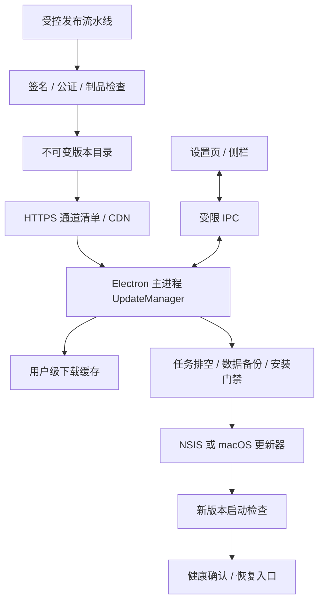
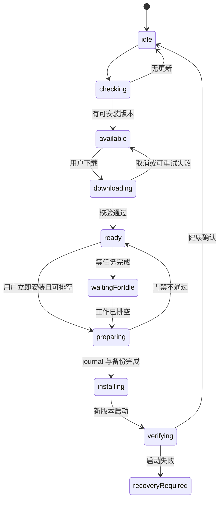

# PiCoddyClaw 远程升级详细设计

状态：待实施。日期：2026-09-07

本方案基于当前仓库实现和官方更新文档设计，不代表功能已经上线。本次不执行自动化测试、不安装依赖、不发布安装包。以下域名、版本、时间和阈值均为设计示例或建议值。

## 1. 结论与范围

采用 electron-updater + electron-builder 的完整应用升级机制，发布文件存放在公司 HTTPS 对象存储/CDN。Windows 使用签名的 NSIS 安装包，macOS 使用签名并公证的 DMG + ZIP。主进程管理检查、下载和安装，用户确认后在任务安全停止点重启。

首期包含：Windows x64/ia32、macOS arm64/x64、首次迁移、后台检查、下载重试、任务排空、数据保护、灰度发布和故障恢复入口。Windows ARM64、Linux、独立运行时热更新不在首期承诺范围。

采用“完整应用作为发布单位，下载可差分”的方式。不能把替换 app.asar 或远程执行升级脚本当成升级机制；Electron、Node、原生模块、Python manifest、工具注册和内置技能必须属于同一个发布版本。

Windows 的自动更新主路径选择 NSIS，macOS 保留 ZIP 供更新使用；这是 electron-updater 支持的发布组合。官方说明见 [electron-builder 自动更新](https://www.electron.build/docs/features/auto-update/)。

## 2. 当前项目差距

| 检查项 | 当前实现 | 必须补齐 |
|---|---|---|
| 更新引擎 | 未接入 electron-updater | 主进程 UpdateManager |
| Windows 安装 | MSI，perMachine=true | NSIS 通道与旧 MSI 迁移 |
| macOS 安装 | DMG/ZIP；本地 build:mac 可关闭签名 | 独立的签名、公证正式发布流水线 |
| 版本号 | package.json 为 1.0.0；设置页写死 v2.0 | app.getVersion() 为唯一展示和比较来源 |
| 更新源 | 未配置 publish | HTTPS feed、不可变制品与发布权限 |
| 退出流程 | main.mjs 的 isQuitting、before-quit | 显式安装前排空，不依赖退出事件做异步准备 |
| 用户数据 | Windows LOCALAPPDATA/Pi-a；macOS ~/.pi-a | 升级禁止删除这些目录 |
| 数据库 | pi-a.db，WAL；初始化内存在隐式迁移 | 显式迁移版本、可靠备份和兼容性门禁 |
| 内置运行时 | Node 随 Electron；Python vendor + 用户目录解压 | 跟随应用版本校验，健康检查不要求先解压 Python |
| 已有草案 | 2026-09-03 增量更新文档 | 本文补齐迁移、恢复、发布及平台边界 |

此前上传表格出现 Tool not found，属于应用代码/模型工具调用问题。远程升级只能分发包含修复的版本，不能单靠更换 Python 自动解决。

## 3. 关键架构决策

| 决策 | 采用方案 | 理由及边界 |
|---|---|---|
| 更新单位 | 完整签名安装包 | 保证原生依赖和 JS/资源一致 |
| 下载 | 优先库支持的差分，失败回退完整包 | 不承诺固定节省比例，也不自行实现二进制补丁 |
| 更新服务 | 首期静态 generic feed；后续独立策略服务 | 首期无需维护业务服务；后续支持租户与紧急撤回 |
| 安装时机 | 下载完成后显式“重启并更新” | 不在用户任务中途或普通退出时偷偷安装 |
| Windows 安装范围 | 新用户优先 per-user NSIS；IT 管理保留 per-machine | 普通用户减少 UAC；企业权限政策不能绕过 |
| 回退 | 默认停止推广 + 更高版本修复；崩溃时提供修复安装 | 不把安装器或 updater 描述成自动原子回滚系统 |
| 数据兼容 | 扩展优先，破坏性迁移独立安排 | 应用回退与数据库回退分开管理 |
| 版本治理 | SemVer + releaseId + 架构 + 通道 | 同版本不得重新上传不同字节 |

依赖版本方向：评估配套采用 electron-builder 27.x / electron-updater 7.x，并锁定通过兼容性评审的精确版本；不能将当前 builder 25.0.3 与网上最新 API 示例直接拼装。官方当前文档描述了 7.x 的 autoInstallEvent；若实施阶段保留旧版本，必须通过适配层使用该版本实际提供的配置。具体版本锁与原生依赖打包验证属于实施首个里程碑，不使用浮动 latest。[版本差异说明](https://www.electron.build/docs/features/auto-update/)

## 4. 总体结构



职责划分：

- UpdateManager：状态机、幂等控制、错误转换、更新库适配；不直接操纵 Agent 工具。
- UpdatePolicy：通道、版本比较、最低系统版本、禁用版本、灰度资格。
- UpdateCoordinator：暂停接入新任务、等待已有任务结束、刷盘和安装前检查。
- UpdateJournal：持久化安装意图、目标版本、备份标识、启动确认。
- BootHealth：在业务启动初期读取 journal；区分安装后首次启动与普通启动。
- Release CI：构建、签名、制品上传、灰度比例调整、审计和撤回。

## 5. 首次升级能力如何到达现有用户

**当前旧版本没有更新客户端，无法只在服务器发布文件就让它自行升级。必须有一次人工安装或公司软件分发。**

### 5.1 Windows 旧 MSI → NSIS

首个可更新版本称为桥接版，示例 1.1.0。不能假设 NSIS 会自动识别并安全替换既有 MSI。

迁移程序流程：

1. 通过已知 UpgradeCode/ProductCode 和卸载注册项识别旧 MSI；不使用名称模糊匹配，不扫描并删除同名目录。
2. 识别安装架构、per-user/per-machine、安装路径、当前 Windows 用户；禁止用管理员账户的 LOCALAPPDATA 代替真实用户数据路径。
3. 用户确认迁移后关闭旧应用及相关子进程，检查备份和新安装包已就绪。
4. 明示旧 MSI 的 per-machine 卸载需要管理员授权；无权限则转 IT 分发流程，不尝试绕过 UAC。
5. 按已核实的产品 ID 调用 Windows Installer 卸载，明确保留 Pi-a 用户数据。处理成功、取消、失败以及需重启状态，不把“命令已启动”视为成功。
6. 安装签名 NSIS 桥接版，重新建立快捷方式和卸载记录，再以原登录用户启动。
7. 新版本读取原有用户数据并显示实际版本；桥接成功后记录 installType=nsis 和安装范围。

若卸载成功而新安装失败，提供已预下载的旧 MSI/修复包恢复入口及原数据位置。迁移不能承诺跨两种安装器的事务原子性。发布前必须查清当前 MSI 是否包含删除用户目录的动作；未查清不得批量迁移。

企业 IT 继续管理 MSI 的机器：保留独立 manual-managed 通道，只展示版本和管理员升级说明，不与 NSIS 自动更新争抢安装控制权。

### 5.2 macOS 旧应用 → 签名桥接版

通过 DMG 手动覆盖安装桥接版或由公司 MDM 分发。保持 appId 和用户数据路径稳定。若旧应用未签名或签名身份不同，不承诺它能直接接受签名自动更新；先人工桥接。

从 DMG 只读卷、临时目录或 App Translocation 环境运行时，提示先安装到支持的位置。没有目录写权限时保留下载并提供系统授权/人工安装路径，不自行 chmod 系统目录。macOS 自动更新要求应用签名。[Electron 平台要求](https://www.electronjs.org/docs/latest/api/auto-updater)

## 6. 发布包、通道与安装范围

建议更新源占位地址：`https://updates.example.com/picoddy/`，上线前替换为公司域名。

```text
picoddyclaw/
  feeds/stable/win32/x64/user/latest.yml
  feeds/stable/win32/x64/machine/latest.yml
  feeds/stable/win32/ia32/user/latest.yml
  feeds/stable/darwin/arm64/latest-mac.yml
  feeds/stable/darwin/x64/latest-mac.yml
  feeds/beta/...相同结构...
  releases/1.1.0/win32/x64/user/<安装包及生成的辅助文件>
  releases/1.1.0/darwin/arm64/<dmg、zip及生成的辅助文件>
```

- 操作系统、进程架构、安装范围都必须匹配，不能只比较版本号。
- 32 位应用运行在 64 位 Windows 上仍走 ia32 通道；切换架构作为独立人工迁移处理。
- macOS Rosetta 的 x64 应用继续走 x64 通道，首期不自动转换 arm64。
- stable 不自动接受 beta；用户显式切换通道需二次说明，不隐式允许降级。
- 构建时注入对应 publish 配置，生成 app-update.yml。渲染进程不可提交任意 feed URL。
- 同一版本同一目标的包不可覆盖；发布错误必须增加版本号。
- releaseId 可使用 `<version>-<commit>-<platform>-<arch>-<scope>`；build commit 只用于追踪，不替代 SemVer 比较。
- MSI 与 NSIS 不共用 feed；企业升级说明不伪装成自动安装清单。

Windows 使用完整 NSIS 而非 nsis-web。per-machine 后续升级仍可能要求 UAC，拒绝授权应回到“已下载”，而非丢失当前版本。macOS 同时构建 DMG/ZIP。安装包的发布者身份保持连续，证书轮换通过过渡版本明确处理。

### 6.1 构建配置示意

以下是 CI 合并到基础配置的意图，不可直接带占位值发布：

```yaml
publish:
  provider: generic
  url: https://updates.example.com/picoddy/feeds/stable/win32/x64/user/
win:
  target:
    - target: nsis
      arch: [x64]
nsis:
  oneClick: false
  perMachine: false
  allowToChangeInstallationDirectory: true
  deleteAppDataOnUninstall: false
```

企业 machine、Windows ia32、两种 Mac 架构分别生成配置文件和制品，避免一个任务覆盖另一个任务的 runtime-staging。现有 afterPack 运行时检查必须保留，增加签名状态、app-update.yml 和版本一致性检查。

## 7. 客户端状态与交互



错误作为独立 error 字段附着在可重试状态，避免所有错误都丢掉下载信息。每个异步结果携带 operationId；取消或被新操作取代的旧回调不得覆盖当前状态。

建议默认：启动就绪后随机延迟 30–90 秒检查；此后每 6 小时带 ±15% 抖动；唤醒后距上次检查超过 6 小时再检查。超时 15 秒，临时网络错误退避 1/5/30 分钟，最多三次；签名错误不自动重试。

首期默认自动检查、用户点击下载。下载完成只提示“重启并更新 / 任务完成后更新 / 稍后”。配置 updater 为手动安装模式：选定 7.x 时使用 autoInstallEvent=manual；旧版适配层使用 autoInstallOnAppQuit=false。不能在 update-downloaded 回调里直接退出，也不在系统注销/关机时安装。[安装时机 API](https://www.electron.build/docs/features/auto-update/)

进度展示百分比、已下载大小和失败原因，不给不可靠的固定完成时间。更新失败不遮挡聊天、附件查看和数据导出。界面版本号来自主进程快照。

## 8. IPC 契约与访问边界

新增专用通道，不作为 Agent 工具暴露：

| IPC | 参数 | 返回/作用 |
|---|---|---|
| update.getState | 无 | 当前完整快照，页面重载后恢复 |
| update.check | 无 | 检查；主进程节流 |
| update.download | releaseId | 必须匹配当前 available |
| update.cancelDownload | operationId | 取消当前下载，重复请求幂等 |
| update.install | releaseId, mode=now/when-idle | 只安排受门禁保护的安装 |
| update.defer | releaseId | 清除等待安装意图，保持缓存 |
| update.openReleaseNotes | releaseId | 主进程映射到允许的 HTTPS 页面 |
| update.state | 主进程推送 | 带递增 revision 的完整状态快照 |

```ts
interface UpdateSnapshot {
  revision: number;
  operationId?: string;
  state: 'idle' | 'checking' | 'available' | 'downloading' | 'ready'
    | 'waitingForIdle' | 'preparing' | 'installing' | 'verifying' | 'recoveryRequired';
  currentVersion: string;
  targetVersion?: string;
  releaseId?: string;
  channel: 'stable' | 'beta' | 'manual-managed';
  platform: 'win32' | 'darwin';
  arch: 'ia32' | 'x64' | 'arm64';
  installScope: 'user' | 'machine' | 'unknown';
  progress?: { transferred: number; total: number; percent: number };
  lastCheckedAt?: string;
  blockedBy?: Array<'agent' | 'automation' | 'file-write' | 'backup' | 'permission'>;
  error?: { code: string; message: string; retryable: boolean };
}
```

在 ipc-handlers.ts 的白名单接入并校验 schema；验证 sender 属于受信的主界面 webContents/mainFrame。网页、webview、iframe、远程内容不能调用安装。preload 不提供“传路径执行安装器”或任意 shell 接口。发行说明按纯文本或受限 Markdown 渲染。

## 9. 下载和缓存

使用更新库负责下载和校验，不自行接管缓存格式。应用另存 journal，不能仅靠 ready=true 判断缓存仍有效。

建议用户级记录目录：`<platformPaths.appDataDir>/updates/`，包含 journal.json、backups/、logs/。更新库自己的下载缓存使用其可配置/约定目录，明确纳入清理策略。

- 下载需支持 HTTPS、Range/206，CDN 禁止动态重压缩安装包与清单。
- 校验使用生成清单的摘要和平台代码签名；摘要只证明内容一致，不证明发布者身份。
- 断网/取消后是否复用部分文件由锁定版本的更新库能力决定；产品承诺可重试，不承诺跨重启断点续传一定成功。
- 差分不可用时回退完整包一次，仍失败则明确报错。
- 磁盘空间检查覆盖缓存盘、安装盘和数据库备份盘；预估至少缓存完整包 + 展开后的新应用 + 数据备份 + 余量，不能只比较压缩包大小。
- 安装前重新确认文件存在、摘要/签名有效、目标仍获准发布。升级包被撤回则阻止进入 installing。
- 正在使用的下载文件、journal 和备份不能被普通缓存清理删除。成功版本和最近一次可恢复备份保留，超额清理只处理未引用文件。

## 10. 安装前任务排空与数据保护

安装准备必须在主进程完成，不能等 quitAndInstall 已关闭窗口后再尝试异步备份。

顺序：

1. 原子取得“准备升级”状态，并关闭新 Agent/自动化任务的入队入口。
2. 暂停自动化调度器，不只检查一次数据库里的 running 数量。
3. 等待现有 Agent、文件写入、连接器子任务完成；用户选择“立即”时先请求可取消任务正常停止。
4. 尚有不可安全中止的写操作时保持 waitingForIdle，用户可取消升级意图。等待超过建议 10 分钟只提示，不强杀。
5. 刷新会话输出、设置和审计记录；确认子进程退出，尤其是占用安装目录 DLL/EXE 的 Windows 进程。
6. 暂停数据库写入，生成一致性备份并确认可读取。
7. 写入并 fsync journal，再调用安装器；提前设置 isQuitting，使 Mac 关闭窗口逻辑不会改成隐藏。
8. 安装器启动失败/授权取消时撤销排空门禁、恢复调度器、保留 ready 状态。

数据库使用 WAL，禁止在线只复制 pi-a.db。首期选择“所有写连接退出后 checkpoint 并关闭，再复制数据库”；若无法保证所有连接静止，改用经验证的 SQLite 在线备份 API。备份落盘并校验完成才允许安装。

备份覆盖 pi-a.db、需要迁移的配置、数据库版本和构建版本；附件/会话文件不做重复全量复制，因为升级不得修改它们。用户技能、专家、连接器凭据和工作区不得被清空。凭据恢复仍遵循原 Windows 用户的 DPAPI/平台钥匙串约束，不能拷给其他用户解密。

## 11. 迁移、健康确认与恢复

### 11.1 数据库迁移

将隐式 initDb 加列逐步收敛为 schema_migrations(version, checksum, appliedAt)，每步事务执行。启动前读取 schema 兼容区间；超出当前应用可读范围时进入恢复页面，禁止继续写入。

常规升级优先新增表/列，不删除旧字段；至少保留上一个稳定版本的数据兼容性。破坏性迁移必须有独立发布说明、足量备份、最低可恢复版本，不进入首批灰度。

### 11.2 安装 journal

```json
{
  "schemaVersion": 1,
  "attemptId": "uuid",
  "releaseId": "1.1.0-commit-win32-x64-user",
  "fromVersion": "1.0.0",
  "toVersion": "1.1.0",
  "phase": "install-requested",
  "backupId": "backup-uuid",
  "dbSchemaBefore": 3,
  "requestedAt": "2026-09-07T08:00:00Z",
  "bootAttempts": 0,
  "healthyAt": null
}
```

journal 仅记录状态和标识，不接受其中的任意执行路径。目标安装文件必须来自更新器已验证缓存。序列化采用临时文件+刷盘+重命名，恢复时容忍一次写入中断。

### 11.3 健康确认

在主进程加载主要业务模块前检查 journal；本次版本等于目标版本时增加 bootAttempts。满足以下条件再标记 healthy：

- 实际应用版本与目标一致，受管 Node/npm 和资源版本匹配。
- 数据库打开及迁移成功，IPC 与本地 API 可用。
- 主页面完成握手，核心工具目录能建立，包含预期的 read_doc 等注册项。
- 内置 Python manifest 与当前架构匹配；未调用 Python 不强迫解压，也不以 Python 下载失败阻断基础启动。
- 经过建议 30 秒观察期未发生致命启动错误。

观察超时/连续两次启动失败进入 recoveryRequired；时间阈值要结合慢盘机器调优，不能因一次杀毒扫描就自动覆盖用户数据。

### 11.4 分级恢复

| 失败位置 | 可行恢复 | 不应承诺 |
|---|---|---|
| 检查/下载/校验失败 | 继续旧版本、重试 | 不需要回滚数据库 |
| 安装器启动或 UAC 失败 | 保留已下载包、恢复任务 | 不能绕过管理员权限 |
| 应用可启动但功能有缺陷 | 撤回灰度，发布更高版本修复 | 不能同版本替换文件修复已安装用户 |
| JS 启动失败但恢复入口可运行 | 最小恢复页、导出诊断、打开签名修复包 | 不假设完整业务 API 可用 |
| Electron/安装目录损坏导致无法启动 | 独立修复安装包或 IT 分发 | 首期无独立常驻守护程序，不保证自动自救 |
| 数据迁移后需降级 | 保留现库，显式选择恢复备份，并告知新数据损失 | 禁止无提示恢复旧库 |

首期默认 allowDowngrade=false。回退发布采用“旧稳定代码 + 更高版本号”的修复版；它仍必须兼容当前数据库。若要求无人值守自动恢复，应另立二期：Windows 签名 Recovery.exe + macOS 签名 Helper、健康握手和安装授权协议，不能仅增加一个 JS 定时器就宣称完成。

## 12. 发布流水线与供应链

1. 受保护的版本 tag 触发；验证 package.json、UI 来源、releaseId 和变更说明。
2. 每个平台/架构使用独立干净工作目录；Windows 用 Windows runner，macOS 用 macOS runner。首期不依赖在 Mac 上生成 Windows 原生依赖。
3. 锁定依赖，准备对应 Python 档案，检查 Node/Electron/npm 版本。
4. 生成内置技能 bundle 与 manifest，打包对应工具注册代码，运行已有 afterPack 制品检查。
5. Windows Authenticode 签名并加时间戳；macOS 使用正式签名和公证，不走禁签名本地命令。
6. 从签名后的最终制品生成/获取更新清单、摘要及更新库生成的 blockmap。禁止签名后再改包内文件。
7. 上传版本目录；核对全部对象大小、摘要、HEAD/GET 与 Range 能力后才发布 feed。
8. 清单发布采用对象存储的条件更新/版本控制，先制品后指针，避免覆盖更新导致半发布；发布操作带审计记录。
9. beta/内部设备确认后进入 stable 灰度，监控后逐步扩大。

制品目录使用长缓存 immutable；通道清单短缓存（建议 ≤60 秒），支持 ETag。清单 URL 引用已上传的不可变制品，不引用临时构建路径。保留最近数个稳定版本及对应清单/辅助文件，保证旧客户端差分失败时仍能获取完整包。

平台签名密钥只在受控 CI/签名服务使用，下载服务只有读取权限。Windows 更新签名校验不能关闭。[官方签名校验说明](https://www.electron.build/docs/features/security/)

## 13. 灰度、撤回与后续策略服务

首期使用 electron-updater 的 stagingPercentage。建议按内部设备 → 5% → 20% → 50% → 100% 推进，每阶段同时观察数量和失败率，小样本不以百分比作唯一依据。渠道资格仍由客户端平台、架构和安装范围确定。[灰度字段说明](https://www.electron.build/docs/api/electron-updater.interface.updateinfo/)

撤回分两件事：

- 对未安装用户：停止 feed 推广目标版本；安装前重新检查。如果已经离线下载，无法保证立即收到撤回通知，因此用户点击安装但撤回检查不可达时首期保留 ready 并提示稍后检查。
- 对已安装用户：发布更高版本修复版，不重写相同版本制品。

二期增加独立策略服务，不与模型服务可用性绑定：

```text
GET /v1/updates/check?version=...&platform=win32&arch=x64&scope=user&channel=stable
POST /v1/updates/events
POST /admin/releases                 创建草稿
POST /admin/releases/{id}/publish    受控发布
POST /admin/releases/{id}/rollout    修改比例
POST /admin/releases/{id}/revoke     撤回并记录原因
```

策略响应包含 decision、releaseId、有效期、minSupportedVersion、blockedReleaseIds、灰度资格和允许的 feed 标识。不得返回任意脚本或任意本地安装路径。服务端为 installId 分桶，租户/部门灰度需要真实身份授权；不能把可伪造的客户端 query 当访问控制。

如清单私有，使用短期下载授权，保证有效期覆盖大包下载并支持续期；不在客户端嵌入长期存储密钥。服务不可用时保留旧版本和数据访问，不导致应用整体无法启动。

策略可通过 Ed25519 签名并内置公钥验证；绑定 feed/制品摘要、平台、版本、有效期。新增公钥通过旧信任链的过渡发布轮换。这是二期独立功能，不能宣称标准 latest.yml 默认具有同样的签名策略能力。

## 14. 日志、指标与运营

客户端记录 check/download/verify/install-request/boot-healthy/recovery-required，各事件包含 releaseId、平台、架构、安装范围、版本和脱敏错误码。禁止上传附件名、工作区路径、对话、密钥、用户名。installId 使用独立随机标识，可在设置中重置。

关注指标：检查成功率、下载成功率、下载耗时、校验失败数、安装后健康确认率、连续启动失败率。安装请求数与健康确认数之间有离线/延迟偏差，应设置观察窗口，不能把没回传立刻判为崩溃。

建议发布暂停条件：任意可信签名/摘要异常即暂停并调查；同一版本两个独立设备出现新启动致命错误即暂停灰度；累计足够样本后再以健康确认率评估扩量。阈值由实际用户规模调整。

错误码至少区分 NETWORK、PROXY、MANIFEST_INVALID、VERSION_MISMATCH、ARCH_MISMATCH、SIGNATURE_INVALID、DISK_SPACE、INSTALL_PERMISSION、TASK_BUSY、BACKUP_FAILED、BOOT_FAILED。用户提示对应可行操作，不统一显示“升级失败”。

## 15. 代码落地清单

| 文件/模块 | 改动 |
|---|---|
| package.json / 锁文件 | 配套 updater/builder 精确版本；正式版本管理 |
| electron-builder.yml / CI 覆盖配置 | NSIS、多架构独立 feed、签名、公证、正式发布任务 |
| src/electron/updates/manager.ts | 更新库适配与状态机 |
| src/electron/updates/policy.ts | 版本/通道/架构/撤回规则 |
| src/electron/updates/coordinator.ts | 任务入队门禁、排空与恢复 |
| src/electron/updates/journal.ts | 原子状态记录、备份引用 |
| src/electron/updates/boot-health.ts | 启动握手与恢复状态 |
| src/electron/updates/ipc.ts | sender 校验、幂等请求与快照推送 |
| main.mjs | 尽早加载恢复入口，业务就绪后检查，安装退出标记 |
| src/electron/preload.cjs / ipc-handlers.ts | 专用受限更新 API |
| src/infra/db.ts + migrations | 显式迁移、备份与关闭接口 |
| Agent / 自动化调度 / 文件写入 | 统一运行任务登记和升级 admission gate |
| frontend/src/store/updateStore.ts | 快照、进度、错误、重载恢复 |
| 设置页 / Sidebar | 实际版本、检查、下载、延期、安装按钮 |
| scripts/release/* | 制品检查、上传、feed 条件发布、撤回 |

## 16. 分期实施和验收设计

以下是实施后需要执行的验收设计，本次没有运行这些测试。

| 阶段 | 交付 | 进入下一阶段条件 |
|---|---|---|
| P0-A 版本与发布基础 | 确认签名/域名、精确依赖、NSIS、正式构建 | 各目标制品和 runtime manifest 对应 |
| P0-B 桥接与升级闭环 | MSI 迁移、Mac 桥接、检查下载安装 UI | 旧用户能保留数据迁移到首个可更新版 |
| P0-C 安全安装 | 任务排空、数据库备份、journal、健康检查 | 活跃任务不被静默杀死，失败能恢复使用 |
| P0-D 小范围上线 | 灰度、日志、撤回和修复包 | 每个平台具备至少一次真实旧→新升级记录 |
| P1 运营增强 | 租户策略服务、签名策略、独立恢复器 | 单独威胁评审与平台恢复验证 |

必备人工验收矩阵：

- Windows x64/ia32；标准用户和管理员；per-user/per-machine；中文、空格、百分号、感叹号路径。
- MSI 桥接成功、取消 UAC、无管理员权限、卸载后安装失败；用户数据与原凭据仍归原用户。
- Mac arm64/x64；正式安装目录、只读 DMG、权限不足、签名不一致、Intel/Rosetta。
- 跨一个版本和跨多个版本；无差分时全量回退；升级 Electron/Python/native modules 的大版本。
- 断网、代理、磁盘满、错误架构、清单先到制品未到、摘要不匹配、下载后版本被撤回。
- 正在执行 Agent/自动化/文件写入，任务结束后更新，用户撤销等待，关机不触发安装。
- SQLite WAL 有写入、迁移失败、新版本首次启动崩溃、重复启动、手工恢复备份。
- 上传 xlsx 后工具目录与内置技能一致，不能再把旧代码/旧资源组合发布为新版本。

## 17. 上线前必须提供的配置

这些是发布所需输入，不影响先完成客户端设计与实现：

1. 公司下载域名、对象存储/CDN、是否要求内网或登录。
2. Windows 签名发布者及证书管理方式；Mac Developer ID/公证凭据与 Team ID。
3. 现有 MSI 的 UpgradeCode/ProductCode、安装范围和卸载行为。
4. 首期用户架构分布；是否确实需要 ia32；企业机器是否禁止 per-user 安装。
5. 灰度人员、发布负责人、紧急撤回负责人和版本保留期限。

在这些输入未就绪前可以完成代码，但不能把未签名本地构建当成正式远程升级包发布。

## 18. 与旧草案的差异

本文作为远程升级的实施主设计，旧草案保留为历史参考。主要修正：下载与安装分开；明确 MSI 首次迁移；不保证差分大小；用户数据及数据库迁移纳入设计；跨平台独立制品；安装前排空；升级健康检查与分级恢复；不承诺 updater 自带自动回滚；明确依赖版本与 API 差异。
