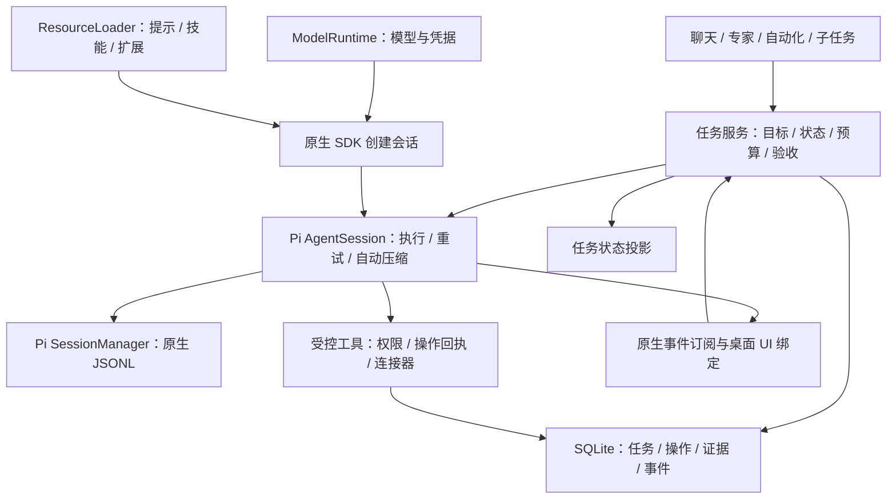

# 任务运行时架构设计

> 日期：2026-09-07。状态：原生 AgentSession 执行链已接入；Task/Run 持久化等后续阶段尚未实现。修订决策：直接采用 Pi AgentSession 原生运行时，替换当前 AgentHarness 主执行链。
> 范围：PiCoddyClaw 桌面应用中的任务执行、跨轮继续、上下文管理、中断恢复、成果验收与状态展示。
> 本次仅编写设计文档，不修改实现、不执行测试。本文的验收场景是未来实施要求，不是已通过的验证结果。
> 现状对照：[第一版实现说明](./2026-09-07-long-task-runtime.md)、[技术架构](../03-技术架构设计.md)。现状依据为当前工作区，包含尚未提交的变更。

## 1. 设计结论与适用边界

推荐以 `@earendil-works/pi-coding-agent` 的 `AgentSession` 作为唯一模型执行运行时，通过原生 SDK 创建会话，使用其模型请求、工具循环、自动压缩、溢出恢复、重试与 SessionManager。现有 `AgentHarness + LongTaskRunner + compaction.ts` 主执行链退出新会话路径。应用建立轻量的任务服务，只拥有用户目标、授权与操作事实、任务预算、成果验收和状态投影。

这是一项执行职责归属的调整，不是让 AgentSession 模拟旧 Harness 接口。应用不再建设独立上下文管理器，不复制 Pi 的循环、摘要协议或会话重建逻辑。Task 是业务目标，AgentSession 是执行会话；二者生命周期不同，不能用模型停止输出代替任务完成。

“长任务”不是按时长或 token 数切换的特殊模式。所有用户工作都使用同一任务模型：简单问答可以在一次执行中结束，复杂工作可以经过多次模型请求、上下文压缩和用户补充。复杂度随实际需要增加，不要求普通问答先生成计划或调用专用完成工具。

首期部署边界仍是本机、单应用主进程、SQLite 与 Pi SessionManager 原生 JSONL 会话。不引入远端调度服务、消息队列、分布式锁服务或通用工作流 DSL。应用退出后不会继续计算；重新启动可以识别中断并提供恢复入口，不承诺无人值守自动恢复所有操作。

### 1.1 要保障的行为

- 模型一次响应结束，不直接等于用户目标完成。
- 用户继续同一任务时，已确认约束、执行预算、操作回执和验收结果可以恢复。
- 输出截断、上下文不足、暂时性网络错误和外部操作结果不明在内部采用不同处理策略；客户端只显示面向任务的进度，不暴露模型供应商的长度、token 或摘要格式细节。
- 摘要失败不覆盖可用历史；摘要不承担权限、工具执行事实和完成状态的唯一存储职责。
- 任务成功有对应的完成依据；依据不足时明确展示限制，不能把“文件存在”宣传为“功能正确”。
- 取消、重启、事件重放和切换会话不会把未完成工作显示成成功。

### 1.2 明确不承诺

- 任意外部工具的 exactly-once 执行。没有幂等键或可查询回执的操作，网络中断后可能只能报告结果不明。
- 依靠一个通用 LLM 评分器证明所有任务的语义正确性。
- 自动重新执行历史工具来重建状态。
- 自动恢复已取消的任务、自动提高权限、为恢复擅自切换模型或扩大费用上限。
- 在首期建设多节点任务迁移、完整 DAG 调度、任意中间步骤回滚或远端常驻执行。

## 2. 现状与架构缺口

2026-09-07 核查 `package.json`、`package-lock.json` 和本地安装，三个 Pi 包均为 0.83.0。`src/agent/engine.ts` 创建的是 core 的 `AgentHarness`，不是 coding-agent 的 `AgentSession`。

| 能力 | 当前 AgentHarness 路径 | 目标 AgentSession 路径 |
| --- | --- | --- |
| 切点、摘要、最近消息保留 | core 已提供原语，应用主动组合 | 使用原生会话压缩完整流程 |
| 自动触发 | LongTaskRunner 在每次请求前判断 | 原生轮次结束阈值检查、溢出后压缩恢复 |
| 运行中压缩 | context hook 调用底层原语；Harness.compact 要求 idle | 由 AgentSession 自己控制暂停、压缩和继续 |
| 输出截断 | 应用强制压缩并续跑 | 原生运行结束后，任务服务按未完成目标有界续跑，不强制压缩 |
| 历史存储 | core JsonlSessionRepo / Session | coding-agent SessionManager，明确数据迁移 |
| 扩展宿主 | 应用模拟部分官方上下文 | 原生扩展生命周期；桌面应用提供 UI 与业务能力 |
| 完成与恢复 | 请求级状态、文件验收 | 持久 Task/Run、操作事实与成果证据 |

当前自动压缩确实存在，但自动触发来自应用；不能把 core 的 `DEFAULT_COMPACTION_SETTINGS.enabled=true` 当作 Harness 自动调度。AgentSession 才提供完整自动流程。官方文章描述的是完整 Pi 行为，不能据此推断所有底层类都具有相同能力。

相关实现口：`src/agent/engine.ts`、`src/agent/long_task.ts`、`src/agent/compaction.ts`、`src/agent/provider.ts`、`src/agent/core_session.ts`、`src/agent/plugin_tools.ts`、`src/agent/prompt-runtime/prompt-aware-harness.ts`。

### 2.1 对截图问题的直接结论

截图中的两行提示属于同一条内部恢复链：模型响应达到输出上限后，运行时尝试恢复；恢复前或恢复中执行上下文摘要；摘要结果没有满足当前应用的结构校验，于是内部恢复失败。这里有两个产品层错误：内部实现原因被直接展示给用户，以及摘要格式校验失败阻断了本可继续的任务。

目标行为是：`length` 只作为协调层的内部事件，自动触发第 9.3 节的恢复流程；前端在续跑期间显示“正在继续执行”，收到原生压缩事件时才显示“正在整理上下文”，不显示“长度限制”“token”“摘要结构不完整”等实现细节。只有在有界恢复确实失败后，才显示任务级结果，例如“自动恢复未能继续，已保留当前进度”，并提供“继续”“缩小范围”或“查看已保存成果”等动作。

## 3. 备选方案与取舍

| 方案 | 架构含义 | 决策 |
| --- | --- | --- |
| 保留 Harness，继续组合压缩原语 | 应用继续拥有自动触发、历史重建及 SDK 差异 | 不采用；持续承担本可由 Pi 负责的运行时职责 |
| 直接嵌入 AgentSession 原生 SDK | Pi 拥有完整执行会话，应用拥有产品业务状态 | 采用；当前 Electron 主进程可直接集成 |
| 将 Pi 作为独立 RPC 进程 | 增加进程隔离，也增加工具、权限与事件跨进程协议 | 首期不采用；出现隔离需求后再评估 |
| 引入通用持久化工作流引擎 | 建立额外调度模型 | 当前目标不需要 |

不先保留旧接口再搭建万能运行时抽象。应用内部会话服务直接持有 AgentSession；对前端暴露 Task 命令与事件，对工具提供业务上下文。只在进程边界使用稳定产品协议，不再包出第二套 prompt、compact、continue SDK。

## 4. 领域模型与不变量

### 4.1 核心对象

| 对象 | 含义 | 关键字段与约束 |
| --- | --- | --- |
| Conversation | 用户交流容器 | conversationId、piSessionPath；包含多个按顺序执行的 Task |
| Task | 一个用户目标及其持续修订 | taskId、conversationId、originMessageId、objective、revision、status、policyVersion、budget、latestCheckpointId |
| Run | 一次开始到停止的执行尝试 | runId、taskId、ownerEpoch、startedAt、endedAt、outcome；一次 Run 可包含多次 AgentSession prompt |
| Checkpoint | 一致恢复位置 | checkpointId、taskId、taskRevision、runId、piSessionPath、leafId、已对账操作水位、预算快照、contextVersion |
| OutcomeContract | 本次任务的成果约定 | version、来源消息、成果类型、必要条件、证据要求、可接受的验证限制 |
| Operation | 一次具有执行语义的工具操作 | operationId、runId、toolCallId、工具版本、语义类别、参数摘要、状态、回执引用 |
| Evidence | 已观察到的成果依据 | evidenceId、taskRevision、criterionId、来源调用、验证器版本、结果、目标版本或哈希、时间 |
| TaskEvent | 已提交的任务变化 | taskId、runId、单调 seq、revision、type、payloadVersion、payload |

Task revision 在目标、约束、成果约定发生变化时递增；普通进度或状态变化不修改目标 revision。并发更新另外使用存储行 version 做 CAS，避免把业务修订与乐观锁混为一谈。

Operation 与 Evidence 只引用已有工具结果、文件或回执，不复制所有聊天内容。里程碑若需要，放在 Task 的版本化计划数据中；首期不设独立步骤调度表。

### 4.2 必须维持的不变量

1. 同一 Conversation 同时最多一个运行所有者，Task 同时最多一个非结束 Run；不能同时改写同一 Pi 会话分支。
2. 只有任务协调层可以改变 Task 状态；模型、工具、前端、自动化只能提交事件或命令。
3. Task 的成功状态必须引用当前 revision 的完成检查结果；旧约定的证据不能直接证明新约定完成。
4. 摘要可以压缩上下文，不能删改 Operation 回执、用户约束记录、预算或 Task 状态。
5. 执行副作用前先记录操作意图；未确认完成的操作必须保持结果不明，不能假装未执行。
6. 每次启动外部操作和提交状态前检查 ownerEpoch；旧 Run 的迟到事件不能推进新 Run。
7. 取消后停止接纳新操作；已有操作不因此自动回滚。最终取消状态可以附带仍需核查的操作。
8. 内部继续指令不是用户新授权，也不形成新的用户目标。
9. Task 的恢复次数与费用等累计计数不会因为新建 Run 或输入“继续”自动清零。
10. 对客户端先提交状态与事件，再发布通知；通知丢失可通过快照和事件重放补齐。

## 5. 模块边界

### 5.1 任务服务

负责 start、resume、steer、cancel、会话单写者、Task/Run 状态、业务预算及完成检查。一次 Run 可以包含多次原生 prompt，但服务只在原生会话执行完整结束后决定是否还需要业务工作。不按 tool_call 自己推进模型，不因原生内部 agent_end 提前释放所有权。

普通问答正常返回即可完成；只有存在未完成要求、输出截断或成果检查失败时，才有界提交后续指令。网络重试、context overflow 和自动 compaction 全部交给 Pi，任务服务不再次重试同一故障。

### 5.2 原生会话创建与生命周期

直接调用 `createAgentSession`，显式提供 cwd、应用专属 agentDir、ModelRuntime、SettingsManager、SessionManager、ResourceLoader 和 customTools / 工具允许列表。不能隐式加载用户另一套 Pi 配置或启用未受控默认工具。使用公开 `bindExtensions` 连接桌面交互能力，使用 `subscribe` 观察会话事件。以 `agent_settled` 配合所属 prompt Promise 的完成作为正常执行稳定边界；`agent_end.willRetry` 只表示中间状态。异常、取消必须另行收敛，不能将 settled 本身等同 Task succeeded。

会话寿命独立于一次 HTTP/SSE 请求。连接断开不销毁模型执行；取消走 `session.abort()`，等待其完成停止再结算 Run。前端关闭、工作区切换与显式任务取消分别定义行为。应用需要 new/resume/fork 的运行时替换时，使用 SDK 的 `AgentSessionRuntime`，不再手写扩展销毁与重绑流程。

发送输入直接使用 `prompt`、`steer`、`followUp` 的公开语义。授权或目标发生冲突性变化时，先持久化并暂停新工具接纳，再 abort 并等待停止后应用修订；普通补充可使用 steering。不要把低层 turn_end 当作会话已稳定，也不要修改 agent 私有状态。

### 5.3 模型、提示和技能

`ModelRuntime` 统一提供模型与凭据，普通生成和摘要使用同一可信配置来源；不为摘要建立另一个供应商客户端。现有模型配置转换为原生 provider 注册及 credential 接口。

保留 Prompt Runtime 中业务目标、专家策略与能力选择的计算，将结果作为原生资源与 `before_agent_start` 输入。技能、模板、扩展发现与执行由 ResourceLoader / 原生扩展宿主负责。RAG 只负责检索及来源标注，不再拥有会话执行包装器。移除 PromptAwareHarness 的执行职责，避免技能展开、提示拼装和扩展加载各做两次。

上下文历史、摘要格式、切点与续接均属于 Pi。应用只投影精简的 Task 事实并提供有界工具输出，不重新排列历史、不展开 retainedTail、不调用 prepareCompaction 或 appendCompaction 来替代原生流程。

### 5.4 工具与授权

保留现有工具的业务实现，通过原生 ToolDefinition / 扩展注册交给 Pi 调用。统一注册明确的工具允许列表；read、bash 等默认工具若绕过现有权限，必须禁用或使用受控实现替换。

`tool_call` 用于提前审批和状态展示；实际工具执行入口再次校验授权、Task revision、ownerEpoch 与操作意图，防止扩展修改参数或其他入口绕过检查。工具元数据由可信注册层确定，不接受模型自行声明只读。Operation 持久化与回执属于产品需求，不是第二套工具执行循环。

原有插件宿主中模拟官方 SessionManager、ModelRegistry 或 ExtensionContext 的部分退出；需要桌面交互的插件通过原生扩展 UI 绑定进入应用。已有连接器和路径保护逻辑保留在工具能力层。

### 5.5 完成与投影

完成检查消费成果约定和 Evidence，返回 satisfied / unsatisfied / inconclusive。Task 服务负责是否补齐与提交终态；goal_complete 只提交声明，不能直接成功。

2026-09-08 请求内实现补充：接收有效声明后冻结业务工具，使用原生工具结果 terminate 提示交还执行控制权；声明必须单独占用工具批次，以满足 Pi 的整批停止语义。任务协调层在原生执行稳定后复验，再以无工具请求生成最终答复，最后由 Provider 投影状态。等待用户和失败声明不映射成功；普通问答及无文件操作不强制声明或文件交付。该实现尚不替代第 7、11 节的持久化完成报告与事务提交要求。

SQLite 保存业务事实，Pi SessionManager 保存执行历史。UI 订阅任务事件；模型流、compaction 与 retry 事件用来更新 phase。`session_compact` 是压缩结果通知，执行结束还须等待原生后续恢复完成；不得把它当作整个 Run 完成或磁盘 fsync 的证明。

### 5.6 实际接入依据

以下为本地安装的 0.83.0 公开声明，实施以锁定版本实际接口为准：

- `node_modules/@earendil-works/pi-coding-agent/dist/core/sdk.d.ts`：createAgentSession 及各配置入口。
- `core/agent-session.d.ts`：prompt / steer / followUp / abort / subscribe / bindExtensions。
- `core/agent-session-runtime.d.ts`：原生会话替换与销毁。
- `core/extensions/types.d.ts`：before_agent_start、tool_call、session_before_compact、session_compact。
- `core/session-manager.d.ts`：原生历史、分支与持久化入口。

接入代码只连接这些原生能力和应用业务服务，不提供复刻旧 Harness 的兼容 API。

## 6. 生命周期与状态协议

生命周期 status 与执行 phase 分离。status 决定任务是否仍有工作；phase 仅描述当前正在执行模型、工具、压缩、恢复、验收或停止。避免把所有阶段组合成几十个状态。

| Task status | 含义 | 进入与退出规则 |
| --- | --- | --- |
| queued | 等待执行 | 有目标与预算；取得会话所有权后 active；可取消 |
| active | 正在执行或进行有界内部恢复 | 可进入 waiting、paused 或终态；phase 表示细分阶段 |
| waiting | 存在明确用户输入或授权缺口 | 记录 questionId、缺口、关联 revision；匹配答复后排队恢复 |
| paused | 当前不可继续，进度可保留 | 原因包括重启中断、预算耗尽、环境缺失、结果不明、恢复无进展；显式恢复后 queued |
| succeeded | 当前目标满足完成条件 | 终态，必须关联完成报告 |
| failed | 当前尝试不可恢复或已明确放弃目标 | 终态，记录失败原因和可保留成果 |
| cancelled | 用户或上层明确取消目标 | 终态，不自动恢复；记录未确认操作 |

终态不原地回到 active。“重新执行”或“继续已取消任务”创建关联的新 Task，引用旧成果和操作回执，避免抹掉历史结果。paused/waiting 的继续创建同一 Task 的新 Run。旧任务的累计消耗和回执必须可见，创建新任务也不意味着外部操作可安全重放。

Run outcome 使用 finished、interrupted、cancelled、failed；finished 仅表示一次执行正常交还控制权，可能使 Task waiting 或 succeeded。每个 Run 有一次持久化结束记录，每个 Task 有一次终态转换；消息系统可以重复投递，对消费者按 seq 去重，不承诺网络只发送一次。

### 6.1 用户继续、插话与新目标

- 输入中的 taskId、resumeFromTaskId、questionId 优先于自然语言猜测。前端“继续”和回答卡片显式携带关联标识。
- active Task 上的补充约束作为 steering 命令：先持久化，冻结新工具接纳，在安全边界应用，递增 revision，重新核对受影响证据后继续。
- 如果正在执行的工具无法中断，界面显示“正在停止当前操作”；在其结果可确认前不执行冲突的新写入。
- 一般新消息先视为当前工作的补充；明确的新目标或前端“新任务”创建新 Task。语义确实冲突且会导致不同外部操作时才要求用户澄清。
- 单纯询问状态不修订目标、不重置预算、不取消当前任务。
- 取消从任意非终态接纳：先写入取消请求，再触发 controller 和子任务取消。取消的 Task 不因迟到的成功回执变成 succeeded，但回执仍需入账。
- waiting 不长期占用 AgentSession 或持有会话锁；提问已持久化后结束当前 Run。收到答复再恢复。

## 7. 持久化与故障一致性

### 7.1 最小存储集合

在现有 SQLite 中增加 Task、Run、Checkpoint、Operation、Evidence、TaskEvent 六类记录。成果约定和可选里程碑作为 Task 的版本化结构数据；大工具结果仍在 Pi 会话或已有附件存储中。表名与迁移编号由实施阶段按现有约定确定。

TaskEvent 只记录低频状态变化、修订、检查点和完成报告，不持久化每个流式 token。不建设全量事件溯源：Task 等记录是当前状态，事件用于审计与客户端补播。状态变更和对应 TaskEvent 在同一个 SQLite 事务内写入。

关键约束包括：任务事件 `(taskId, seq)` 唯一；操作调用 `(runId, toolCallId)` 唯一；每个 Task 仅一个未结束 Run；Conversation 所有者包含 Run 与 epoch。不能靠内存 Map 单独保证这些条件。

### 7.2 SQLite 与 JSONL 的事实归属

- 原始请求、模型响应、工具结果正文：Pi 原生 JSONL。
- 任务目标 revision、约定、预算、操作状态、验收与终态：SQLite。
- Checkpoint 指向已确认可恢复的 Pi session leaf；它不是复制一份聊天历史。
- 旧 `OpenedCoreSession.commit()` 只发布旧路径映射；新原生路径也必须区分内存 entry、可重开读取与磁盘持久性，不能把原生事件当作 fsync 保证。

首期保障范围是正常进程退出和进程崩溃后的可检测恢复。对于操作系统崩溃或掉电，依赖实际存储 flush 能力；实施时必须检查 JSONL 写入和 SQLite 同步配置，未验证前不宣称掉电零丢失。

### 7.3 检查点提交顺序

1. 等待原生会话稳定边界，取得 ownerEpoch 与当前 Pi session leaf。
2. 确认此前工具的 Operation 已完成对账；不确定操作可以保留，但必须明确标记，不能伪装为干净检查点。
3. 确认 Pi 会话记录可恢复读取，发布初始 Pi 会话路径映射。
4. 在 SQLite 事务中写入 Checkpoint、预算增量、Task 当前指针和对应事件；CAS 校验所有者、Task revision 与行 version。
5. 事务成功后才向客户端发布检查点事件。

不假定 SQLite 与 JSONL 存在跨存储原子事务。提交窗口用引用校验与重启对账处理：

| 中断位置 | 恢复处理 |
| --- | --- |
| Pi 会话已追加、SQLite 尚未更新 | 扫描最后检查点之后的记录，按调用 ID 对账；没有可证明映射的记录保留为待核查，不重放 |
| Operation 意图已写入，结果尚未记录 | 状态转 unknown，结合工具查询接口和 Pi 会话结果核查 |
| Checkpoint 已提交，通知尚未发送 | 客户端通过事件 seq 或快照补齐 |
| SQLite 引用的 Pi session leaf 不可读 | Task paused，标记存储不一致；检查前一个有效检查点，禁止盲目续跑 |
| 摘要已追加、任务指针未更新 | 校验摘要记录及对应源 leaf 后对账；不能因为缺一个通知再压缩一次 |

### 7.4 进程重启

重启后先识别上一进程未结束 Run 并标记 interrupted，使其 Task paused。对账完成前不运行模型和工具。展示目标、最后确认进度、未确认操作、已用预算和恢复限制。

首期由用户点击继续触发恢复，不在启动时批量自动续跑。恢复前重新解析凭据、工具可用性、工作区与权限；保存配置标识和版本，不保存密钥。权限撤销即时生效；配置变化影响成果或操作时，重新验证对应部分。子进程若可能仍在运行，先按进程身份和启动标识核实，不能仅凭 PID 判断。

## 8. 直接采用 Pi 原生上下文管理

### 8.1 唯一责任方与算法

AgentSession 是自动压缩的唯一责任方。使用 SettingsManager 的原生配置，0.83.0 默认启用，reserveTokens=16384，keepRecentTokens=20000。阈值为 contextTokens > contextWindow - reserveTokens。Pi 使用有效 usage 与后续消息估算，在合法消息边界保留近期历史，对旧历史发起独立摘要请求；跨轮摘要更新与长轮次前缀摘要也交给 Pi。

应用不实现另一套计数器决定压缩，不提供自定义标题协议，不通过 session_before_compact 返回自定义摘要。需要调整预留量时通过原生设置按模型配置，不把旧版的 20% / maxTokens 公式搬入新运行时。

### 8.2 接受原生触发时机

- 原生 AgentSession 在一轮执行结束后检查阈值，阈值压缩不自动延长已经完成的回答。
- 工具循环中遇到 context overflow，原生底层执行退出后由 AgentSession 压缩并继续；0.83.0 对该溢出恢复限制一次 compact-and-retry。
- 不在每个模型请求前插入自定义预防性压缩，也不在每次工具结束后手动 compact。
- 输出 length 与输入窗口无必然关系。它可以触发任务层续跑，但不能触发应用强制压缩。

这也意味着极长工具循环可能先收到一次溢出错误，再由原生恢复。若未来必须在溢出前压缩，应评估 Pi 原生新版本或推动上游能力，而不是同时保留旧触发器。参见 [How Compaction Works in Pi](https://earendil.com/posts/compaction-in-pi/)；版本细节以已安装 AgentSession 源码为准。

### 8.3 应用仍负责的上下文输入

Task 目标、未解决约束、操作结果与验收状态是 SQLite 中的业务事实，向模型投影精简上下文；其优先级不能被摘要中的计划或未验证声明覆盖。历史和摘要由 Pi 自行重建。

超大文档、工具结果通过分页、检索、文件引用限制单次输入。这是工具的数据契约，不是历史压缩器。模型窗口与输出参数必须准确配置；固定输入或单次工具结果自身超过窗口时，不能依赖历史摘要解决。

### 8.4 压缩事件、计费与失败

通过 session.subscribe 订阅 compaction_start / compaction_end，通过原生扩展监听 session_compact，用于界面 phase、消耗统计与恢复水位观察。任务检查点引用确认可读取的原生 sessionId / entryId，不解析摘要标题或依赖 retainedTail 的内部表示。

Pi 原生重试与压缩流程未结束时，不启动第二个摘要器或另一个 prompt。原生恢复失败后，任务进入 paused 并保留历史。手动整理仅响应明确的用户动作，通过公开 compact 能力在允许状态调用。

摘要消耗纳入 Task 统计；仅使用公开事件和会话 usage 能证明的数据。没有公开暴露的失败请求消耗标记 unknown，不声称精确计费。请求与摘要超时使用原生可配置能力；不能为了保留旧 120 秒参数再包一层摘要客户端。

### 8.5 版本质量门槛

直接使用原生不等于声称 0.83.0 没有缺陷。分别核查 core 与 coding-agent 的摘要路径后，确认本地 coding-agent 的 `core/compaction/compaction.js` 中 generateSummaryWithUsage 与 generateTurnPrefixSummary 也没有显式拒绝 stopReason=length（约 486、637 行）；不能承诺此版本会自动拒绝截断摘要。覆盖摘要截断、连续压缩、工具调用配对和重开会话等原生行为。

若所锁版本在必要场景失败，选择已验证的上游修复版本或向 Pi 提交修复，并重新锁定依赖；不在应用复制摘要器，不 monkey-patch 私有方法。修复未满足前不开放受影响的自动恢复路径，也不把设计要求写成现有保证。特别是“候选超预算绝不发布”“摘要 length 必须拒绝”不能由当前文档直接承诺。

## 9. 恢复策略与执行预算

### 9.1 故障分类

| 结束或故障原因 | 策略 | 不应采取的动作 |
| --- | --- | --- |
| 输出 length | 核对最后完整工具结果；进入统一的自动恢复流程，必要时先压缩上下文，再缩短输出并继续未完成目标 | 把内部 length 原因直接展示给用户、自动重放残缺工具 |
| context overflow | 等待 Pi 原生压缩重试；最终失败后暂停并检查模型配置或超大输入 | 应用再做一轮压缩重试 |
| 模型暂时性传输／限流错误 | 由模型适配层有界重试，遵循服务端等待信息 | 协调层再叠加同一组网络重试 |
| 鉴权、配置或模型不可用 | paused，说明需要修复的环境项 | 自动换模型、猜测凭据 |
| 工具参数或本地构建失败 | 把明确失败证据交还模型修正；受任务预算限制 | 将所有工具错误当任务终态 |
| 外部操作超时且结果不明 | 先查询回执或目标状态，不能确认则 paused/waiting | 直接再次发送或提交 |
| 文件／代码验收不通过 | 只补齐未满足条件，重新验证受影响证据 | 重新做全部已完成工作 |
| 用户补充／取消 | 先停止新动作，再在安全边界修订／终结 | 当成服务故障自动重试 |
| 进程中断 | 对账、重新检查环境，等待显式恢复 | 启动后立即重放操作 |

错误对象包含稳定 code、来源层、retryability、关联 operationId、用户可读原因和可执行恢复动作；不要依赖中文错误字符串决定状态。

### 9.2 重试归属与总预算

Pi 负责传输重试、自动压缩和溢出恢复；任务服务只负责原生执行结束后的业务续跑与成果补齐。禁止外层再重试同一 overflow 或建立摘要候选修复。预算统计覆盖公开可观察的全部调用；硬上限必须有真实执行前拦截能力，否则只作为软阈值并注明在途请求可能超出，不能仅凭事件计数声称严格限额。

### 9.3 截断后的统一自动恢复流程

`stopReason=length` 是运行时信号，不是用户可见的任务结果。协调层按以下顺序处理：

1. 等待原生运行及内部重试结束，再确认本轮已落盘的用户消息、完整模型消息和工具结果；把响应中未形成完整调用的工具块标记为未执行，不把模型输出中的计划当成事实。
2. 生成恢复检查点，记录截断原因、当前 Pi session leaf、任务 revision、已确认操作水位和当前预算。
3. 确认 Pi 已完成本轮原生 compaction / retry。协调层不预先请求压缩；下一次原生 prompt 仍由 Pi 按自己的阈值及溢出流程处理，应用只观察结果与记录检查点。
4. 等待原生 prompt 完整结束后，在同一 AgentSession、同一权限和同一任务 revision 中发送内部继续指令。指令要求核对已保存进度、不要重放已确认副作用、缩短单次输出，并继续原目标。
5. 前端只收到 `task_status` 的面向任务阶段，例如“正在继续执行”；只有原生 compaction 期间显示“正在整理上下文”；不发送 `length`、token 数、供应商 stopReason 或摘要标题校验错误。
6. 若恢复成功，清除本次连续截断计数，但保留累计请求和压缩消耗；若连续无进展、预算耗尽或摘要无法生成，任务进入 paused/failed，并向用户说明“自动恢复未能继续”的具体可行动原因。

该流程仍然区分两件事：截断是触发恢复的信号，Pi compaction 是恢复过程中获得可用上下文的机制。协调层不根据 `length` 自己实现第二套摘要算法；它只决定是否继续、如何缩短内部继续指令，以及如何把最终结果映射为任务状态。

Task 创建时保存版本化策略，包含模型请求数、总 token、活动时间、可选费用上限、摘要次数和恢复次数。等待用户不计活动时间；模型、摘要和工具等待均计入。达到任一启用硬上限即停止接纳新工作并 paused。费用未知时不能声称已执行货币限额，仍以请求数、token 与时间控制。

首次迁移沿用 Pi 的原生压缩与重试设置，业务层暂保留 2 次连续截断续跑、2 次连续验收补齐。旧 80 次请求、8 次压缩、120 秒摘要超时不作为必须模拟的兼容要求；按公开可观测与可取消能力重新定义任务预算。活动时间上限可在任务层调用原生 abort 实现，但不宣称取消能撤销已经发生的外部操作。

连续失败计数在该故障完成恢复后可归零，总任务请求和累计恢复消耗不归零。用户继续预算耗尽任务时显示已用额度与拟追加额度；只有明确增加预算或已保存的续跑策略才能扩大上限。

### 9.4 进展判定

使用与目标相关的变化：成果目标版本变化、验收条件从未满足变为满足、已确认操作回执、新的必要信息、里程碑完成。工具结果哈希变化仅为辅助信号；时间戳变化或反复读取不自动算进展。

纯文本任务允许新的非重复正文作为弱进展，但不能绕过硬预算。模型称“已经完成”不算独立证据。连续恢复没有相关进展时 paused，保留诊断与下一步建议；不自动判 failed 或无限反思。

## 10. 工具操作、幂等与取消

### 10.1 工具元数据

| 类别 | 举例 | 恢复语义 |
| --- | --- | --- |
| read_only | 文件读取、查询接口 | 可重复，但不默认算新进展 |
| idempotent_write | 对指定版本覆盖内容、支持幂等键的操作 | 满足前置版本条件或复用幂等键后可重复 |
| non_idempotent | 发消息、创建订单、执行一次性提交 | 成功复用回执；结果不明先核查 |
| unknown | 任意 shell、缺少元数据的 MCP 工具 | 不承诺安全重试；按实际能力核查 |

幂等性由“操作＋目标＋前置条件”决定，不只由工具名决定。通用 bash 不靠正则变成只读工具；专用检查工具可声明只读。模型提供的说明不是可信分类来源。

### 10.2 Operation 生命周期

状态为 prepared → dispatched → succeeded / failed / unknown；另有 denied 表示执行前被权限层拒绝。prepared 表示意图已记录而尚未越过调用边界。先持久化 dispatched，再发出调用，因此进程中断后 dispatched 也可能实际未发送，仍需保守对账。

Operation ID 标识业务操作，toolCallId 标识本次模型调用。重试在确认属于同一操作后复用 operationId 或幂等键。参数哈希仅帮助寻找候选，不能把用户有意重复的两次操作强行合并。

对可控工具，执行守卫在工具返回 Harness 前保存结果状态及回执索引，随后由 Harness 追加历史。若其中一步中断，使用 operationId/toolCallId 对账。后置的 tool_execution_end 订阅只能补观察信息，不能承担“副作用前记录意图”的保证。

网络成功响应丢失时，优先通过幂等键查询或服务端回执确认；没有此能力则 unknown。不能依靠模型观察一句“应该失败了”把 unknown 转成 failed。failed 也需要区分确定未生效、已部分生效和可重试前置条件。

### 10.3 取消与旧执行隔离

取消令牌贯穿模型、摘要、校验、工具和子任务。取消并不证明外部操作没有发生。可中断工具等待停止回执；不可中断操作记录 unknown 或仍在运行，停止新调度并向用户展示。

ownerEpoch 只能阻止旧 Run 再提交本地状态或启动新操作，无法撤回已发出的外部请求。与未知操作相冲突的新任务必须先核查；无冲突的只读查询可以执行。迟到回执更新原 Operation，发布审计事件，但不复活旧 Task。

## 11. 成果约定与完成检查

### 11.1 约定来源与修订

优先使用调用方结构化要求和用户显式要求；模型可从自然语言整理候选约定并附来源消息，普通、可逆的实现细节不要求额外确认。影响任务范围、验收标准或外部授权的歧义才需要澄清。

约定可以混合文本、代码、本地文件和外部操作。不能通过关键词把所有“实现系统”任务都变成“交付一个非空文件”。每条必要条件具有 criterionId、来源、验证方式和允许的验证限制。修改必要条件形成新版本；模型不得为通过验收自行删除条件。

### 11.2 不同成果的完成依据

| 成果 | 必要依据 | 能证明与不能证明的范围 |
| --- | --- | --- |
| 普通回答／解释 | 正常完整响应、覆盖已知问题、没有未解决的必要工作 | 可以正常结束问答，不承诺机器证明全部语义真实 |
| 代码修改／应用 | 相关修改引用、按需求选择的构建／运行／行为检查及结果 | 检查通过证明对应行为；不能仅凭文件存在或模型 proof 文本 |
| 本地文件 | 文件可读、非空、稳定哈希、格式或内容检查（如约定要求） | 非空检查只证明文件可交付，不能证明内容质量 |
| 外部操作 | 目标、操作回执及可用的状态查询 | 接口成功不总等于下游业务完成，按接口语义说明 |
| 混合成果 | 各必要条件分别满足 | 任一必要条件不满足都不能整项成功 |

检查强度应与要求相称：文案小改不强制新增测试，界面交互任务应有相应运行依据，财务计算不能只验容器结构。验证命令由现有权限和工具环境执行，验证器不能绕过权限直接运行模型提供的命令。

### 11.3 Evidence 与证据失效

每条证据关联 Task revision、条件、来源调用和目标版本。文件使用稳定内容哈希；代码检查记录相关文件／构建输入版本；外部操作记录目标与回执。后续修改影响证据时标记 stale，只重验受影响条件。

验证结果区分 passed、failed、not_run、unsupported。未执行和不支持不能折算为通过。确实无法验证但用户原本允许交付并注明限制时，Task 可 succeeded，完成报告必须标注 verificationLevel=limited；必要检查缺失且未被允许时为 inconclusive，不得静默降低标准。

`goal_complete` 只是完成声明入口，`present_files` 只是交付与证据入口，两者都不能直接设置 Task succeeded。普通问答不必调用 goal_complete；有操作成果的任务也不能靠 proof 非空绕过证据检查。

### 11.4 最终完成提交

在工具停止、当前 revision 稳定的边界执行：汇集最新证据 → 检查全部必要条件 → 生成完成报告 → 在同一 SQLite 事务中写入 Task succeeded、Run 结束和事件。若 revision 或 ownerEpoch 变化，废弃本次判定并重新检查。

unsatisfied 可在预算内安排局部补齐；inconclusive 依据缺口进入 waiting 或 paused。已明确无法达到目标且无可执行恢复方案，进入 failed 并保留部分成果。避免把所有异常都映射为失败，或把所有未验证工作都无限补齐。

## 12. 前端、自动化与子任务协议

任务事件至少携带 taskId、runId、seq、status、phase、reasonCode、revision 和时间。状态快照包含最后事件 seq。流式文本仍走现有流协议，但应带任务／执行关联，防止旧 Run 的消息覆盖新 Run。

前端重连先读取快照，再补播水位后的事件；重复事件按 seq 去重，缺口无法补齐时重新取快照。phase 不能单独把终态任务设为 busy，必须校验 taskId、runId 和当前状态。

| 状态 | 主文案 | 用户动作 |
| --- | --- | --- |
| active | 执行中／整理上下文／恢复中／验收中／正在停止 | 补充、取消 |
| waiting | 等待补充信息／等待授权 | 回答、取消 |
| paused | 已暂停，并显示具体原因 | 在条件满足后继续、取消 |
| succeeded | 已完成；必要时注明验证限制 | 查看成果 |
| failed | 未完成，并显示可保留成果 | 查看原因、创建关联重试任务 |
| cancelled | 已取消；必要时注明未确认操作 | 查看进度 |

过程折叠面板读取对应 Task/Run 结果，移除固定“已完成”。conversation.status 仅用于兼容旧列表：active/queued 映射 running，waiting/paused 映射 pending，succeeded 映射 done，failed/cancelled 保留各自状态。没有 Task 的旧会话维持 legacy 标识，不能把历史 done 回填成已验证成功。

子任务使用相同 Task 协议并记录 parentTaskId。父任务只接受必要子任务的 succeeded 及其成果证据，不能因为子会话结束而成功。父取消传播给子任务；子任务费用和消耗计入父任务分配的总额度，不能利用委派绕开限制。实现时在父预算中预留子额度并结算，防止并发超分配。

自动化调度只负责创建任务和触发恢复，不直接写任务成功。自动化遇到 waiting/paused 时结束当前执行实例并记录“需要干预”，通知方式沿用已有用户配置；若旧自动化结果只能表示成功／失败，则兼容映射为失败并保留原因。用户补充后创建关联执行实例，不让旧实例无限占用调度槽。计划任务的下一次触发是否并发仍服从既有调度策略和会话单写者约束。

## 13. 可观测性与数据管理

记录并关联 taskId、runId、operationId、Pi session leaf、模型与 SDK 版本、上下文估计／实际 usage、摘要类型、预算消耗、恢复原因和最终验证级别。内部继续消息保留来源标识，用于上下文重建，但不显示为用户发言或成为新的授权证据。

关键指标：首次完成率、恢复后完成率、各恢复原因占比、摘要失败／截断率、压缩前后 token、恢复重复操作拦截和误拦、unknown 操作数、取消收敛时间、完成后被证据推翻的比例、每任务成本与活动时间。按任务类型和模型区分观察，不能只看总成功率。

日志默认保存必要索引和脱敏摘要；不额外复制密钥、完整请求头或大段敏感工具正文。任务和会话删除时按现有产品策略清理所属记录；父子共享证据需要引用检查。运行中删除先取消并完成本地收敛，未知外部操作不能被描述成已撤销。诊断数据与历史保留期限沿用现有应用策略，不另建永久日志库。

## 14. 关键场景走查与验收要求

以下为后续实现的行为验收清单，应使用可控模型／工具响应与故障注入覆盖真实调用边界，而非仅搜索源码是否出现函数名。

| 场景 | 预期行为 |
| --- | --- |
| 排课系统任务正常完成 | 按已确认功能产生实现和对应运行依据；文件可交付不直接代替功能验收 |
| 小上下文、大输出导致 length | 客户端只看到自动继续；运行时核对未执行调用，按预算决定是否压缩，缩短输出后续跑 |
| 工具执行多轮后接近窗口 | 轮次结束由 Pi 检查；若先溢出则原生压缩重试，应用不重复触发 |
| 普通／更新／分段摘要 | 三类模板分别兼容；同一固定标题规则不误拒绝 |
| 摘要 length 或不可用 | 验证所选 Pi 版本的实际行为；必要缺陷在上游解决，应用不生成第二份修复摘要 |
| 第二次及之后压缩 | 原生重建保留必要近期消息、最新补充、工具调用配对；不检查特定内部 tail 格式 |
| 压缩后仍超预算 | 验证原生有界失败和可恢复历史；应用暂停，不另启压缩循环 |
| 发送请求成功但响应丢失 | 保留 unknown，查询确认；不自动再发送 |
| 用户有意重复相同操作 | 经新意图关联后允许；不被参数哈希永久阻止 |
| 摘要／验收时用户补充要求 | 旧 revision 候选不能提交；新要求在安全边界生效 |
| 任意阶段取消 | 停止新动作；迟到回执记账但不改变取消终态 |
| core 写入与 SQLite 提交之间崩溃 | 对账后恢复已知事实，不重放操作，不伪造成功 |
| 预算耗尽后输入继续 | 保留累计消耗；没有追加额度时不继续请求模型 |
| 交付后文件被改动 | 原证据 stale；重新交付或验证后才成功 |
| 纯解释任务 | 正常回答即可完成，不被要求生成文件或无关测试 |
| 必要验证无法执行 | 显示具体限制；未获允许不标记全部验证通过 |
| SSE 重复、乱序、丢失或切换会话 | 快照加 seq 收敛到同一状态；旧事件不复活任务 |
| 子任务等待用户／失败 | 必要子任务未成功时父任务不成功；自动化释放执行槽 |

上线门槛分层：先以适配器契约和故障注入验证确定性行为，再用小规模真实模型覆盖普通问答、代码任务、文件任务和外部操作模拟任务；最后检查界面终态、重连与重启。不能以 TypeScript 检查通过代替这些行为证据。

## 15. 分阶段实施、删除计划与回退

### 阶段 A：原生能力验证与版本选择

先使用真实 createAgentSession、SessionManager、受控工具及可控模型，验证多轮工具执行、阈值压缩、溢出压缩重试、摘要失败、取消和历史重开。不增加 Task 数据模型，也不写 Harness 兼容层。验证所需模型、工具权限、插件交互与原生生命周期能正常连接。

退出条件：上述原生路径的行为证据齐全；必要缺陷由上游修复或版本选择解决。升级仅在发现实际需要时进行，不凭升级文档标题认定工作区已经升级。

### 阶段 B：替换新会话主执行链

新会话统一由原生 SDK 创建；连接现有模型、受控工具、提示资源、原生扩展和桌面 UI。先保留现有产品能力，再删除旧执行职责，不以长期双栈作为终态。

| 当前模块 | 目标处理 |
| --- | --- |
| engine.ts 中 AgentHarness 创建 | 替换为原生会话创建和生命周期管理 |
| compaction.ts | 新路径删除全部调用；不迁移自定义切点准备、预算公式、标题校验与发布流程 |
| LongTaskRunner | 删除 context 压缩 hook 与强制压缩；仅将确需的业务续跑和验收职责迁入任务服务 |
| PromptAwareHarness | 删除执行包装；保留业务提示计算与 RAG，接原生资源/扩展入口 |
| plugin_tools.ts 自建扩展上下文 | 使用原生扩展宿主；仅保留工具业务实现和桌面 UI 绑定 |
| core_session.ts | 旧格式只读与迁移入口；新历史使用 SessionManager |
| provider.ts | 处理产品输入输出、事件映射与任务调用，不负责模型循环和 compaction |
| artifact_verification.ts / 权限工具 | 保留业务能力，接 Task 与原生工具入口 |

退出条件：新会话不创建 Harness、不调用应用 compaction 原语；聊天、专家、连接器、自动化与子任务共同使用原生路径；原生重试中的内部结束事件不会提前完成任务。

### 阶段 C：历史迁移与 Task 持久化

core JsonlSessionRepo 和 coding-agent SessionManager 是不同存储实现，不能将旧路径直接交给 SessionManager.open 并假定兼容。新增 runtimeKind / formatVersion / 原生 sessionId 路径引用，保留不可变旧文件。

读取旧 Session 的公开上下文和历史，离线迁入新的原生会话：保留角色、工具调用 ID、结果、时间与必要来源关联，使用目标 SessionManager 的公开写入 API。旧 compaction 的引用与 retainedTail 必须通过源会话语义解析，不能复制内部 entry 结构。迁移只做数据转换，不请求模型、不重放工具、不发明旧操作结果。无法无损转换的分支保留旧历史只读，阻止静默续跑并说明限制。

先写新文件，重开验证有效上下文与调用配对，再在 SQLite 事务中发布新映射；失败继续指向旧历史，不做原地覆盖。迁移幂等键使用源会话与源 leaf，避免重复导入。旧 entry 与新 entry 的映射单独保存，Task 检查点引用迁移后的真实 ID。

同时落地 Task/Run、Operation 与事件，在开放跨进程恢复前完成中断对账。保留“只识别中断，用户显式继续”的首期边界。一次迁移只处理一个会话，先覆盖无摘要、再覆盖多次摘要与分支样本。

### 阶段 D：统一完成语义与移除旧运行时

文件验收并入成果接口，扩展代码和外部操作证据；统一前端、自动化和子任务完成语义。迁移验证后移除旧 Harness 执行路径、相关 compaction 测试及模拟扩展宿主，仅保留必要的旧数据读取器。新测试验证用户行为与原生集成，不测试旧实现细节。

回退只允许会话开始时选择明确的 runtimeKind。新原生会话不得交回旧 Harness 继续写入；故障时暂停，保留原生文件与业务状态。已迁移会话可查看原始归档，但不能同时恢复两个写入者。数据库迁移增量进行，不删除业务回执或历史数据。

## 16. 架构决策摘要

1. 采用 Task/Run 分离，拒绝以请求结束或会话结束代表目标完成。
2. 直接采用 AgentSession 原生执行、自动压缩与恢复，删除旧 Harness 主执行链，不建立兼容运行时。
3. 采用 SQLite 控制状态与 JSONL 原始历史的明确分工，通过检查点和对账处理双写窗口。
4. 摘要是可替换的上下文优化，任务约束、操作事实和预算独立持久化。
5. 外部副作用采用意图、回执与 unknown 语义，不承诺通用 exactly-once。
6. 完成检查按成果类型和用户要求选择证据，避免文件专用规则扩大为所有任务规则。
7. 采用统一生命周期、事件水位与前端投影；保留简单任务的低开销路径。
8. 先实现可检测中断与显式恢复，再根据真实需求建设自动恢复或分布式能力。

本设计不需要先选定工作流平台或拆出独立服务即可实施。下一步应按阶段划分具体变更与验证范围；是否进入实施由用户另行决定。
