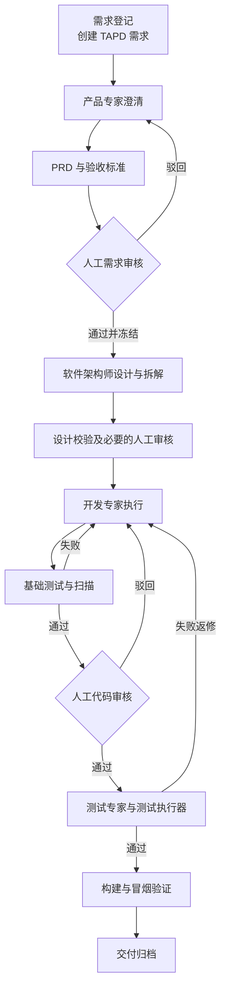

# 研发阶段独立专家设计方案

日期：2026-09-14

状态：按用户最新说明调整当前范围；本文不表示专家能力已经实现。
修订：第三稿。先建设独立阶段专家，通过 TAPD ID 与 MCP 获取需求及关联产物，结合用户关联的代码仓库完成工作。统一入口、自动串联和远程后端另行设计。

## 当前方案 1：目标与边界

每个研发阶段形成相对独立的专家，用户可以从现有专家入口单独启动。专家根据明确的输入完成当前阶段，输出可供人检查、供其他专家引用的产物。调用下一个专家由用户决定，不要求先创建项目或运行一条完整流程。

用户已明确的场景：

1. 通过 TAPD ID，经 MCP 读取需求详细信息及关联产物。
2. 专家执行涉及代码的任务时，要求用户输入并关联涉及的代码仓库。
3. 需求分析和架构设计必须结合真实代码进行详细分析。
4. 各阶段先作为独立专家使用，后续再考虑如何串联以及提供统一入口。
5. 统一入口涉及的远程后端方案尚未确定，不作为当前专家建设的前置条件。

当前先明确并验证需求分析专家与软件架构专家；开发、代码审查、测试、构建交付沿用独立专家的边界逐步建设。独立是指不依赖某个工作流实例或上一个会话，不代表可以缺少本阶段必要输入。

本阶段不建设项目工作台、跨阶段状态机、自动调度、集中审批、跨机器租约和远程 Worker。TAPD 保留现有业务管理职责；专家完成一次任务不自动改变 TAPD 状态，也不自动启动其他专家。

## 当前方案 2：路线选择

| 路线 | 当前适配程度 | 决定 |
| --- | --- | --- |
| 独立专家，共用输入输出约定 | 可以分别使用和验证，不依赖新远程后端 | 当前采用 |
| 本地统一入口，手动串联专家 | 需要先确定项目、阶段和产物导航模型 | 后续评估 |
| 远程后端管理流程，统一入口调用 | 需要确定共享状态、认证、执行位置及恢复机制 | 后续单独设计 |

复用现有专家、技能、会话和 MCP 接入机制。专家定义阶段职责与工作步骤，技能封装可复用方法，工具负责实际读取和执行。MCP 服务与网盘可能本身是远程服务，但不因此要求先开发新的工作流后端。

## 当前方案 3：一次独立专家执行

```text
用户选择专家，输入 TAPD ID 和本次目标
  → 确定 TAPD 项目上下文，经 MCP 读取需求详情
  → 发现关联产物，读取本阶段相关内容
  → 要求关联涉及的代码仓库，检查可访问性与代码版本
  → 汇总需求、产物、源码证据，澄清缺口
  → 完成本阶段分析或执行，生成文件与输入来源记录
  → 返回结果、未解决问题和后续建议，由用户决定下一步
```

### TAPD 与产物读取

- 输入包含 TAPD ID；项目上下文可来自已有 MCP 配置。不能唯一定位时询问项目，不猜测需求归属。
- 读取需求正文、验收条件、相关字段及本阶段必要的关联信息；实际可读范围取决于已接入 MCP 的工具能力与权限。
- 从需求附件、关联文档、字段或评论中的引用发现产物。TAPD 中的链接是定位信息，必须继续通过可用工具读取内容，不能把发现链接当作已阅读文档。
- 记录需求读取时间、来源标识和工具提供的版本信息；产物记录来源、版本及可计算的内容哈希。不虚构接口未返回的版本或审批信息。
- 存在多个版本时明确本次采用哪一版及依据；无法确定、无权限或链接失效时列出缺口并请求补充。缺少必要输入时停在待补充，不输出伪完整结果。
- 不依赖上一位专家的完整聊天记录，也不依赖另一台机器的本地数据库。用户提供的文档可以补充缺口，但应保留来源并与 TAPD 内容区分。

### 仓库关联与源码检查

- 涉及现有系统的需求分析、架构设计、开发、审查和测试，均要求关联涉及的仓库。可复用已有明确关联，但每次执行需核对其适用性。
- 每个仓库记录地址或标识、本地目录或可用源码访问方式、分支或 Tag、解析后的 commit SHA、职责及重点分析范围。
- 支持列出多个相关仓库并说明系统边界；这不等于承诺多仓库自动开发或事务式交付。
- 只填写仓库地址不等于已完成源码分析。必须验证可访问性，读取目录、关键模块、接口、数据模型、调用链、测试与工程约束，并给出文件路径或符号证据。
- 分支、Tag 应解析为确定 commit；本地有未提交修改时记录差异范围，明确本次是否纳入分析，不能把工作区内容冒充该 commit 的内容。
- 需求分析和架构设计默认只读源码，产物写到明确的输出目录；开发专家另行确定代码写入范围和隔离工作目录。
- 没有现有代码的新建项目需明确声明，可产出新建系统方案；不得声称已完成现有代码分析。必要仓库不可访问时，先补齐输入。

## 当前方案 4：专家职责与产物

| 独立专家 | 必要输入 | 核心职责 | 主要产物 |
| --- | --- | --- | --- |
| 需求分析专家 | TAPD 需求、关联业务产物、涉及的仓库 | 对照现状澄清业务目标、流程、边界、异常、影响范围与验收条件 | 详细需求分析、问题清单、验收标准、源码依据 |
| 软件架构专家 | TAPD 需求、相关分析或 PRD、涉及的仓库 | 分析现有架构、复用点、改造范围、接口、数据与迁移、兼容性及验证方案 | 架构设计、接口与数据设计、任务拆解、风险与源码依据 |
| 开发专家 | 需求、设计、仓库、明确任务范围 | 按设计实现和基础验证 | 代码差异或提交、变更说明、真实验证记录 |
| 代码审查专家 | 需求、设计、仓库、待审差异或提交 | 检查实现符合性、缺陷及风险 | 含文件位置与依据的审查报告；AI 结论不代替人工审批 |
| 测试专家 | 需求验收条件、仓库与目标版本、测试环境 | 设计并执行适用测试，区分计划和实际结果 | 用例、执行日志、报告与缺陷 |
| 构建交付专家 | 已验证的源码版本、构建命令与环境、相关报告 | 构建及验证，记录交付来源 | 实际制品、哈希、构建记录及交付清单 |

软件架构专家可以直接启动：若 TAPD 已关联足够的需求文档，无需先运行本产品的需求分析专家。若需求仍有关键歧义，先澄清或建议进行需求分析，不凭阶段名称认定输入合格。

专家只声明本次实际完成的工作。未运行测试不能写测试通过，未读取源码不能写源码分析完成，未执行构建不能生成声称已交付的结果。

## 当前方案 5：最小交接约定

每次输出包含面向人的正文和可独立理解的来源记录：TAPD 项目与需求 ID、专家及版本、执行标识、读取时间、输入产物引用与版本、仓库及实际分析的代码版本、输出文件、验证结果、未解决问题。

需求分析应将验收标准赋予稳定编号；架构设计将设计项和任务关联到这些编号。后续专家可据此建立需求、设计、代码与验证之间的关系，而不依赖全局阶段状态。

产物先生成真实文件。沿用网盘作为共享发布位置的方向，但上传和回链需在可用 MCP 或工具能力验证后接入；本次不假设已经存在专用发布工具。上传、关联回 TAPD、修改业务状态是不同操作：产物共享不隐含业务状态变更。

需要跨人使用时，应把产物及来源记录发布到可访问位置并关联到 TAPD 需求。仅保存在本机的结果明确显示为本地结果；上传或回链失败时明确显示未共享或未关联，不能声称下一位专家已经可以通过 TAPD 获取。

当前不强制创建 Git manifest 或自动提交代码。后续采用 manifest 时，应分别记录源码 SHA 与索引提交 SHA，避免归档报告的新提交改变被审核和测试的源码身份。

## 当前方案 6：验收与后续决策

当前优先验证以下场景：

1. 新开需求分析专家会话，凭 TAPD ID 读取真实详情和相关产物，要求关联仓库并输出有代码依据的详细需求分析。
2. 新开架构专家会话，不携带上一个会话历史，凭同一 TAPD ID、关联产物和仓库完成具体到模块、接口、数据和文件的设计。
3. TAPD ID 歧义、MCP 未连接、产物失效或必要仓库缺失时，专家明确请求补充，不生成假定已经验证的设计。
4. 多仓库需求逐项记录仓库职责、版本及分析覆盖范围；遗漏的相关仓库作为输入缺口展示。
5. 每个专家可单独使用，输出不自动推进 TAPD 状态、不自动启动其他专家。
6. 共享成功的产物可由新会话通过 TAPD 关联定位并读取；失败时结果明确区分本地产出、发布成功和回链成功。
7. 需求或代码版本变化后，新执行记录准确反映变化，不沿用旧结果声称新版本已验证。

实施前只需针对独立专家确认实际 TAPD MCP 的工具与权限、产物读取与发布能力、专家绑定及首批验证仓库。这些能力尚未在本次文档修订中进行实测。

统一入口形态、远程后端部署、共享状态模型、集中审批、自动串联、跨机器执行及故障恢复另行设计。原第二稿的 35–55 人日估算针对完整工作台，不适用于当前范围。

现有项目页面属于历史交互原型，不作为当前阶段专家方案的验收入口。本次仅修订设计文档；入口代码的保留、隐藏或移除另行决定。

---

# 历史方案：第二稿项目研发交付工作台（已被当前范围替代）

以下保留第二稿原文供追溯。其“第一版”、状态控制、模块、实施阶段和验收要求均为历史方案，不构成当前实施要求；与第三稿冲突时以文档上半部分为准。

日期：2026-09-14  
状态：设计草案，待评审；不代表已实现或已批准实施。  
适用项目：PiCoddyClaw / picoddy
修订：第二稿。相对初稿的变化：TAPD 由"同步目标之一"改为阶段状态控制面；产物发布面确定为内部网盘；状态机拆为阶段状态与节点状态两层；新增"产物组织与共享"一节。

## 1. 目标与结论

在左侧菜单增加“项目”入口，将现有专家、技能、连接器和 Pi 会话能力组织为可追溯的研发交付流程：

> 需求登记 → 产品澄清与 PRD → 需求审核 → 软件架构设计 → 开发 → 人工代码审核 → 自动测试 → 构建与交付归档。

一个项目关联代码仓库和默认角色配置；项目下每条需求在 TAPD 建立对应需求记录，项目内每条需求启动独立流程。每个阶段产生可检查、可版本化的产物，程序校验完成条件后推进流程，人工节点持久化等待。

四个面各管一件事，互不重叠：

| 面 | 角色 | 承载 |
| --- | --- | --- |
| TAPD | 控制面 | 阶段状态、任务、处理人、产物索引入口 |
| 内部网盘 | 发布面 | 产物的内容，业务方与同事在线查看和下载 |
| git | 追溯锚 | 代码，以及产物索引 manifest |
| 本地 | 工作面 | 工作副本、节点执行细节、流程状态缓存 |

推荐第一版采用“现有 Pi SDK + TAPD 控制面 + 本地执行持久化 + 网盘产物发布”，使用固定研发流程模板，开放角色、命令和质量门槛配置。先实现串行开发闭环，再扩展并行开发、可视化编排和团队后台执行。

实现难度为中高。页面和入口相对简单，主要难点是阶段完成判定、暂停恢复、外部写入去重与对账，以及审核、测试、交付对应同一份代码。

## 2. 设计依据与边界

### 2.1 参考材料

- 本地文章：[分享一个提需求→研发→交付的AI驱动的一体化智能研发平台设计方案](</Users/xiaozhongyuan/Documents/obsidian/Clippings/分享一个提需求→研发→交付的AI驱动的一体化智能研发平台设计方案.md>)。
- 原文：<https://mp.weixin.qq.com/s/p1s2R9l8QqmCpxsVMSg3Ow>。
- 当前仓库代码检查及此前对 WorkBuddy 5.5.6 的项目、专家和提示词链路分析。

文章展示了需求澄清、基线冻结、扫描阻断、测试返修、构建、数据检查、发布特批和交付追溯。它是产品演示，未提供底层代码；其中评分、覆盖率和灰度结果不能直接证明通用能力或成熟度。

### 2.2 第一版假设

- 阶段状态由 TAPD 承载；每条需求在 TAPD 有对应需求记录与阶段任务。
- 产物发布到内部网盘的项目与需求目录，团队通过网盘链接查看，不依赖本机。
- 项目第一版绑定一个主要代码仓库；需求在架构设计阶段之前完成落仓。
- 使用现有可用专家、模型和连接器机制；技能是产物的唯一生产者。
- 第一版开发任务串行执行；流程模板固定且版本化。
- 人工审核结论写回 TAPD；审核动作在项目工作台办理。
- 本机应用退出后停止执行；重启后恢复调度，不承诺离线持续运行。

这些是设计假设，不是已经确认的用户选择。网盘上传工具的具体能力、TAPD 状态候选值、TAPD 账号权限和实际构建环境需在实施前确认。

### 2.3 第一版不包含

- 任意拖拽式工作流编辑器。
- 多仓库事务式交付和大规模并行开发。
- 生产数据自动修复、灰度设备控制、冻结期特批体系。
- 服务端多租户、完整团队 RBAC 和持续后台 Worker。
- TAPD 与本地状态的任意双向覆盖。

## 3. 从参考方案提炼的原则

1. **需求基线**：澄清、评审后冻结版本，开发和测试引用同一份定稿。
2. **阶段产物**：每步交付文件、代码或真实报告，聊天结论不能代替产物。
3. **质量门槛**：失败阻止流转，返修保留历史。
4. **完整追溯**：需求、设计、任务、commit、报告、安装包之间存在明确关联。
5. **AI 与程序分工**：AI 提出内容和建议，程序控制状态、校验和外部写入。
6. **人工审批独立**：AI reviewer 的通过结论不等于人工批准。
7. **内容与关系分离**：文档与二进制内容交给共享存储；版本、哈希和追溯关系记录在有 schema 的地方（manifest、数据库）。共享存储不承担关系语义。

AI 评分仅作辅助；强制门槛应是可验证规则。数据检查按项目类型启用，灰度进度必须来自实际发布系统，不能由界面自行修改数字表示完成。

## 4. 当前代码基础与缺口

| 能力 | 现状 | 本次增量 |
| --- | --- | --- |
| 项目 | 名称、描述、目录、颜色、会话关联 | 仓库、需求、流程实例、角色配置 |
| 专家 | 目录、提示词解析、版本绑定、附带技能 | 节点角色和执行版本快照 |
| Pi 执行 | 原生 AgentSession、模型与工具循环 | 节点执行适配器及输出协议 |
| 自动化 | 运行记录、并发许可、超时、事务领取 | 阶段执行、等待输入、审批、恢复和返修 |
| 工件 | 文件登记、历史版本，记录本机绝对路径 | 网盘归属、哈希、阶段归属、输入输出关系 |
| 连接器 | 网关、权限、生命周期、产物输出 | TAPD 与网盘业务适配及对账 |
| 团队资产 | SkillHub 已接入专家与技能分发 | 不新增；规则类资产后续评估 |
| 钉钉 | OAuth 扫码登录已实现 | 作为网盘对接的地基 |
| 导航 | 专家、自动化等入口 | 项目列表、需求和角色视图页面 |

代码入口：

- [项目存储](../../src/domains/project/node/store.ts)
- [专家类型](../../src/agent/experts/types.ts)
- [专家运行配置](../../src/agent/experts/runtime_profile.ts)
- [专家目录](../../src/agent/expert_center.json)
- [Pi 执行入口](../../src/agent/provider.ts)
- [自动化执行器](../../src/domains/automation/node/executor.ts)
- [自动化协调器](../../src/domains/automation/node/coordinator.ts)
- [工件存储](../../src/domains/artifact/node/store.ts)
- [连接器命令网关](../../src/domains/connector/node/command_gateway.ts)
- [文档工具（工具即宿主代码的先例）](../../src/agent/tools/doc.ts)
- [云服务凭证工具（凭证不进模型的先例）](../../src/agent/tools/connect_cloud_service.ts)
- [钉钉登录](../../src/auth/dingtalk.ts)
- [SkillHub 客户端](../../src/domains/skillhub/node/client.ts)
- [侧栏](../../frontend/src/components/Sidebar.tsx)
- [主内容区](../../frontend/src/App.tsx)

### 4.1 需要特别处理的约束

当前自动化执行器拒绝后台权限确认，发现用户提问会判定任务失败，因此不能直接用它承担人工评审。应复用其基础能力，新增阶段执行器。

当前专家类型为单 Agent，`workflow.items` 是指导语，不是可执行流程。第一版可通过不同阶段启动不同专家会话实现角色接力，无需先实现 Team 型专家。

当前目录存在 `SoftwareArchitect`；其他角色需绑定实际可用专家 ID，不能仅按显示名称匹配。目录存在不代表运行时依赖已经就绪。

当前工件存储以本机绝对路径为主键（`getArtifactByPath`），且历史版本在本机保存多份副本。接入网盘后，文本产物的版本由网盘与 git 承载，本地只保留工作副本与哈希。

本次源码检索未发现 TAPD 与网盘专用业务适配器。通用连接器能力可以复用，账号、权限和实际部署情况仍需验证。

## 5. 技术路线选择

| 路线 | 优点 | 代价 | 选择 |
| --- | --- | --- | --- |
| Pi SDK + TAPD 控制面 + 本地执行持久化 | 复用现有会话、权限、模型、工件和 UI；阶段状态天然对团队可见 | 阶段状态受 TAPD 可用性与字段表达力约束 | 第一版推荐 |
| Pi SDK + 本地持久化全流程状态机 | 状态表达力最强，离线可用 | 状态只在本机，团队不可见，需要服务端才能共享 | 不选 |
| pi-messenger / pi-wisp | 已有任务依赖或 DAG 编排 | 需要适配额外的会话与状态体系 | 对照验证，按需借鉴 |
| 服务端流程引擎 + Pi Worker | 多人、多机器、长期等待和后台执行 | 部署、认证、运维成本提高 | 团队版再评估 |

社区能力参考：

- [pi-messenger](https://pi.dev/packages/pi-messenger)：PRD 拆任务、Crew 执行、任务协调、Team 审批门槛。
- [pi-wisp](https://github.com/harms-haus/pi-wisp)：节点依赖、结构化输出、审查循环和运行记录；作者标注早期开发。
- [pi-subagents](https://github.com/tintinweb/pi-subagents)：子 Agent 和脚本化工作流。
- [Temporal](https://docs.temporal.io/)：可作为后续持久化服务端编排候选。
- [teamai-cli](https://github.com/Tencent/teamai-cli)：团队级 AI 资产分发（skills/rules/hooks/MCP）与知识回流。已评估，与现有 SkillHub 在专家与技能分发上重叠，且其单元是团队长期资产而非单条需求的交付物，不用于承载阶段产物。

上述社区包未在当前 Pi 0.83.0、Electron 和会话封装中完成兼容性实测。现有桌面会话体系较完整，直接引入第二套编排体系可能增加集成成本。

## 6. 产品信息架构

### 6.1 对象层次

```text
Project 项目
  仓库、角色、执行环境、默认策略
  └─ Requirement 需求
       需求编号、原始描述、澄清记录、验收标准
       TAPD 需求记录
       └─ WorkflowRun 流程实例
            模板版本、基线、阶段、任务、产物、审批
```

例如“库存后台”是项目，“新增库存预警”是一条需求，“增加导出能力”是另一条需求。不同需求启动独立流程，不重置项目状态。

### 6.2 左侧入口与项目列表

新增一级入口“项目”。项目卡片显示名称、目录、执行中需求数、待审核数、阻塞数和最近交付。

创建项目时配置：名称、代码目录、仓库和默认分支、TAPD 项目与状态映射、角色专家、构建测试命令、网盘目录根。配置未齐全可保存草稿，启动执行前检查必要条件。

### 6.3 项目详情页签

| 页签 | 内容 |
| --- | --- |
| 概览 | 需求进度、审核待办、失败阶段、最近交付 |
| 需求与流程 | 需求登记、流程实例、阶段状态 |
| 任务 | 依赖、处理人、TAPD 映射、Git 关联 |
| 产物 | PRD、设计、报告、代码版本、安装包，含网盘链接与哈希 |
| 审核 | 差异、证据、意见、批准记录 |
| 设置 | 仓库、TAPD 映射、专家、技能、命令、质量门槛、网盘根目录 |

### 6.4 单条需求工作台

```text
需求标题 | 需求编号 | TAPD 链接 | 基线版本 | 当前状态

澄清 → PRD → 需求审核 → 架构 → 开发 → 代码审核 → 测试 → 交付

当前阶段：输入 / 产物 / 检查结果     当前专家会话

事件时间线 / 历史尝试 / 暂停 / 重试 / 审核操作
```

阶段内容按类型展示。PRD 阶段展示文档与版本差异，代码审核展示 diff、commit 和检查报告，测试展示用例、日志和证据。聊天不能替代阶段产物视图。

**角色视图**：一份数据，按角色过滤展示范围与默认展开项，不按人拆分为多套界面。

| 视图 | 展示阶段 | 默认面板 |
| --- | --- | --- |
| 产品视角 | 登记、澄清、PRD、需求审核 | 产物全文、网盘在线预览链接、验收标准 |
| 开发视角 | 架构、开发、代码审核、测试 | diff、commit、测试报告 |
| 交付视角 | 构建、归档 | 制品清单、哈希、下载链接 |

需求编号是跨系统主键：同时出现在 TAPD 字段、网盘目录名、Git 分支名和 manifest，因此“通过 TAPD 查出全部产物”不需要各系统互相调用。

## 7. 研发交付流程



| 阶段 | 执行者 | 输入 | 产物 | 放行条件 |
| --- | --- | --- | --- | --- |
| 登记 | 用户 | 业务原话 | 需求记录、TAPD 需求 | 基本范围确定，需求编号生成，TAPD 需求已创建 |
| 澄清 | 产品专家 | 原始需求、仓库扫描 | 问答、范围、约束 | 关键问题已回答 |
| PRD | 产品专家 | 澄清结果 | PRD、验收标准 | 必填内容完整 |
| 需求审核 | 人工，AI 辅助 | PRD 差异、风险 | 意见、冻结基线 | 批准指定版本 |
| 架构设计 | 软件架构师 | PRD、代码基线 | 设计、接口、数据变更、任务依赖 | 校验通过，必要审批完成 |
| 开发 | 开发专家 | 任务、设计、基线 | commit、变更说明、基础测试 | 构建和基础检查通过 |
| 代码审核 | 人工，AI 辅助 | diff、检查结果 | 代码版本审批 | 人工通过 |
| 测试 | 测试专家与执行器 | 验收标准、批准代码 | 用例、真实报告、缺陷 | 必要测试通过 |
| 构建交付 | 执行器 | 通过测试的代码 | 包、哈希、交付清单 | 构建及冒烟通过 |

每次阶段切换同步 TAPD 阶段状态，并把本阶段产物发布到网盘需求目录。TAPD 任务按阶段创建，owner 为业务责任人，与本地执行角色分开保存。

需求在架构设计阶段之前完成落仓：架构师需要读取代码基线，因此仓库与起始 commit 必须在进入该阶段前确定。产品阶段（登记、澄清、PRD、审核）不依赖仓库。

开发阶段先执行单元测试、类型检查等基础验证；独立测试阶段负责验收覆盖、集成和端到端验证。返修必须受次数、时间和成本预算约束，超限转人工。

返修在 TAPD 表现为阶段状态回退，在本地表现为新的 attempt 和新的产物版本，历史不删除。

## 8. 专家节点执行协议

### 8.1 节点配置

每个节点配置角色、专家 ID 与版本、模型、允许技能、工具范围、输入产物、输出要求、超时和重试策略。

示例：软件架构师读取 PRD v2 与指定代码基线，只读代码并输出 `architecture.md` 和 `tasks.json`。开发节点才获得对应 worktree 的写入能力。

每个节点每次尝试拥有独立会话：

```text
requirementId → stageId → nodeRunId → attempt → conversationId
```

### 8.2 上下文组成

1. 专家角色及版本。
2. 阶段任务与完成条件。
3. 批准的项目约束和输入产物引用。
4. 简短交接摘要。
5. 输出格式、技能和工具范围。

下游默认不继承上游完整聊天。阶段之间只通过网盘产物引用与 TAPD 状态通信，因此不同阶段可以由不同人、在不同机器、不同时间执行。节点启动时记录执行配置快照，后续项目默认配置变化不影响已运行实例。

### 8.3 产物提交

技能是产物的生产者，也是唯一的推送者。技能不直接写数据库、不直接持有凭证，而是调用宿主提供的工具：

```text
技能 → publish_artifact 工具（宿主代码）
         ├─ 校验本地工作区文件存在、sha256 与阶段目录正确
         ├─ 调用网盘上传适配器
         ├─ 取回文件 ID，读回校验大小与哈希
         ├─ 登记工件、外部映射与哈希
         ├─ 追加 TAPD 评论（产物链接与哈希）
         └─ 需求落仓后更新 Git manifest
```

宿主验证格式、文件存在、版本、哈希、代码状态和检查结果后决定阶段状态。开发节点输出契约示意（设计结构，非现有 API）：

```json
{
  "requirementId": "REQ-2026-0914-001",
  "taskId": "dev-003",
  "baselineId": "baseline-002",
  "repositoryId": "repo-001",
  "baseCommit": "固定起始提交",
  "headCommit": "待审核提交",
  "artifacts": [
    {
      "stage": "dev",
      "path": "05-开发/change-summary-v1.md",
      "driveFileId": "外部文件 ID",
      "sha256": "内容哈希"
    }
  ],
  "completion": "ready_for_review"
}
```

外部 TAPD ID 与 PR/MR 链接由宿主验证并关联。模型不能直接写数据库或自行批准阶段。凭证留在连接器授权层，不进入专家提示词、工件或日志正文；工具描述中应明确要求模型不输出、不总结任何凭证信息。

## 9. 状态模型、人工审核与恢复

### 9.1 阶段状态（TAPD，控制面）

阶段状态由 TAPD 承载，业务方与同事可见：

```text
登记 → 澄清中 → PRD 待审 → PRD 已冻结 → 设计中 → 开发中
     → 待代码审核 → 测试中 → 待交付 → 已交付
```

TAPD 状态候选值依赖项目配置，不能写死。项目创建时读取实际候选值，由用户配置阶段到状态的映射；候选项不足以覆盖时，允许用状态与自定义字段组合表达。映射存在项目配置中。

跨阶段切换必须写 TAPD，是唯一有网络依赖的状态操作，走幂等与对账流程（见 11.4）。

### 9.2 节点状态（本地，执行面）

阶段内部的执行细节保留在本地，不对团队暴露：

```text
pending → ready → running → validating → succeeded
                    ├─ waiting_input
                    ├─ waiting_approval
                    ├─ failed
                    ├─ interrupted
                    └─ cancelled
```

- `pending`：依赖尚未满足。
- `ready`：满足依赖，可以领取。
- `running`：已获得租约并执行。
- `validating`：检查节点输出及外部证据。
- `waiting_input`：等待澄清或补充信息。
- `waiting_approval`：等待人工批准具体版本。
- `failed`：本次尝试失败，可按策略重试。
- `interrupted`：进程退出或租约失效，需要检查现场。
- `succeeded`：产物与必要门槛验证通过。
- `cancelled`：用户取消，停止后续调度。

人工等待释放执行资源。失败重试创建新的 attempt，保留历史。阶段状态由 TAPD 与待办汇总，不能仅凭最后一条助手消息判断完成。

### 9.3 状态权威与冲突

- **阶段状态以 TAPD 为准，节点状态以本地为准。** 本地不是控制面，只保存执行状态与阶段状态的缓存。
- 本地检测到 TAPD 阶段状态与预期不符时，停止当前阶段执行，标记需要人工确认，不自动覆盖。
- 界面不能直接把阶段改为成功或自行推进下一步；所有阶段变更经过 TAPD。

### 9.4 审批绑定

审批记录绑定阶段、节点、尝试编号、产物版本与哈希、commit SHA、审核人、决定、意见和时间。

- 审批结论写回 TAPD（评论与阶段状态），哈希与尝试编号保留在本地数据库和 manifest。
- 批准后代码或产物变化，旧审批不适用于新版本。PRD 或设计变更时显式创建新基线，标记受影响下游结果失效，保留历史记录，重新调度必要阶段。
- 网盘需求目录的写权限应限制为流程账号；人工可直接改写会使哈希绑定失去意义。

### 9.5 重启与并发

- 使用数据库事务领取任务，保存租约、心跳和执行实例标识。
- 应用启动后扫描未结束运行，区分等待、可恢复和需要人工确认的状态。
- 崩溃前可能发生外部写入，恢复时先对账，不能直接重跑。
- 审批、完成和重试操作携带版本号，拒绝过期状态操作。
- 停止节点时通知 Pi 中止，并处理由执行器管理的子进程；不能把“请求停止”立即视为“已经停止”。
- 阶段状态通过轮询 TAPD 刷新：桌面应用没有公网可达地址，接收不到 TAPD webhook。刷新时机为打开需求时、定时轮询和手动刷新。对外描述应为“准实时”，不承诺实时。

本机版只保证状态保留与重新打开后的恢复调度。跨机器连续运行需要服务端 Worker。

## 10. 产物组织与共享

### 10.1 需求编号：跨系统主键

需求编号格式建议 `REQ-<项目简称>-<yyyymmdd>-<序号>`，例如 `REQ-2026-0914-001`，同时出现在：

| 位置 | 用法 |
| --- | --- |
| TAPD 需求 | 自定义字段或标题前缀 |
| 网盘 | 需求目录名 |
| Git | 分支名与 commit message |
| manifest | 追溯锚的键 |

这样三个系统不需要互相调用即可人工拼接，API 只是加速器。

### 10.2 网盘目录结构

```text
/研发交付/
  库存后台/                                    ← 项目
    REQ-2026-0914-001 新增库存预警/             ← 需求
      00-登记/
        requirement.md
      01-澄清/
        qa.md
      02-PRD/
        prd-v1.md
        prd-v2.md                              ← 只放冻结版本
        acceptance-criteria.md
      03-需求审核/
        approval-2026-09-15.md
      04-架构/
        architecture-v1.md
        tasks.json
      05-开发/
        change-summary-v1.md
      06-代码审核/
        review-record-v1.md
      07-测试/
        test-report-v1.md
        junit-v1.xml
      08-交付/
        delivery-manifest.md
      _dist/                                   ← 二进制：安装包、截图、录屏
        app-1.2.0.dmg
```

三条规则：

1. 目录名使用需求编号与标题，路径中不出现 UUID；UUID 只存在于数据库和 manifest。否则在线浏览时无法辨认目录归属。
2. 只发布冻结版本（`prd-v2.md`），草稿保留在本地。否则共享存储被草稿污染，且无法判断哪个版本是基线。
3. 阶段目录带序号前缀，排序即流程顺序。

### 10.3 追溯锚：Git manifest

需求落仓后，产物索引写入仓库内固定路径：

```yaml
requirementId: REQ-2026-0914-001
tapdStoryId: "1234567890"
baseline: baseline-req-001-v2
artifacts:
  - stage: prd
    version: 2
    driveFileId: "xxxxx"
    path: 02-PRD/prd-v2.md
    sha256: "..."
    approvedBy: 张三
  - stage: test-report
    version: 1
    driveFileId: "yyyyy"
    path: 07-测试/test-report-v1.md
    sha256: "..."
    commit: abc1234
delivery:
  commit: abc1234
  package:
    driveFileId: "zzzzz"
    sha256: "..."
```

manifest 位于 `docs/delivery/<需求编号>/manifest.yaml`，随代码 commit 原子提交，可 diff、可评审。文件内容在网盘，索引在仓库，因此同事 clone 仓库即可看到某条需求的全部产物。

manifest 只在需求落仓后存在。落仓那一刻把已有产物一次性补录，追溯链从此不断。

### 10.4 本地工作区与拉取

```text
节点启动 → 读数据库或 manifest 得到输入产物清单
         → 拉取到本地工作区（~/.pi-a/requirements/<需求编号>/）
         → 校验 sha256
              不一致 → 拒绝启动，标记“产物已变更，需重新确认”
节点产出 → 写本地工作区 → 宿主校验 → 上传网盘 → 取回文件 ID
         → 登记数据库 → 需求落仓后更新 manifest
```

共享存储是发布位置，不是编辑位置；不做双向覆盖。同事在网盘修改文件导致哈希不符时，流程停住并要求人工确认，而不是静默合并。这与“不做任意双向覆盖”一致，也是审批绑定哈希的前提。

网盘不可用时，产物提交进入待发送队列，复用 11.4 的幂等机制，不阻塞本地执行。

### 10.5 交付清单

交付清单双份保存：网盘 `08-交付/` 下供人阅读，Git `manifest.yaml` 的 `delivery` 段供程序追溯。清单至少包含需求基线、设计版本、TAPD ID、最终 commit、测试报告、构建包和审批记录。桌面应用签名、Web 部署和移动端发布使用不同适配器。

如果网盘支持大文件与权限控制，构建包直接存放于 `_dist/`，第一版不额外引入制品库。

## 11. TAPD 集成

### 11.1 控制面定位

TAPD 是阶段状态的唯一控制面，同时是团队查询需求与产物的入口。它不存储产物内容，只保存状态、任务、处理人与索引。

| 数据 | 主来源 |
| --- | --- |
| 阶段状态、任务、处理人 | TAPD |
| 产物内容 | 网盘需求目录 |
| 产物索引与哈希 | Git manifest（落仓后）、本地数据库 |
| 节点执行细节、尝试、租约 | 本地数据库 |
| 代码与提交 | Git |
| 业务负责人、迭代 | TAPD |

### 11.2 承载对象

| TAPD 对象 | 承载 | 说明 |
| --- | --- | --- |
| 需求 story | 阶段状态字段、自定义字段（需求编号、网盘目录链接、MR 链接） | 一条需求对应一个 story |
| 任务 task | 阶段任务与 owner | 一个阶段一个任务；owner 是业务责任人 |
| 评论 | 产物发布记录：阶段、文件名、网盘链接、sha256 | 追加式，形成带哈希的时间线 |

产物查询有两条路径：自定义字段中的网盘目录链接可浏览全部产物，评论时间线可查看每次发布的哈希与顺序。

TAPD task 的 owner 与本地执行角色分开保存：前者是业务责任人或约定账号，后者是执行该阶段的专家。

### 11.3 操作范围

1. 读取项目成员、字段、状态候选值和迭代。
2. 创建或关联需求，保存本地需求与 TAPD ID 映射；登记阶段完成。
3. 按阶段创建开发任务，关联需求，记录负责人和任务依赖的本地表达。
4. 推进或回退阶段状态；回退用于返修与驳回。
5. 追加产物发布评论。
6. 按项目配置同步测试缺陷。

阶段状态、模块、迭代等字段取值依赖项目配置，不能写死。连接向导应读取实际配置并提供映射。

Agent 负责提出结构化内容；程序适配器校验并执行写入。

### 11.4 幂等与对账

- 每次写操作生成稳定操作 ID，先记录待发送操作。
- 成功后保存外部 ID 和返回摘要。
- 超时但结果不明确时查询对账。
- 无法判断时标记“同步待确认”，不盲目重发。
- 不假定外部接口提供完整幂等保证。
- 阶段切换失败时本地保留待推队列，界面显示“状态待同步”，不阻塞阶段内执行。

官方参考：

- [需求字段及动态候选值](https://open.tapd.cn/document/api-doc/API%E6%96%87%E6%A1%A3/api_reference/story/story.html)
- [创建需求](https://open.tapd.cn/document/api-doc/API%E6%96%87%E6%A1%A3/api_reference/story/add_story.html)
- [创建任务](https://open.tapd.cn/document/api-doc/API%E6%96%87%E6%A1%A3/api_reference/task/add_task.html)

## 12. Git、测试与构建

### 12.1 Git 隔离与关联

每条需求固定起始 commit，在独立 worktree 中执行，避免修改用户正在操作的目录。第一版开发任务串行，共享该需求的受控开发分支。分支名包含需求编号。

记录 repository、baseCommit、headCommit、branch、PR/MR 链接和 TAPD taskId。推送、创建 PR/MR、合并和发布是不同操作，分别受策略控制。

产物目录随分支提交；本机 worktree 中的中间文件不进入共享存储，只有通过工具发布的冻结版本才会。

后续并行开发使用任务级 worktree，并增加集成阶段。合并后重新检查和测试，不能把多个分支各自通过视为集成通过。

### 12.2 测试证据

测试执行器保存命令、运行环境、退出码、日志、结构化结果和代码版本。支持按项目接入 JUnit、覆盖率、Playwright 等报告。

测试专家负责用例生成、验收覆盖分析和失败解释；执行器负责真实运行。覆盖率缺失显示“未提供”，AI 自述不能作为通过证据。

每个验收标准使用稳定编号，关联相应测试。失败交回开发返修；产生新 commit 后，必要审核和测试重新执行。

### 12.3 构建与交付

构建节点读取通过验证的代码版本，执行项目命令，记录产物路径、哈希、大小、构建环境及必要冒烟结果，按 10.5 发布交付清单。

## 13. 后端模块与数据设计

### 13.1 模块职责

沿用 `src/domains/*/node` 结构，建议新增或扩展：

| 模块 | 职责 |
| --- | --- |
| project | 配置、仓库、角色、需求和项目归属 |
| workflow | 阶段定义、阶段准入校验、TAPD 状态映射、恢复 |
| workflow-execution | Pi 会话适配、输入组装、产物校验 |
| approval | 审批请求、版本绑定、批准和驳回 |
| integration | TAPD 适配器、网盘适配器、Git 与 PR 适配 |
| verification | 测试、扫描、构建和报告解析 |
| artifact（扩展） | 工件登记、哈希、外部映射、阶段归属 |

阶段编排由 TAPD 承担后，本地不再需要常驻的全链路调度器：依赖检查退化为进入阶段前的准入校验（上游产物存在且已批准），这显著收缩 workflow 模块的职责。

### 13.2 主要数据

| 表或实体 | 关键内容 |
| --- | --- |
| requirements | 项目、需求编号、原始描述、澄清、验收标准、TAPD ID |
| workflow_runs | 需求、模板版本、TAPD 状态缓存、配置快照 |
| workflow_nodes | 类型、角色、状态、输入引用、版本 |
| node_attempts | 会话、执行次数、租约、错误、时间 |
| node_dependencies | 前置条件和阶段准入条件 |
| approvals | 审核人、决定、意见、批准的版本与哈希 |
| artifact_links | 本地工件 ↔ 网盘文件 ID ↔ Git 路径与 commit ↔ TAPD ID |
| external_links | TAPD 与 Git 对象映射 |
| sync_operations | 外部操作、请求键、状态、对账结果 |
| workflow_events | 状态与操作时间线 |

`workflow_runs` 中的阶段状态是 TAPD 的本地缓存，不是权威数据。命名为设计建议，实施时应结合现有 schema 和迁移机制确定。数据库迁移必须验证旧数据兼容及备份恢复。

### 13.3 API 与事件

前端通过 API/IPC 发起创建需求、启动阶段、提交澄清、审批、暂停、重试、取消等命令，读取阶段和产物状态。后端集中校验状态转换。

事件包含 requirementId、stageId、nodeId、attempt、版本和时间，用于更新 UI；数据库是本地事实来源，前端重连后重新加载快照。页面不能直接把阶段改为成功或自行推进下一步。

## 14. 实施阶段与工作量

估算前提：一名熟悉仓库的全栈工程师，配合 AI；单仓库、本地运行、固定模板、TAPD 测试账号与网盘上传工具可用，不含多人权限、生产发布和灰度。

| 模块 | 人日 |
| --- | ---: |
| 项目入口、列表、配置、需求登记 | 3–5 |
| 阶段状态、TAPD 状态映射与恢复 | 5–7 |
| 专家节点、上下文、结构化产物 | 4–6 |
| 网盘适配器、产物登记与推送工具 | 3–5 |
| 澄清、审核、基线和返修 | 4–6 |
| TAPD 任务、索引、评论与对账 | 3–5 |
| Git worktree、提交、manifest 与 PR/MR 关联 | 3–5 |
| 测试执行、报告、构建归档 | 5–8 |
| 联调、异常恢复与验收 | 5–8 |
| **合计** | **35–55** |

这是粗估投入，不是交付承诺，也不是自然日工期。

### 阶段一：文档与设计闭环

约 14–20 人日，计入总投入。交付项目入口、TAPD 状态映射、网盘产物发布、需求澄清、PRD、人工审核、架构设计、真实产物和阶段状态。

### 阶段二：开发闭环

增加开发任务、Git worktree、提交、manifest、代码审核和 TAPD 任务同步。串行开发，优先保证版本与任务关联。

### 阶段三：可靠交付

增加自动测试、返修、构建、完整追溯，并完善崩溃恢复、外部对账和异常处理，达到总投入范围。

### 后续扩展

任务级并行、集成阶段、团队服务端、发布规则、真实灰度、可视化编辑器分别评估，不混入第一版。

## 15. 验收标准

1. 一条真实需求完成产品、架构、开发、审核、测试、构建全链路。
2. 未批准 PRD 或代码版本时，受控下游阶段不能启动。
3. 修改代码或产物使旧审批失效，新旧记录均可追溯。
4. TAPD 需求创建或状态推进成功后模拟超时、重启，不重复创建或重复推进。
5. 人工等待跨应用重启保留，批准后只触发一次调度。
6. Agent 说“完成”但产物缺失、哈希不符或未发布到网盘时，阶段不能成功。
7. 测试失败、报告缺失或退出码异常时，不能交付。
8. 所有报告和构建包可追溯到确定 commit 与需求基线，且可通过需求编号从 TAPD 查到全部产物。
9. 用户原工作目录不因流程执行发生非预期修改。
10. 网盘中的产物被人工改写时，本地校验能发现并停止推进。
11. 取消、超时、凭证失效和进程崩溃有明确状态及恢复入口。
12. 多次点击认领、审批、重试不会产生重复执行。
13. 旧项目、会话、专家、自动化和工件功能不回归。

## 16. 实施前待确认事项

- 网盘上传工具：接口形式、是否返回稳定文件 ID、能否读回哈希。没有稳定 ID 时只能退化为路径引用，路径变更会切断追溯。
- 网盘需求目录的写权限如何控制；流程使用服务账号写入时账号如何获取。
- TAPD 状态候选值能否覆盖 9.1 的阶段状态；不足时用到自定义字段与状态的哪种组合。
- 阶段状态由人手动推进还是由应用代推；若代推，使用哪个账号。
- 本机单人版是否满足要求，是否必须关闭客户端后持续执行。
- Git 使用 GitLab、GitHub 或其他平台；是否必须创建 MR/PR。
- 产品、开发、测试角色绑定哪些已安装或可用专家。
- 第一批目标项目的技术栈、构建和测试命令。
- PRD 被驳回时回到澄清，还是新建一条需求。
- 第一版交付终点是安装包归档，还是实际发布环境。

本草案记录当前方案和估算。确认上述边界后，再拆分实施任务并进入开发。
