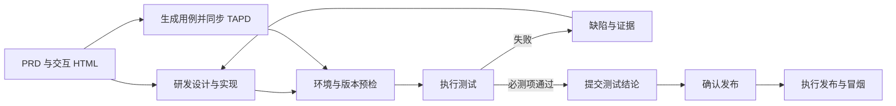

# 四阶段需求交付与测试专家详细设计

日期：2026-09-16  
状态：详细设计草案；四阶段方向已确认，本文尚未实施。  
适用范围：PiCoddyClaw TAPD 需求工作台。

## 1. 目标与已确认决策

需求工作台收敛为 **产品设计 → 研发实现 → 测试验收 → 发布**。只配置产品专家、架构研发专家、测试专家三个业务角色，发布由用户确认后交给执行流程。

- 产品专家完成 PRD、交互 HTML 和验收标准。
- 架构研发专家完成方案细化、代码实现和开发自测，不再要求用户切换架构、计划、开发等独立节点。
- 测试专家根据 PRD、交互 HTML 生成测试用例，结合技术设计与代码补充覆盖，上传 TAPD 并执行自动化测试。
- 测试问题回到研发修复，修复后复测，达到条件后进入发布。
- 设计评审、研发计划、代码审核、构建验证、交付归档不再作为独立阶段；必要检查分别纳入对应阶段内部。
- 不要求对接 Figma；现有交互 HTML 是产品交互基线。未来设计链接可作为补充资产。
- 本次仅落成设计文档，不修改业务代码、不创建 TAPD 数据、不执行测试环境部署或生产发布。

本文提出的状态、数据结构和接口均为目标设计，不代表当前已经具备。发布渠道、测试环境配置和测试专家市场身份是接入参数，不影响四阶段模型的确定。

## 2. 现状与改造依据

| 当前实现 | 现状 | 设计影响 |
| --- | --- | --- |
| `frontend/src/components/projects/projectDemo.ts` | 定义十个阶段；包含本地演示数据及模拟产物 | 真实流程和演示流程需要区分，不能沿用模拟成功作为交付证据 |
| `frontend/src/components/projects/requirementStageExpert.ts` | 根据阶段数组下标选择专家；测试专家未配置；按 TAPD 状态名称推测阶段 | 改为稳定阶段键和项目配置；未知状态不自动认定完成 |
| `frontend/src/components/projects/RequirementChat.tsx` | 阶段会话、仓库和资产选择、上传并推进 TAPD | 复用工作台骨架，替换阶段专属操作与完成条件 |
| `src/domains/requirement/node/store.ts` | 需求空间及阶段专家绑定 | 保留账号隔离和需求归属，增加版本化流程与会话映射 |
| `src/domains/requirement/node/repositories.ts` | 阶段解析、仓库引用和输入记录 | 去除对中文标题与十阶段顺序的依赖 |
| `src/domains/requirement/node/assets.ts` | 文件版本、内容哈希、同步状态；阶段范围为 0–9，按阶段顺序筛选上下文 | 迁移为稳定阶段键和显式输入版本引用 |
| `src/domains/requirement/node/delivery.ts` | 登记交付文件；上传成功后再推进 TAPD；失败可重试 | 复用文件校验和上传机制，新增测试/发布完成门槛 |
| `src/integrations/tapd/requirements.ts` | 附件上传、工作流读取、需求状态流转 | 第一期用已有附件能力承载用例与报告；不假设已有原生测试管理能力 |

当前产物自动收集有限定目录、文件类型和单文件 10MB 限制。测试脚本、截图、trace 和视频不能假定都会被现有收集器登记。需增加测试结果清单导入，超限证据保留本地并显示同步失败/未上传原因。

## 3. 阶段契约

| 阶段键 | 用户名称 | 必要输入 | 必要交付 | 完成条件 |
| --- | --- | --- | --- | --- |
| `product` | 产品设计 | TAPD 需求、业务约束 | PRD、交互 HTML、带编号验收标准 | 用户确认具体产物版本，必需附件同步成功 |
| `engineering` | 研发实现 | 产品交付版本、涉及仓库 | 详细设计、代码版本清单、变更说明、自测结果、测试启动说明 | 代码可定位，自测已实际执行，测试部署或启动方式明确 |
| `testing` | 测试验收 | 产品交付、研发交付、测试环境 | 用例集、自动化脚本、执行报告、缺陷清单 | 必测项完成且通过，阻断缺陷关闭，报告与被测版本一致，必需文档同步成功 |
| `release` | 发布 | 有效测试结论、版本及制品、发布配置 | 发布记录、冒烟结果、回滚信息 | 用户确认后实际发布成功、验证成功，并完成必要状态同步 |

产品确无 UI 变化时允许明确标记“交互 HTML 不适用”，填写原因；不以缺文件自动判断不适用。已有 HTML 原型不能当作真实应用完成测试。

阶段导航只是查看/继续某个阶段的会话，不等同于完成阶段，不直接修改 TAPD。四个阶段的状态和执行历史均持久化到后端，不能只依赖前端 localStorage。

## 4. 用户操作与页面结构

顶部只显示四阶段导航和 TAPD 实际状态。需求标题、阶段导航、当前会话专家各保留一个明确入口，避免重复显示“阶段专家/已绑定”。

右侧保留“代码仓库、资产、需求、任务”。资产按用途分组：产品产物、研发产物、测试产物、发布记录；默认引用上游已确认交付，用户可以查看所采用的版本。

本地文件显示文件夹图标、文件名及必要状态。点击文件入口在系统文件夹中定位文件，完整路径不直接铺在列表中。同步按钮和打开文件夹互不触发。

### 4.1 各阶段主要动作

| 阶段 | 主操作 | 辅助操作 |
| --- | --- | --- |
| 产品设计 | 确认产物并交给研发 | 预览 PRD/HTML、修改产物、重试同步 |
| 研发实现 | 提交研发交付并进入测试 | 查看设计、仓库版本、自测证据、处理测试问题 |
| 测试验收 | 按当前状态显示生成用例/执行测试/提交测试结论 | 配置环境、同步用例、查看失败、交回修复、复测 |
| 发布 | 确认发布 | 查看目标环境、制品、变更、测试依据及回滚方案 |

测试页按顺序显示“测试输入 → 用例 → 环境 → 执行结果”。用例生成后先同步 TAPD；同步失败时允许继续本地执行，但明确标记未同步，不能完成正式测试交接。

研发返修时，导航标记研发“修复中”、测试“待复测”。返回既有研发会话并附缺陷与证据，不新建一个“返修阶段”，也不删除历史测试结果。

## 5. 三个专家的边界

### 5.1 产品专家

输出 PRD 和交互 HTML，验收标准使用稳定编号，例如 `AC-001`。每个标准给出触发条件、预期行为、边界/异常、权限和数据规则。HTML 包含必要资源或声明外部依赖；确认版本时对入口和资源清单计算哈希，避免只冻结 HTML 而遗漏样式和脚本变化。

### 5.2 架构研发专家

统一负责源码分析、方案细化、任务组织、实现和自测。保留设计与代码的可追溯关系，但不把内部工作步骤暴露成独立阶段。

研发交付至少包含：涉及仓库及 commit、工作区是否干净、接口/数据库变更、运行命令、测试地址或部署方式、必要账号角色、测试数据准备方式、自测命令与真实结果、已知限制。

需要多个仓库时，交付是仓库版本集合，不能用单个 SHA 代表整个系统。本地未提交修改可用于开发测试，但必须记录差异摘要和内容指纹；正式发布要求可复现的提交或制品版本。

### 5.3 测试专家

读取已确认产物，分析需求覆盖，生成结构化用例与可执行脚本，执行和解读测试，整理证据与缺陷。不能仅凭模型判断生成“已通过”记录，也不能为了让测试通过擅自修改验收标准或删除失败断言。

测试角色复用现有专家安装/绑定机制，配置项保存实际 `expertId` 与版本。测试专家尚未配置时显示“配置测试专家”，禁止静默借用开发专家。架构研发角色可绑定既有具备设计和编码能力的专家，不要求另造市场身份。

## 6. 测试用例设计与产物规范

### 6.1 输入优先级与冲突处理

1. PRD 验收标准决定业务预期。
2. 交互 HTML 决定页面结构、操作顺序及交互反馈。
3. 技术设计和接口约定补充后端契约与数据规则。
4. 代码与变更范围用于识别实现风险和回归范围。

输入矛盾时生成待澄清项并标记受影响用例阻塞，不根据现有代码反推“正确预期”。技术实现缺少设计约定时由研发补齐。

### 6.2 用例模型

```ts
interface RequirementTestCase {
  id: string;                    // 同一需求内稳定，例如 TC-001
  revision: number;
  acceptanceIds: string[];       // AC-001 等
  title: string;
  type: "api" | "ui" | "integration" | "manual";
  priority: "P0" | "P1" | "P2";
  required: boolean;
  preconditions: string[];
  dataRequirements: string[];
  steps: Array<{ action: string; expected: string }>;
  automation: { status: "planned" | "ready" | "manual"; script?: string; testId?: string };
}
```

优先级用于安排执行顺序；`required` 决定是否必须通过，不把低优先级自动当作可忽略。非必测项需在执行前确认理由，执行失败后修改范围必须形成新版本，保留原失败。

覆盖内容：主流程、边界输入、异常反馈、身份/数据权限、状态转换、重复操作、接口契约、必要回归。并发、性能和兼容性按本需求适用性纳入，不自动承诺完整压力测试。

### 6.3 交付文件

```text
testing/<suiteRevision>/
  test-cases.json                # 稳定结构化来源
  test-cases.md                  # 供产品、研发和 TAPD 阅读
  coverage.md                    # AC → TC → 自动化/人工验证
  automation/                    # 脚本、配置模板、依赖与运行说明
  runs/<runId>/
    results.json                 # 逐用例实际结果
    report.md
    defects.json
    evidence/                   # 脱敏截图、日志、trace 等
```

测试脚本可进入关联仓库，也可作为独立测试包；无论存放何处都固定脚本版本、依赖锁文件和执行配置。资产清单引用实际文件与哈希，不依靠扫描整个代码仓库寻找脚本。

## 7. 自动化执行设计

### 7.1 第一版范围

支持项目已有测试命令、Node.js 接口测试和 Playwright 页面测试。具体命令优先采用项目已有约定；不替换已有测试体系。桌面原生、移动端、复杂压测等无法执行的场景明确列为人工验证或未支持。

交互 HTML 可以进行链接、控件和静态一致性检查；业务验收必须指向研发实现后的应用和真实接口，不能把原型按钮可点击作为业务通过。

### 7.2 环境配置

测试环境包含环境名称、应用/API 地址、涉及组件版本、账号角色引用、数据准备与清理命令、执行命令、工作目录、超时、并发限制、证据目录。凭据通过密钥引用注入，不进入报告、TAPD 附件或可导出的配置。

测试前核验服务连通、授权账号、数据准备条件、被测部署版本和脚本依赖。无法获取部署版本时记录“版本未验证”，结果可供诊断但不能用于正式发布准入。

默认测试在明确配置的非生产环境运行，测试数据带执行标识。启动、清理和测试命令按现有工具权限执行；本次测试取消时只清理本次创建的进程和数据。

### 7.3 执行和判定



用例结果为 `passed / failed / blocked / skipped / not_run`；任务执行状态为 `queued / running / finished / failed / cancelled / interrupted`。进程启动失败是执行故障；业务断言失败是用例失败，分别展示。

退出码 0 不是充分通过条件：必须成功解析结果、匹配预期用例、确认必测项无遗漏、无失败/阻塞/跳过，并核对输入版本。空报告和零用例执行不能产生通过结论。人工必测项必须有操作者、时间和验证证据。

进程退出码非零且存在有效失败结果时仍导入报告；解析失败则保留原始日志并标记执行故障。首次失败后重试保留所有尝试，不能将偶发通过覆盖成稳定通过；不稳定必测项在处理前阻止完成。

桌面应用退出/重启后，将无法确认仍运行的任务标记中断并提供重新执行，不能伪造续跑。执行器持久化心跳、取消状态、开始结束时间，限定单需求同时只能有一个修改同一测试环境的任务。

## 8. 缺陷修复与复测闭环

缺陷记录关联用例、验收标准、输入基线、被测版本、期望/实际、复现步骤、证据和严重程度。相同用例与相同根因的后续失败追加执行证据，不无条件创建重复缺陷。

状态采用 `open → fixing → ready_for_retest → closed`；复测失败回到 `open`。研发声明已修复只能变为待复测，不能直接关闭。

用例执行本身出错时先区分测试脚本缺陷与产品缺陷。脚本调整生成新脚本版本；产品修复生成新研发交付版本，随后执行失败用例和受影响回归。

第一版发布依据要求在同一目标版本集合上完成一次全部必测项验收，不混合多个代码版本的历史通过结果。后续如做增量结果复用，需要单独设计影响分析与有效性证明。

产品/设计版本变化时，原测试结果标记过期并进行用例影响检查；代码或部署版本变化时重新验证。无关文件变化可以经明确的影响判断形成记录，不自动把旧结论绑定到新版本。

## 9. TAPD 同步与本地流程

### 9.1 第一期明确范围

“测试用例上传 TAPD”第一期定义为：将用例文档和报告作为**当前需求的附件**上传，并记录附件 ID、字段与内容哈希。此行为不等于创建 TAPD 原生测试用例、测试计划或测试执行记录。

原生测试管理作为后续独立适配能力：实施前核验项目可用接口、权限、字段与关联方式，再支持用例映射、更新和执行结果回写。不得在文档阶段假定具体原生 API 已可用。

默认复用项目附件字段；允许配置产品、研发、用例、报告的独立字段。执行前检查配置，不硬编码字段英文名。测试缺陷第一期作为报告及本地缺陷记录保存；自动创建 TAPD 缺陷留为显式配置的后续能力。

### 9.2 同步状态与重试

每个附件同步记录包含需求归属、资产 ID、版本哈希、目标字段、附件 ID、尝试时间和错误。同步键覆盖账号、TAPD 服务、项目、需求、资产版本和字段。

同步失败不丢本地产物，不自动推进 TAPD。部分成功后只重试失败项。若服务端已接收但响应丢失，状态为“结果待核对”；优先通过可用附件查询能力核对，无法可靠确认时明确提示可能重复，不承诺网络超时下绝对只上传一次。

### 9.3 四阶段与 TAPD 状态解耦

项目配置本地阶段与 TAPD 状态的对应关系，但流转目标必须来自 TAPD 当前允许的真实转换。不得假设所有项目都有“开发中/测试中/已发布”，也不能按中文名称强制设置。

完成阶段时：验证交付条件 → 固定输入输出版本 → 同步必需附件 → 如配置了状态流转，检查预期状态并执行 → 记录完成。未配置外部流转时允许只完成本地阶段，明确显示“未变更 TAPD”。

外部状态冲突时保留上传结果，请用户刷新选择合法目标。外部已处于目标状态时只有本次操作记录和核对结果支持，才能恢复为成功。TAPD 显示已发布不能直接证明工作台执行过发布。

## 10. 数据模型与一致性

### 10.1 核心对象（拟新增）

| 对象 | 关键字段与用途 |
| --- | --- |
| `requirement_workflows` | `spaceId, workflowVersion=2, activeStageKey, revision`；四阶段持久化状态 |
| `requirement_stage_runs` | `id, spaceId, stageKey, attempt, status, conversationId, expertId, expertVersion`；阶段轮次 |
| `requirement_deliveries` | `id, stageRunId, inputRefs, outputRefs, repositoryRefs, manifestHash, confirmedBy, confirmedAt`；不可变交接版本 |
| `requirement_test_suites` | `id, spaceId, revision, productDeliveryId, engineeringDeliveryId, casesAssetRef, scriptsRef` |
| `requirement_test_runs` | `id, suiteId, environmentRef, targetVersions, executionStatus, verdict, reportRef, evidenceRefs, timestamps` |
| `requirement_test_results` | `runId, caseId, caseRevision, attempt, outcome, duration, evidenceRefs`；逐项结果 |
| `requirement_defects` | `id, spaceId, caseId, sourceRunId, severity, status, fixDeliveryId, retestRunId` |
| `requirement_releases` | `id, spaceId, deliveryId, testRunId, artifactRefs, environmentRef, confirmation, executionState, syncState` |
| `requirement_operations` | `operationId, idempotencyKey, kind, step, requestHash, heartbeat, result, error`；跨网络操作恢复 |

所有对象通过 `spaceId` 校验当前账号、TAPD 服务、项目和需求归属，不能凭客户端给出的资产 ID 或执行 ID 跨空间引用。

资产仍复用本地版本文件，新增 `stageKey`、用途 `kind`、生产执行 ID、交付版本引用。业务关联使用 `{assetId, hash}`，路径只作为文件定位信息。测试运行引用环境配置版本与密钥引用，不保存明文凭据。

### 10.2 状态和操作一致性

阶段状态采用 `not_started / in_progress / blocked / completed / stale`；测试结果和发布执行状态分别保存。阶段变为 completed 必须由领域服务校验，不接受模型文本直接设置。

SQLite 保存业务状态和操作日志；网络调用不持有长事务。先持久化操作意图，再执行外部步骤，再记录结果。文件先写临时文件并校验，原子移动后提交引用；崩溃恢复时清理未引用临时文件、核对缺失版本。

完成/发布操作使用客户端操作 ID、请求摘要、需求流程 revision 和目标版本集合做幂等校验。同一幂等键配不同请求必须拒绝。并发修改使用 revision 比较，跨重启的互斥依靠持久化操作状态，不能只依赖进程内 Set。

## 11. API 与执行分层（拟定契约）

复用 Electron IPC → `handleApi` → requirement 领域服务。渲染进程不直接读文件、启动测试或访问发布凭据。

接口统一以现有 `/api/tapd/requirements/:workspaceId/:storyId` 为前缀，服务端解析当前账户与服务地址形成需求空间。

| 方法与相对路径 | 用途 |
| --- | --- |
| `GET /workflow` | 四阶段状态、专家配置、有效交付与下一步阻塞原因 |
| `POST /stages/:stageKey/complete` | 固定交付并校验完成条件；返回可追踪 operationId |
| `POST /test-suites` | 发起用例生成任务，固定输入交付版本 |
| `POST /test-suites/:suiteId/sync` | 同步该用例集的具体版本到 TAPD |
| `POST /test-runs` | 依据用例集、环境版本、研发交付发起执行 |
| `GET /test-runs/:runId` | 状态、逐用例结果、证据和阻塞信息 |
| `POST /test-runs/:runId/cancel` | 请求取消并保留已产生结果 |
| `POST /defects/:defectId/return-to-engineering` | 关联研发修复任务/会话，不直接关闭缺陷 |
| `POST /releases/prepare` | 校验有效测试、构建或选择制品、生成可审核发布计划 |
| `POST /releases/:releaseId/confirm` | 确认计划哈希、制品、环境，启动发布操作 |
| `GET /operations/:operationId` | 上传、完成、发布等长操作的恢复和查询 |

写接口携带 `operationId`、`expectedRevision` 和具体版本引用；任务型接口返回 202 与执行 ID。错误分类包含输入缺失、版本过期、环境阻塞、结果不完整、同步失败、状态冲突和执行中断，页面给出针对性操作。

建议在 requirement 领域新增 `workflow.ts`、`testing.ts`、`release.ts`、`operations.ts`；现有 `delivery.ts` 保留文件收集与交付基础能力。测试进程管理复用已有任务执行设施，避免为每个专家单独实现进程生命周期。

## 12. 发布设计

发布是需求对应业务系统的发布，不默认调用 PiCoddyClaw 自身的安装包或七牛更新脚本。每个项目需要明确发布渠道、目标环境、构建/部署方式及回滚方式。

发布准备可以执行构建和制品校验，形成具体发布计划；生产变更在用户确认后执行。确认绑定代码/制品哈希、目标环境和测试报告，任何关键项变化都使确认失效。

若测试在源码环境完成，构建后还需要对候选制品执行适用的冒烟验证；不能仅凭同一个 commit 推断制品已验证。发布支持本地受控命令或外部流水线适配器，第一版落地一种已有渠道即可。

发布状态区分 `prepared / awaiting_confirmation / running / verifying / succeeded / failed / unknown / rolled_back`。收到流水线触发成功只代表已启动；需查询部署结果和冒烟结果。发布成功但 TAPD 同步失败时显示“已发布，状态同步待重试”，重试同步不得再次部署。

发布记录包含操作者、版本集合、制品校验和、环境、时间、执行链接/日志、冒烟结果和回滚版本。失败或取消不默认声明旧版本仍正常，必须核对实际部署状态；回滚后重新记录验证结果。

未配置发布执行器时停留“待配置发布”；可以登记外部发布证据，但需要明确标记为外部执行并校验目标版本，不把上传发布说明当作发布成功。

## 13. 旧十阶段迁移

不能直接将旧数组从十项换成四项。新代码使用 `StageKey` 和 `workflowVersion`，数字下标只留作兼容读取。

| 旧编号/阶段 | 新阶段 |
| --- | --- |
| 0 设计分析、1 产品 PRD、2 设计评审 | `product` |
| 3 架构设计、4 研发计划、5 软件开发、6 代码审核 | `engineering` |
| 7 自动测试 | `testing` |
| 8 构建验证、9 交付归档 | `release` |

迁移规则：

1. 迁移前备份数据库及资产索引，生成版本化迁移记录。迁移可重复运行且不复制/覆盖原文件。
2. 旧 `stage:中文标题` requestKey 保留，增加旧会话到新阶段的映射；多会话映射到一个阶段时全部保留历史，默认恢复该组最近活动会话，允许切换历史。
3. 专家绑定按新角色重新解析；有显式用户选择时优先保留适用绑定并提示冲突。不得把旧人工评审阶段的绑定自动视为测试专家。
4. 资产新增规范化阶段键和原始阶段信息，内容哈希不变，历史引用不变；取消仅靠 `asset.stage <= currentStage` 推断可用输入，改为明确交付引用。
5. 旧输入快照与完成记录保持可读，不能因阶段合并重新上传全部附件。新完成操作使用版本化命名空间，防止与旧幂等键混淆。
6. 前端 localStorage 演示数据单独升级；模拟报告一律标注演示。旧“完成/归档”只有文字记录时，不转换为真实测试通过或发布成功，转为“历史完成，证据待核验”。
7. 未识别的旧阶段进入兼容历史视图，不能因读取失败重新生成种子数据覆盖原记录。

上线前先做只读迁移预览，统计受影响需求、会话和资产。回滚使用备份和兼容读取；不让旧客户端写入新结构。上线迁移期间暂停同一空间写操作，完成后统一切换流程版本。

## 14. 实施顺序与验收

### 第一步：四阶段骨架与兼容迁移

建立稳定阶段定义、后端状态、旧数据映射和三个专家角色配置；替换界面十阶段入口。验证旧会话/资产可访问、显式专家选择不丢失、演示数据不进入真实完成判断。

### 第二步：测试用例与 TAPD 附件闭环

接入测试专家和产物模板、AC/TC 映射、用例版本、用例与报告附件同步。验证缺少 PRD/交互说明的阻塞、输入冲突、跨账号隔离、部分上传失败重试和超时待核对。

### 第三步：自动化执行与复测

增加环境预检、运行器、结构化结果、证据、取消/中断恢复、缺陷闭环。至少用一个真实可运行测试项目完成接口和页面测试。专门验证零用例、跳过必测项、报告缺失、退出码异常、部署版本未知均不能误报通过。

### 第四步：发布与状态同步

对接项目已有发布渠道，加入计划确认、候选制品验证、部署结果核对与发布后冒烟。验证测试过期阻止发布、确认过期、超时结果未知、发布成功但 TAPD 失败只重试同步、多仓库版本一致性。

### 核心端到端验收场景

1. 产品交付 PRD/HTML → 研发交付 → 测试用例上传 → 自动测试通过 → 确认发布 → 真实成功记录。
2. 接口测试失败 → 研发修复 → 新代码版本 → 全部必测项复测通过 → 原失败报告仍可追溯。
3. 环境未启动/账号缺失 → 测试阻塞，可保存用例但不可完成测试。
4. 产品产物修改 → 旧测试结论过期 → 更新用例与复测后恢复发布资格。
5. 上传或状态流转失败 → 本地结果保留 → 重试不重复执行测试/发布。
6. 应用重启 → 操作状态恢复 → 无结果证据的任务不会被标记成功。
7. 旧需求迁移 → 会话、仓库关联、资产版本和原始同步记录均保持可追溯。

## 15. 接入时需要确定的配置

| 配置 | 本文默认策略 | 落地时需要提供 |
| --- | --- | --- |
| 测试专家身份 | 不虚构市场 ID，通过既有专家机制绑定 | 可用专家包或市场标识与版本 |
| 架构研发专家 | 单角色覆盖方案与编码 | 确认现有专家实际具备的工具/技能 |
| TAPD 测试产物 | 第一版使用需求附件 | 项目允许写入的附件字段 |
| 测试环境 | 明确的非生产环境；缺配置阻塞执行 | URL、版本识别方式、账号和数据方案 |
| 发布渠道 | 复用业务项目已有发布方式 | 流水线/命令、制品来源、目标环境、回滚方式 |
| 无法自动化的必测项 | 人工执行并记录证据 | 验证负责人和适用范围 |

以上是运行前配置，不新增业务阶段。后续如要求 TAPD 原生测试管理或跨机器执行，再扩展相应适配器，不改变四阶段主流程。

## 16. 与历史文档的关系

本文作为本轮四阶段目标设计，取代历史方案中“十阶段导航”和“架构/计划/开发/审核分别作为独立用户节点”的部分。历史文档保留其当时的讨论背景；需求空间隔离、多仓库关联、资产版本引用和真实执行证据原则继续复用。

参考现有文档：

- [产品研发测试全流程与产物总览](../产品研发测试全流程与产物总览.md)
- [TAPD 需求工作台与会话隔离详细设计](../TAPD需求工作台与会话隔离详细设计.md)
- [研发阶段需求澄清与多仓库设计流程](../研发阶段需求澄清与多仓库设计流程.md)
- [需求交付流程历史设计](./2026-09-14-project-delivery-workflow-design.md)
