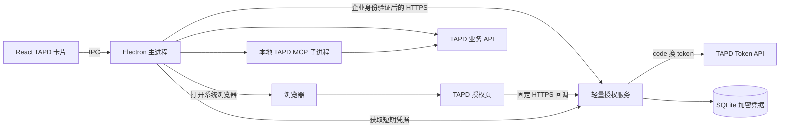
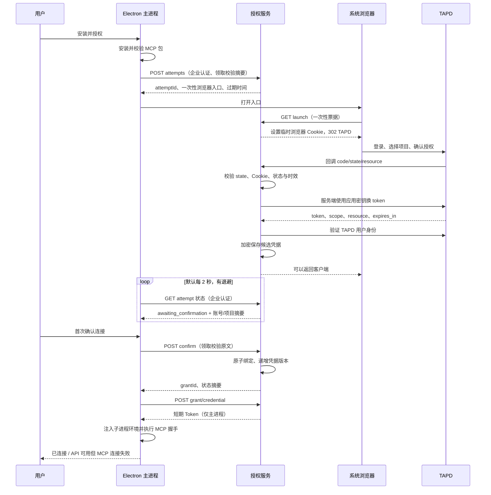

# TAPD 用户授权与轻量凭据服务设计

日期：2026-09-20。状态：待评审；仅设计，未实现或验证真实 TAPD 授权。

配套实现：服务端代码已新增于 `server/`，尚未完成真实授权验证；客户端的具体接口及源码改动见 [客户端对接详细设计](./2026-09-20-tapd-oauth-client-integration-design.md)。本文示例 IPC 名称以该客户端设计沿用的现有命名为准。

## 1. 背景、目标与范围

现有客户端安装 `mcp-server-tapd==8.0.81` 后要求用户输入个人 Key。目标是点击“安装并授权”，完成安装后在系统浏览器授权，回到客户端使用 TAPD MCP 和需求工作台，全程不要求员工复制 Key。

目标包括：个人身份绑定、按项目授权、统一凭据获取、过期重新授权、账号隔离、可恢复的授权过程，以及 Windows/macOS 共用流程。

本次不重构全部连接器，不把业务 API 全部迁往服务端，不实现 TAPD 未公开的刷新协议，不以共享管理员令牌替代个人权限。既有 API 是否支持用户态必须逐项实测；本方案没有宣称已经兼容。

部署假设：企业提供 HTTPS 域名和可验证的 PICODDY 登录身份。默认独立 Node.js 服务，也可将相同接口实现为现有 Java 后端模块。

## 2. 当前代码与外部约束

### 2.1 已核实的项目代码

| 位置 | 当前行为 | 设计变化 |
|---|---|---|
| `src/agent/builtin_mcp.ts` | 安装 Python MCP 包；验证 Key；写入配置环境变量 | 保留安装器；授权状态与包状态分离；凭据在启动时注入 |
| `frontend/src/components/TapdConnectorCard.tsx` | 安装后弹出 Key 输入框 | 安装后发起浏览器授权，展示进度和授权项目 |
| `src/agent/mcp.ts` | 按服务名缓存连接，启动时捕获环境变量 | TAPD 专用作用域和凭据版本参与缓存，执行前检查有效性 |
| `src/integrations/tapd/requirements.ts` | 多处读取同一个 `TAPD_ACCESS_TOKEN` | 全部从项目级 CredentialProvider 获取 |
| 同上 `listTapdRequirements` | 用 PICODDY `session.nick` 找 TAPD 项目及过滤需求 | 使用已验证 TAPD 身份和已授权项目列表 |
| `src/domains/requirement/node/test_case_import.ts` | 通过 `tapdTestXRequest` 访问 namespace 下 TestX API | 显式传入 workspace，核对 URL namespace 与授权范围 |
| `src/auth/session_store.ts` | 保存本地登录记录及 PICODDY 网关令牌 | 本地 UUID 不能作为服务端认证凭据 |
| `application.electron.ts` | 启动时预连接已启用 MCP；提供 TAPD/API 路由 | TAPD 授权凭据不就绪时跳过预热，选中项目后连接 |

### 2.2 官方协议证据

TAPD 官方提供用户态授权码流程：浏览器访问 `/oauth/`，回调带 code/state/resource，再由应用密钥换取 Bearer token；资源范围按授权项目约束，接口须支持用户态。code 文档有效期五分钟；令牌有效期按返回值处理。当前文档未给出 refresh_token/PKCE/撤销接口的完整合同。

官方还提供应用态 client_credentials，但它不能视为用户态令牌的续期方式。

来源：

- [用户态授权](https://open.tapd.cn/document/api-doc/API文档/授权凭证/用户态.html)
- [权限点列表](https://open.tapd.cn/document/api-doc/API文档/授权凭证/scopes.html)
- [应用态凭证](https://open.tapd.cn/document/api-doc/API文档/授权凭证/项目态.html)
- [开放应用接入](https://open.tapd.cn/document/api-doc/)

用户信息详情页本次抓取失败。实施前必须用开发者后台和真实测试应用确认用户标识字段、scope、回调限制、应用发布/安装要求及接口支持；不凭字段名称猜测稳定用户 ID。

## 3. 架构选择

| 方案 | 优点 | 成本与限制 | 选择 |
|---|---|---|---|
| 服务端代办授权、保管凭据；客户端直连业务 API | 复用 MCP 和 API 实现，附件不经过授权服务 | Token 需交给受信任主进程；撤销不能即时收回已下发 Token | 推荐 |
| 服务端代理所有 TAPD 请求及 MCP | 可集中管控、立即拒绝后续请求 | 需适配全部工具、附件流和业务协议，服务端明显变重 | 本次不采用 |
| Electron 内置 client_secret 自行换令牌 | 无额外后端 | 安装包可提取共享应用密钥 | 不采用 |

推荐方案只部署一个授权服务，使用 Node.js 原生 HTTP、fetch、crypto，以及 SQLite 持久卷。首版单实例，不需要 Redis、消息队列、WebSocket。HTTPS、企业鉴权和限流复用网关。



默认通过客户端轮询完成授权交接；浏览器展示“授权已提交，请返回 PiCoddyClaw”。不依赖自定义协议、localhost OAuth 回调、入站防火墙或 WebSocket。需要自动唤起应用可后续单独添加，不影响主流程。

## 4. 两种身份与授权绑定

### 4.1 企业身份验证

必须在服务端建立 `Principal { tenantId, userId }`，禁止信任请求正文中的 userId、客户端本地会话 UUID、显示姓名或任意 `X-User-Id`。

推荐将服务放在企业网关后：主进程携带现有 PICODDY 网关令牌，网关向现有权威认证服务校验，验证成功后通过可信内网/mTLS 向授权服务传递身份。网关必须清除外部同名身份头，服务禁止公网绕过网关直接访问。

若无现成网关鉴权能力，授权服务必须增加真实的服务端身份校验适配器；仅凭客户端“已经登录”不能上线。现有仓库不包含该认证服务合同，这是部署前置条件。

### 4.2 TAPD 身份验证

换令牌成功后，服务端调用经确认支持用户态的官方身份接口，取稳定 TAPD 标识及显示名。项目 ID 以 token 响应中验证后的 resource 为准，不能直接信任回调 query 中的 resource。

绑定关系：`企业租户 + 企业用户 + TAPD 稳定账号 + TAPD 项目`。

首版同一企业用户只绑定一个 TAPD 账号，允许多个授权项目。第二个项目必须与已绑定 TAPD 账号一致；更换账号需要显式解除旧绑定再授权。不得把两边姓名相等作为账号匹配条件，也不自动认定 TAPD 同名人员就是当前员工。

首次授权在客户端展示经过验证的 TAPD 账号与项目，让用户点击“确认连接”。这是产品绑定确认，不要求复制凭据。后续同账号同项目续权可自动完成；新增项目再次确认范围。

## 5. 完整交互时序



轮询由主进程持有，卡片卸载不创建额外循环。默认 2 秒，网络失败退避至 5/10 秒；429 遵循 Retry-After。一次尝试最长 10 分钟，TAPD code 到达后立即换取，不把 code 有效期扩大为 10 分钟。

用户取消后服务端标记尝试取消并删除候选 Token，迟到回调不创建绑定。重新点击授权生成新尝试，关闭当前设备同连接器旧尝试。授权服务重启后状态可恢复；客户端退出可丢弃未完成尝试，重新打开时重新发起即可。

## 6. 服务端接口合同

公开前缀为 `https://gateway.example.com/tapd/v1/integrations/tapd`。除 launch/callback/静态完成页外均需企业认证。用户身份取自 Principal，不接受调用方指定归属用户。

| 方法与路径 | 输入 | 返回与职责 |
|---|---|---|
| `POST /attempts` | `deviceId, claimChallenge, intent: connect/reauthorize, grantId?` | `attemptId, launchUrl, expiresAt, pollAfterMs`；权限集由服务端固定 |
| `GET /launch?ticket=...` | 一次性随机入口票据 | 消耗票据，设置 attempt 专用 HttpOnly/Secure/SameSite=Lax Cookie，302 TAPD |
| `GET /callback` | TAPD code/state/resource | 校验浏览器绑定，兑换并存候选 Token；重定向无敏感参数完成页 |
| `GET /attempts/:id` | 无 | 非敏感状态、账号/项目、错误码；不返回 Token/code |
| `POST /attempts/:id/confirm` | `claimVerifier` | 验证原文摘要与归属，原子确认绑定，返回 grantId |
| `DELETE /attempts/:id` | 无 | 取消；仅 owner 可操作；幂等 |
| `GET /grants` | 无 | 当前企业用户的账号与已授权项目摘要 |
| `POST /grants/:id/credential` | `expectedRevision?` | 当前有效 Token、实际 expiresAt、revision、workspaceId；仅主进程调用 |
| `DELETE /grants/:id` | 无 | 禁用本产品绑定、删除密文、增加版本；幂等 |

`deviceId` 是排查与尝试分组标签，不是认证凭据。`claimVerifier` 由主进程生成 32 字节随机数，仅保存在内存；服务端保存 SHA-256 摘要。它保护本产品的确认交接，不是宣称 TAPD 支持 PKCE。

`launchUrl` 仅主进程获取并打开；不进入模型消息或普通日志。浏览器入口票据和 OAuth state 都是独立 32 字节随机值，数据库只保存其摘要。Cookie 只关联本次尝试，多窗口使用不同 Cookie 名或受限会话集合，不能互相覆盖。丢失 Cookie 时失败并要求重试，不降级为只检查 query 参数。

所有敏感响应 `Cache-Control: no-store`。回调与 launch 的 query 在网关、应用日志中均脱敏；完成页不加载第三方资源，设置 `Referrer-Policy: no-referrer`、CSP 和 HTML 转义。

### 6.1 响应示例

状态接口：

```json
{
  "attemptId": "a_opaque",
  "state": "awaiting_confirmation",
  "tapdAccount": { "displayName": "员工 TAPD 账号" },
  "workspace": { "id": "12345678", "name": "项目名称或项目 ID" },
  "capabilities": { "requirementsRead": "verified", "testCasesWrite": "unverified" },
  "expiresAt": "2026-09-20T10:10:00Z"
}
```

`capabilities` 必须来自实际批准权限、接口兼容性清单和运行结果，不因 token 存在就把全部功能标为 available。查询范围与写操作权限不同，不能通过读成功推断写成功。

凭据响应只进入 Electron 主进程内存：

```json
{
  "grantId": "g_opaque",
  "revision": 3,
  "workspaceId": "12345678",
  "accessToken": "<仅主进程可见>",
  "tokenType": "Bearer",
  "expiresAt": "<按 TAPD 实际返回计算>",
  "recheckAfterSeconds": 60
}
```

60 秒只是客户端重新验证绑定的间隔，不改变 TAPD Token 本身的有效期或撤销能力。

### 6.2 数据结构

首版两张表即可：

```text
tapd_oauth_attempts
  id PK, tenant_id, user_id, device_id
  state_hash UNIQUE, launch_ticket_hash UNIQUE, browser_nonce_hash
  claim_challenge, intent, target_grant_id, target_revision
  status, created_at, expires_at, processing_started_at
  candidate_token_ciphertext, candidate_key_id
  candidate_tapd_subject, candidate_display_name, candidate_workspace_id
  candidate_scopes_json, candidate_token_expires_at
  grant_id, error_code, updated_at

tapd_grants
  id PK, tenant_id, user_id, tapd_subject, tapd_display_name
  workspace_id, workspace_name, scopes_json
  token_ciphertext, key_id, token_expires_at
  revision, status, created_at, updated_at
  UNIQUE(tenant_id, user_id, tapd_subject, workspace_id)
```

同一企业用户的多条 grant 必须遵守“一个 TAPD 账号”约束，在 SQLite 事务内检查。所有查询都加 tenant_id/user_id 条件；不同用户的非法 ID 统一返回 404。

Token 使用 AES-256-GCM，独立随机 nonce，AAD 包含记录 ID/租户/用户/项目/版本；密文格式带 key_id、nonce、tag。确认时从候选记录解密，按 grant 的 AAD 重新加密，不能直接复制密文。密钥通过部署 Secret 注入，与 SQLite 卷和备份分离。过期删除密文，可保留非敏感状态记录。

### 6.3 核心逻辑伪代码

以下为设计表达，不是已运行实现：

```ts
async function onCallback(request) {
  const attempt = findByStateHash(hash(request.query.state));
  requireUnexpired(attempt);
  verifyBrowserCookie(attempt, request.cookies);
  // CAS 更新 pending -> exchanging，防止重复交换同一个 code。
  if (!claimPendingAttempt(attempt.id)) return renderExistingStatus(attempt.id);
  try {
    const token = await exchangeAtFixedTapdEndpoint({
      grantType: "authorization_code",
      code: requireBoundedCode(request.query.code),
      redirectUri: configuredCallback,
      clientId: secretConfig.clientId,
      clientSecret: secretConfig.clientSecret
    });
    validateTokenResponse(token); // status、类型、时效、scope、resource
    const identity = await verifiedTapdIdentity(token.access_token);
    // CAS exchanging -> awaiting_confirmation；取消/过期发生时丢弃结果。
    saveEncryptedCandidateIfStillActive(attempt, token, identity);
  } catch (error) {
    failAttemptIfStillActive(attempt.id, classifyAndRedact(error));
  }
  return redirectToCleanResultPage();
}

async function confirm(principal, attemptId, verifier) {
  return transaction(() => {
    const a = ownedAttempt(principal, attemptId);
    verifyClaimHash(a, verifier);
    if (a.status === "completed") return existingGrantSummary(a.grant_id);
    requireConfirmableAndTokenValid(a);
    requireSameBoundTapdAccount(principal, a.candidate_tapd_subject);
    // 续权校验 targetRevision，防止旧回调覆盖新凭据或复活已解除绑定。
    const g = commitGrantWithRevisionCheck(a);
    markCompletedAndEraseCandidate(a, g.id);
    return publicGrantSummary(g);
  });
}

async function getCredential(principal, grantId) {
  const g = ownedActiveGrant(principal, grantId);
  requireRemainingLifetime(g, 60); // 小于一分钟要求重新授权
  return noStoreCredentialResponse(g, decrypt(g));
}
```

交换 Token 的外部调用不放进数据库长事务。超时可能意味着 code 已被消费，不能无限重试；标记 exchange_uncertain 并重新授权。服务重启遗留 exchanging 超过 30 秒也转为失败重试，不重复发送同一 code。回调重放只显示现有状态。

confirm 可安全重试但不会多建 grant。续权携带预期版本，事务冲突返回 409；取消/解除绑定同时使相关尝试失效，迟到回调不能恢复旧授权。

## 7. 客户端接入

### 7.1 本地域模块

新增 `src/domains/tapd-auth/node/`：

| 文件 | 职责 |
|---|---|
| `broker_client.ts` | 主进程访问固定企业授权服务；注入企业认证；响应校验与错误映射 |
| `service.ts` | 安装后授权编排、单次轮询、取消、确认、解绑和状态 DTO |
| `credential_provider.ts` | 按账号/项目/版本缓存 Token，单飞获取，过期与会话检查 |
| `types.ts` | 公共状态 DTO 和内部凭据类型分离 |

不增加客户端凭据落盘实现：Token 仅在主进程内存和受信任 TAPD 子进程环境中；重启后以现有 PICODDY 身份向服务端取仍有效的凭据。主进程使用新的 AccountSessionGeneration，账号切换立即让所有旧异步操作失效。

若请求服务端失败且上次绑定检查超过 60 秒，暂时阻止新 TAPD 操作，不继续无限使用缓存。有效期、企业登录期限、绑定检查期限三者取最早。

### 7.2 本地 API / IPC

保留现有安装接口路径，新增授权接口并同步四处映射：`frontend/src/api/client.ts`、`src/electron/preload.cjs`、`src/electron/ipc-handlers.ts`、`application.electron.ts`。

| 本地路径 | IPC 名 | 行为 |
|---|---|---|
| `GET /api/mcp/builtin/tapd` | `tapd.status` | 安装、授权、连接三个维度的状态 |
| `POST /api/mcp/builtin/tapd/install` | `tapd.install` | 保留安装；成功后 UI 调用 authorize |
| `POST /api/mcp/builtin/tapd/authorize` | `tapd.authorize` | 主进程创建尝试、打开浏览器、轮询；返回摘要 |
| `POST /api/mcp/builtin/tapd/authorize/confirm` | `tapd.authorizeConfirm` | UI 确认 attemptId；主进程补入 verifier |
| `POST /api/mcp/builtin/tapd/authorize/cancel` | `tapd.authorizeCancel` | 停止本地轮询并取消服务端尝试 |
| `GET /api/mcp/builtin/tapd/grants` | `tapd.grants` | 项目及能力列表 |
| `DELETE /api/mcp/builtin/tapd/grants/:id` | `tapd.disconnectGrant` | 停止对应运行时、清除缓存并解除服务端绑定 |

不提供任何 Renderer 可调用的 Token 获取接口。HTTP 补充链路只公开相同脱敏合同；必须有本地请求鉴权/Origin 校验，禁止外部网页无认证调用 authorize/confirm/delete。不能因监听 loopback 就假定安全。

`service.ts` 以 Event/现有 IPC 推送进度；如沿用 UI 轮询，只轮询本地主进程状态，不重复启动服务端轮询。打开浏览器复用项目已有跨平台 shell 适配器，并校验返回 URL 的 scheme、固定域名和路径。

### 7.3 前端状态模型

采用三个维度，避免把包安装、授权成功和 MCP 在线混为一谈：

```ts
type TapdStatus = {
  installation: "not_installed" | "installing" | "installed" | "failed";
  authorization: "none" | "pending" | "awaiting_confirmation"
    | "authorized" | "expired" | "cancelled" | "failed";
  connection: "disconnected" | "connecting" | "ready" | "failed";
  account?: { displayName: string };
  grants: PublicTapdGrant[];
  attemptId?: string;
  error?: { code: string; message: string; retryable: boolean };
};
```

按钮依次为“安装并授权”“前往 TAPD 授权”“等待浏览器授权”“确认连接”“使用 TAPD”。设置提供“添加授权项目”“重新授权”“解除绑定”。已授权但 MCP 失败显示“授权成功，连接失败，可重试”，API 可用性单独判断。

安装耗时后仅在原发起登录会话仍有效且流程未取消时自动打开浏览器。授权过期不自动弹浏览器，当前操作返回重新授权提示。

## 8. MCP 与 API 共用凭据

### 8.1 CredentialProvider 合同

```ts
type TapdExecutionScope = {
  accountId: string;       // 本次任务绑定的 PICODDY 用户
  sessionGeneration: number;
  grantId: string;
  workspaceId: string;
};

interface TapdCredentialProvider {
  get(scope: TapdExecutionScope, minimumTtlMs?: number): Promise<{
    accessToken: string;
    expiresAt: number;
    revision: number;
    tapdSubject: string;
    tapdNick: string;
    scopes: string[];
  }>;
  invalidate(grantId: string): void;
  clearAccount(accountId: string): void;
}
```

执行范围由主进程根据当前认证用户和已授权 grant 解析；Renderer 只提交 grantId/workspaceId 引用，不提交 accountId、Token、API URL 或 scope。请求前后都核对会话代次，避免用户退出后迟到响应写入另一个账号。

### 8.2 MCP 接入

1. 安装信息留在配置中，增加明确的内部 `authProvider: tapd-oauth` 类型标识；`env` 不保存任何授权 Token。
2. 在 `connectMcpServer` 创建 TAPD transport 前，由专用分支调用 CredentialProvider；只有内置 TAPD 可使用此分支，手工配置不可声明该身份。
3. 仅该子进程注入 `TAPD_ACCESS_TOKEN`；API base 固定为 TAPD 官方地址。不把 Token 放进 `process.env`、命令参数或模板解析全局变量。
4. 内部连接键为 `(serverName, accountId, sessionGeneration, grantId, workspaceId, credentialRevision)`；普通 MCP 仍保持原行为。
5. UI 仍显示一个 TAPD 连接器，任务选择时带授权项目。单轮 MCP 只绑定一个项目；跨项目汇总通过 API 按项目分别取凭据。后续多项目 MCP 需另行定义工具路由。
6. 已创建 AgentTool 的 execute 必须通过作用域句柄获取有效连接，不能永久闭包捕获旧 client/token。凭据版本变化后，下次执行重新获取连接和工具 Schema，拒绝已被新版本移除的工具。
7. 新增按作用域关闭连接的能力，避免当前 configure 调用 `disconnectAllMcpServers()` 影响其他服务。新握手完成前不暴露 ready。
8. 工具调用前核对项目参数；有多个项目参数/URL namespace 时全部核对。首版只开放核验过的 MCP 工具清单，未知或无法识别授权范围的工具不自动暴露。
9. 作用域取消/退出后禁止新调用；已在 TAPD 执行的写操作不能假装已撤销。关闭进程或请求中断后结果记为不确定并查询核对。

MCP 包是否直接接受该 OAuth Token，以及是否存在自行读取其他凭据的行为，需要针对锁定的 8.0.81 版本检查与实测；环境变量同名不构成兼容性证明。

### 8.3 需求工作台 API 接入

- `requirements.ts` 中所有 Token 读取改为统一 Provider，查询、附件、工作流和 TestX 不再各自读取 `mcp.json`。
- 项目列表以服务端 grant 为授权事实源；不要求先调用个人全部参与项目接口，避免单项目 Token 被用于全局枚举。
- “我的需求”过滤使用授权后验证的 TAPD nick；若身份接口未返回查询所需标识，该功能不能用 PICODDY 姓名兜底。
- `tapdTestXRequest` 增加显式 workspace/scope 参数，并从受信任调用点构造 endpoint，核对 TestX namespace；不接收 Renderer 自由 URL。
- API 缓存键加入 accountId、tapdSubject、workspaceId、grant revision 及查询参数。解绑/续权/账号切换清理旧缓存。
- 区分无数据、缺权限、Token 过期。现有附件 `.catch(() => [])` 不得吞掉授权错误并伪装为空附件。
- 保留现有测试用例导入回执、状态前置检查。写请求超时、凭据变更或结果不明时不自动重放。

## 9. 权限与兼容性验收

候选 scope 来自官方权限点表；它们是开发申请范围，不能作为“这些业务接口已经支持”的结论。

| 能力 | 现有接口或模块 | 候选 scope | 上线验证 |
|---|---|---|---|
| 账号和项目 | 用户信息；授权 resource；项目详情 | `user#read workspace#read` | 稳定账号标识、TAPD nick、项目 ID 一致 |
| 需求查询 | `stories`, `stories/count` | `story#read` | 列表/详情/分页/我的需求过滤 |
| 任务查询 | `tasks` | `task#read` | 关联需求任务 |
| 工作流读取 | `workflows/status_map`, `workflows/all_transitions` | `workflow#read` | 状态、允许流转 |
| 需求修改 | `POST stories` | `story#write` | 受控测试项目写入及恢复 |
| 附件 | `attachments`, `attachments/down`, `files/upload_attachment` | `attachment#read attachment#write` | 列表、上传、下载授权链接 |
| TestX | `api/testx/case/v1/namespaces/...` | `tcase#read tcase#write` 候选 | 单独验证 TestX，不以旧测试模块 scope 推断兼容 |
| MCP 缺陷/迭代等 | 服务端返回的工具清单 | 对应 `bug`、`iteration` 等细分权限 | 按工具核对底层 API 及读写行为 |

权限配置由服务端固定、按已上线功能申请；不接受客户端任意扩大 scope。未验证工具保持关闭。若必要接口不支持用户态，必须明确评审为后续应用态服务端代理或暂不发布该功能，不能静默退回共享 Key。

## 10. 生命周期、并发与错误

### 10.1 过期与续权

按 Token 接收时间及 `expires_in` 计算到期，提前 60 秒停止发起新请求；长上传可要求至少 120 秒剩余有效期。不硬编码“永远两小时”，不制造 refresh token。

重新授权沿用同一流程。相同账号项目校验成功后替换 grant 密文、增加 revision。Token 到期后台任务标记 needs_authorization，通知用户；不得在无交互任务中自动打开浏览器或重放失败写操作。

重新获取仍有效 Token 只是再次领取，不是续期。将来若 TAPD 正式提供且实测支持 refresh token，再加入服务端单飞刷新与版本控制。

### 10.2 解除绑定、退出与多设备

解除绑定先阻止当前设备新调用、清空 Token 并关闭对应 MCP；再请求服务端禁用 grant。网络失败显示“本机已断开，服务端解绑待重试”，不能报告全局解除成功。

服务端解绑会停止后续凭据下发；其他正常客户端最迟在下一次 60 秒检查/下次任务入口发现失效。因为本方案客户端直连 TAPD，已经发出的原始 Token 在上游到期/撤销前可能仍有效。没有确认官方撤销接口前，不宣称立即全球撤销；需要这种保证应选择全量代理方案。

退出 PICODDY 仅清空本机凭据、任务作用域和进程；不自动删除用户其他设备授权。远端取消尝试失败也不再接受迟到结果。多设备续权使用 revision 乐观锁，旧设备重新取新版本；不会覆盖新授权。

### 10.3 错误码

| 错误 | 行为 |
|---|---|
| `ENTERPRISE_AUTH_REQUIRED` | 登录 PICODDY 后重试，不误报 TAPD Key 错误 |
| `TAPD_AUTH_PENDING` | 继续等待，可取消 |
| `TAPD_AUTH_EXPIRED` | 发起新的浏览器授权 |
| `TAPD_AUTH_STATE_INVALID` | 拒绝回调，不修改已有 grant |
| `TAPD_AUTH_EXCHANGE_UNCERTAIN` | 新建授权尝试，不重复消费 code |
| `TAPD_ACCOUNT_MISMATCH` | 显示账号不一致，要求显式换绑 |
| `TAPD_SCOPE_INSUFFICIENT` | 提示缺少的功能权限，禁止无限重试 |
| `TAPD_WORKSPACE_NOT_AUTHORIZED` | 选择已授权项目或新增项目授权 |
| `TAPD_GRANT_REVISION_CONFLICT` | 刷新状态，保留新版本，旧尝试不能覆盖 |
| `TAPD_API_NOT_SUPPORTED` | 禁用对应能力并给出说明 |
| `TAPD_MCP_CONNECTION_FAILED` | 保留授权，单独重试连接 |
| `TAPD_WRITE_RESULT_UNKNOWN` | 查询结果/保留导入回执，由用户决定下一步 |

HTTP 401 与已确认过期业务码使凭据失效；403 先判断权限不足，不能全部当成过期。Token API 错误格式与业务 API 错误格式分别解析。

## 11. 轻量服务端部署

建议源文件边界：

```text
tapd-auth-service/
  src/server.ts           # node:http 路由、请求限制、健康检查
  src/principal.ts        # 可信网关身份适配
  src/tapd_oauth.ts       # 固定端点换 Token、身份读取、响应校验
  src/authorization.ts    # 尝试、确认、解绑、领取服务
  src/store.ts            # 两张 SQLite 表和事务
  src/token_cipher.ts     # AES-GCM
  src/config.ts           # 配置校验
```

部署配置：`TAPD_CLIENT_ID`、`TAPD_CLIENT_SECRET`、`TAPD_REDIRECT_URI`、批准的 `TAPD_SCOPES`、`TOKEN_ENCRYPTION_KEY_ID`、加密密钥、SQLite 路径和企业网关信任配置。域名固定，启动时拒绝缺配置；生产 OAuth 回调必须 HTTPS。

网关仅将浏览器 launch/callback/结果页设为无需企业 API Token，其他接口均验证企业身份。OAuth 回调无法要求浏览器携带桌面端企业令牌，依靠 state、Cookie 和服务器尝试归属完成关联。

SQLite WAL、短事务、本地持久磁盘。每分钟清理过期尝试/Token，终态尝试最多保留 24 小时非敏感摘要；日志不含 Token/code/secret/query。尝试创建每用户建议最多 5 次/分钟、同设备仅一个活跃尝试，轮询按返回间隔限流。Token API 超时 15 秒；身份请求超时 10 秒；服务端 JSON 请求体上限 16 KiB。

单实例滚动重启会短暂中断轮询但不丢绑定。需要多副本时改用现有关系数据库共享状态；不把 SQLite 放到多副本共享文件系统中。Node 版本使用企业批准且支持所需 node:sqlite API 的版本，在部署清单锁定。

首版约 6 个小模块、2 张表、9 类端点；业务数据与附件直接到 TAPD，不需要给授权服务扩展文件存储和任务调度集群。

## 12. 影响范围、切换与验收

### 12.1 代码影响

新增 tapd-auth 领域模块和独立服务；修改 TAPD 卡片、API/IPC 四处映射、安装状态、MCP TAPD 分支/连接作用域、requirements 凭据入口、TestX 请求参数及账号退出清理。会话/自动化选中 TAPD 时增加 grantId/workspaceId；不使用全局默认项目隐式影响既有会话。

只读分析发现的 `pi-mcp-adapter` 长期架构与本次授权独立，不作为本次实现前置。后续实现后同步 MCP、IPC 专项文档。

### 12.2 切换

新版本取消 Key 表单和 configure-key 路由，不双轨保留认证。升级用户显示“需要授权”，不读取旧 Key 继续调用。经用户发起新授权并确认替换时，精确删除旧 TAPD Token 配置，保留安装包、用户其他 MCP 配置和业务记录；旧 Key 在 TAPD 上是否撤销由用户管理。

选择“直接删除旧认证入口”意味着上线前必须完成所需业务功能兼容性验收，不能先替换后发现工作台不可用。OAuth 应用尚未准备好时，不发布这一切换。

### 12.3 验证清单（本次仅设计，未运行）

- 协议：真实企业测试应用完成授权；确认 callback 精确匹配、账号字段、resource/scope、过期响应及取消返回。
- 安全：伪造 principal、跨用户 grantId、错误 state/Cookie、回放 code、领取校验错误均拒绝；令牌不出现在 Renderer、配置文件或日志。
- 并发：重复回调、确认重试、取消与回调竞态、续权与解绑竞态、双设备版本冲突均有确定结果。
- 兼容：逐项执行第 9 节接口；写操作使用隔离测试项目；MCP 8.0.81 所需工具单独验证。
- 生命周期：过期停止新请求、续权重建对应 MCP、退出不串号、网络失败不会错误显示全局解绑成功。
- 客户端：安装后打开浏览器、取消不重装、状态重进可读；Windows x64/macOS 都完成一轮真实授权。
- 业务：多项目分别查询、TAPD 与 PICODDY 姓名不同时身份正确、附件/测试用例/状态流转不重复写入。

实施顺序：先验证 TAPD 应用和接口合同；随后实现服务端协议和桌面授权流程；再接入 API 与 MCP 凭据作用域；最后完成功能验收并切换入口。构建和测试执行需遵循项目授权规则。

## 13. 评审决策与实施前置

本设计推荐确定：轻量授权代理、业务直连、服务端加密存 Token、客户端仅内存、HTTPS 回调加轮询、个人账号按项目授权、无自动刷新假设。

实施前需要企业提供三个事实：

1. TAPD 开放应用的创建/发布权限和测试项目，确认用户态 API 能覆盖所需功能。
2. 一个固定 HTTPS 回调域名和部署位置；已有 Java 网关时可直接采用同一合同。
3. 服务端验证当前 PICODDY 身份的真实接口或可信网关机制。

这些是对接条件，不影响本设计交付；未确认前不把示例 URL、候选权限或身份字段当成生产合同。
