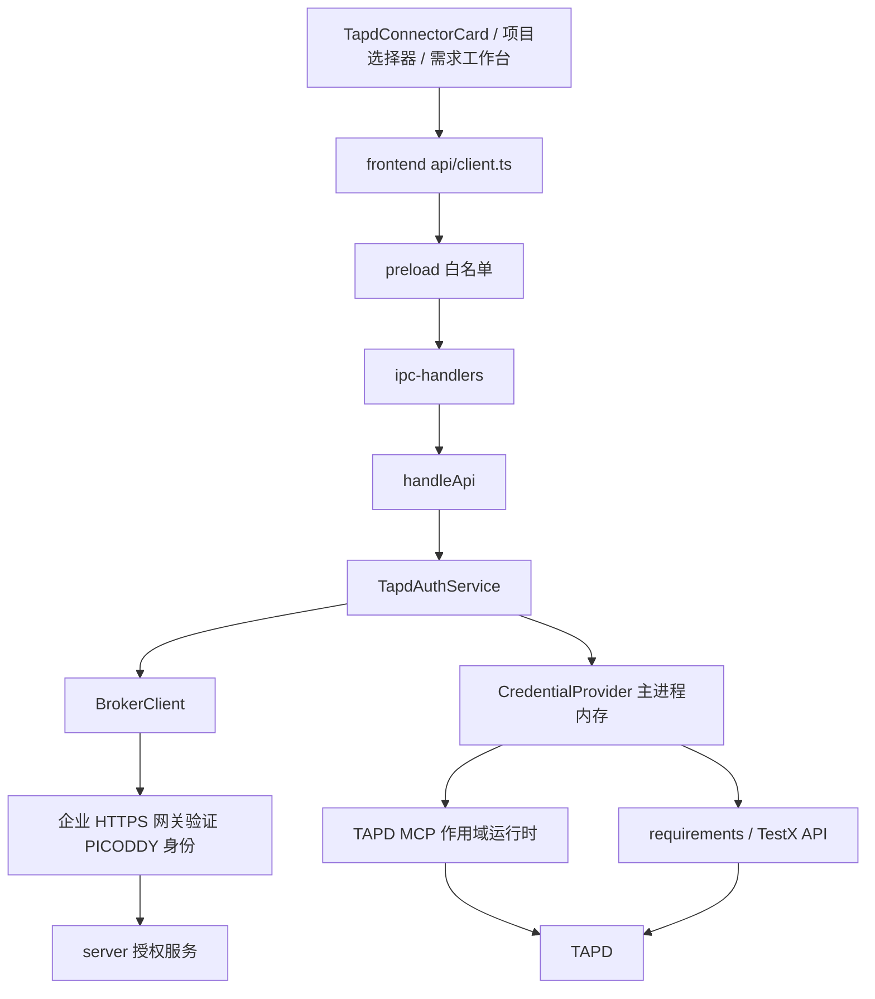

# TAPD OAuth 客户端对接详细设计

日期：2026-09-20。状态：设计待评审，尚未实现客户端改造。

配套：[授权整体设计](./2026-09-20-tapd-oauth-authorization-design.md)、[服务端配置与接口](../../server/README.md)。本文细化客户端合同；与整体设计中的示例 IPC 名称冲突时，以本文沿用现有 `mcp.tapd*` 命名的合同为准。

## 1. 背景、目标与边界

当前 TAPD 卡片安装后显示 Key 表单，`configureTapd()` 把 Key 写进 MCP 配置。MCP 和需求工作台共同读取这份静态凭据。服务端 `server/` 已有独立授权实现，但前后端尚未接通。

目标是用户安装后浏览器授权，确认 TAPD 账号及项目，随后在会话和需求工作台使用该项目能力；重启、续权、取消、退出和多设备更新都有明确行为。

本次设计覆盖客户端与服务端之间的对接和必要的服务端合同补齐，不扩展为全部连接器重构。业务请求继续由 Electron 主进程及本地 TAPD MCP 发往 TAPD。授权成功和具体业务接口可用是两个独立结论。

## 2. 架构与身份边界



三种凭据分别管理：

| 凭据 | 持有方 | 用途 |
|---|---|---|
| 现有 PICODDY 登录令牌 | Electron 主进程、企业认证网关 | 证明企业用户身份 |
| TAPD client_secret、TRUSTED_PROXY_SECRET | 授权服务与企业网关 | 服务端换令牌、可信身份转交 |
| TAPD 用户态 access_token | 授权服务密文、主进程内存、受信任 TAPD 子进程 | 指定项目的业务调用 |

客户端不配置、不下发 `X-Auth-Gateway-Secret` 或 `X-Auth-User-Id`。企业网关验证 PICODDY 令牌后，覆盖并注入 `X-Auth-Tenant-Id`、`X-Auth-User-Id` 和网关秘密头。当前 `server/src/principal.mjs` 仅接受 loopback + 网关秘密头，桌面直接请求其 8091 端口不是有效对接方式。

客户端拟使用现有网关认证习惯，以 `X-Access-Token: <PICODDY token>` 调用固定企业入口。该 header 是否被部署网关接受必须由企业确认；BrokerClient 将其集中在一个认证适配函数中。不得把企业令牌发给任意 Renderer 提交的 URL。

`brokerBaseUrl` 由应用受信任发布配置提供，仅允许固定 HTTPS origin。主进程读取现有登录会话；服务端 Principal 为归属最终依据。本地 `session.id` 只用于失效控制，不能代替远端认证。

## 3. 模块与文件职责

| 文件 | 变更及职责 |
|---|---|
| 新增 `src/domains/tapd-auth/node/types.ts` | 公共 DTO、内部凭据、错误联合类型 |
| 新增 `broker_client.ts` | 固定服务地址、企业鉴权、超时、响应结构校验、取消信号；不直接暴露给 Renderer |
| 新增 `service.ts` | 唯一授权任务、浏览器打开、后台轮询、确认、取消、解绑、状态快照 |
| 新增 `credential_provider.ts` | 项目凭据单飞获取、缓存、版本与生命周期校验 |
| 新增 `runtime.ts` | TAPD MCP 专用连接句柄、工具适配与按项目关闭 |
| `src/agent/builtin_mcp.ts` | 保留安装器，移除个人 Key 配置；安装状态独立于 OAuth |
| `src/agent/mcp.ts` | 内置 TAPD 分流到授权运行时；普通 MCP 按原协议连接 |
| `application.electron.ts` | 路由到领域服务，解析会话项目，退出时清理 |
| `frontend/src/components/TapdConnectorCard.tsx` | 授权卡片与账号/项目摘要 |
| 新增 `frontend/src/store/useTapdStore.ts` | 唯一 UI 状态订阅与操作，不保存凭据 |
| `frontend/src/api/client.ts`、preload、ipc-handlers | 同步新增接口和白名单，移除 Key 配置路由 |
| 会话请求映射、Composer、自动化配置 | 传递授权项目引用 |
| `src/integrations/tapd/requirements.ts` | 所有 API 改用统一执行作用域及凭据 |
| `src/domains/requirement/node/test_case_import.ts` | 显式接收 workspace 作用域，校验 TestX namespace |

安装包只管理运行时文件；授权服务只管理身份/凭据；主进程服务将二者组合。需求工作台使用 HTTP API 时不要求 MCP 子进程在线。

## 4. 前端交互设计

### 4.1 首次使用

1. 卡片“安装并授权”先检查 PICODDY 登录；未登录显示登录入口。
2. 主进程安装已有 Python MCP 包，UI 展示安装进度，禁止重复安装。
3. 安装完成且原登录会话仍有效时，前端调用 authorize；主进程创建尝试并打开系统浏览器。
4. 卡片显示“请在浏览器完成 TAPD 授权”，可取消。关闭弹窗或切换页面只隐藏 UI，不隐式取消后台授权。
5. 后台收到 `awaiting_confirmation` 后，卡片显示 TAPD 账号、项目与“确认连接”。首次和新增项目都要求确认。
6. 确认成功后刷新 grant 列表；如本次由会话入口触发，连接所选项目 MCP。失败时保留授权，显示“授权完成，工具连接失败，可重试”。
7. 用户点击“使用 TAPD”，把 `{id:'tapd', kind:'mcp', grantId, workspaceId}` 放入 Composer 本轮选择，发送前显示项目标签。

授权页已使用错误 TAPD 账号时，用户取消并在浏览器切换账号；不得根据 PICODDY 姓名自动认可该账号。

### 4.2 项目与续权

卡片设置包含项目列表、到期状态、“添加项目”“重新授权”“解除绑定”。多个项目的授权分别管理，UI 不使用一个全局 `configured` 布尔值代表所有项目。

只有一个有效项目时可以自动选中；多个有效项目时必须选择。上次选择可作为 UI 提示，但不可无提示更改已发送会话或自动化的项目。

重新授权必须带原 grantId。回调的账号/项目与目标一致后，主进程可以自动提交确认；结果不一致时显示错误，不能偷偷改成新项目绑定。Token 过期不会自动弹浏览器，用户点“重新授权”启动。

### 4.3 状态快照

```ts
interface TapdClientSnapshot {
  version: number; // 主进程当前账号内递增，用于丢弃迟到 UI 响应
  installation: 'not_installed' | 'installing' | 'installed' | 'failed';
  broker: 'unconfigured' | 'available' | 'unreachable' | 'login_required';
  attempt?: {
    id: string;
    state: 'creating' | 'waiting_browser' | 'exchanging'
      | 'awaiting_confirmation' | 'confirming' | 'cancelled' | 'expired' | 'failed';
    expiresAt?: string;
    accountDisplayName?: string;
    workspaceId?: string;
  };
  grants: Array<{
    grantId: string; workspaceId: string; workspaceName: string;
    accountDisplayName: string; revision: number; expiresAt: string;
    authorization: 'authorized' | 'expired' | 'disconnect_pending';
    connection: 'disconnected' | 'connecting' | 'ready' | 'failed';
    capabilities: Record<string, 'verified' | 'unverified' | 'denied'>;
  }>;
  error?: { code: string; message: string; retryable: boolean };
}
```

授权列表 API 返回 active 也可能马上到期；主进程以 expiresAt 再计算状态。网络不通显示“连接服务不可达”，不伪装成用户已解除授权。capabilities 来自宿主已验证能力清单与 scope 交集，不靠 Token 是否存在推断。

## 5. 本地 API、IPC、服务端映射

本地路径前缀为 `/api/mcp/builtin/tapd`。复用现有 `mcp.tapdStatus` 和 `mcp.tapdInstall`，不引入第二套同义 IPC 名。

| 本地 API | IPC | 请求 | 服务端交互 |
|---|---|---|---|
| `GET /` | `mcp.tapdStatus` | 无 | 返回主进程快照；按需 GET grants |
| `POST /install` | `mcp.tapdInstall` | 无 | 本地安装，返回安装结果 |
| `POST /authorize` | `mcp.tapdAuthorize` | `{intent,grantId?}` | POST attempts，主进程打开 launchUrl |
| `POST /authorize/confirm` | `mcp.tapdAuthorizeConfirm` | `{attemptId}` | 主进程补入 verifier，POST attempt/confirm |
| `POST /authorize/cancel` | `mcp.tapdAuthorizeCancel` | `{attemptId}` | 先取消本机任务，再 DELETE attempt |
| `GET /grants` | `mcp.tapdGrants` | 无 | GET grants，仅返回脱敏 DTO |
| `DELETE /grants/:id` | `mcp.tapdDisconnectGrant` | 路径 grantId | 本机停用并 DELETE grant |
| `POST /connect` | `mcp.tapdConnect` | `{grantId,workspaceId}` | 获取凭据并连接本地 MCP |

`POST /authorize` 立即返回已开始的状态，不能让 IPC 一直等待浏览器。返回快照不含 launchUrl、verifier、Cookie、企业 Token 或 TAPD Token。

新增主进程调用 `POST /grants/:id/credential`，它不映射为本地 API/IPC。前端也不能经通用 fetch 代理获得该响应。

IPC handler 必须验证请求来自应用的可信 WebContents/frame，并经 handleApi 调用领域服务。HTTP 补充路径必须有真实本地认证及 Origin 校验：若项目当前没有可复用的本地认证通道，首版拒绝这些敏感授权操作的纯 HTTP 请求，开发前端通过 Electron 测试。不能因为绑定 loopback 就开放匿名授权/解绑。

移除 `/configure`、`mcp.tapdConfigure` 和 Key 输入状态，不双轨保存个人 Key。普通 `/api/mcp/connect` 遇到 TAPD 且缺少项目上下文时返回 `TAPD_WORKSPACE_REQUIRED`，不能猜项目。

## 6. 与 server/ 的精确协议

| 服务端响应 | 客户端处理 |
|---|---|
| 创建返回 attemptId/launchUrl/expiresAt/pollAfterMs | 仅主进程保留，校验 launch origin/路径为部署允许值，再打开 |
| attempt: pending/launched | waiting_browser |
| attempt: exchanging | exchanging，继续轮询 |
| attempt: awaiting_confirmation | 展示服务端账号/项目摘要，等待用户 |
| attempt: completed | GET grants 恢复状态；不能因此假定 MCP ready |
| attempt: failed/cancelled/expired | 结束轮询并删除 verifier，保留已存在的其他 grant |
| GET grants: `{grants:[...]}` | 映射到统一快照，保留 grantId/revision/expiresAt |
| credential: accessToken/tokenType/expiresAt/revision/workspaceId | 校验 workspace、版本和到期时间，写内存，禁止输出到 UI |

主进程生成 `randomBytes(32).toString('base64url')` 作为 verifier，`SHA-256(verifier UTF-8)` 的小写十六进制值作为 challenge，匹配当前 server 实现。不要改为对原始随机字节求摘要。

设备 ID 是本地生成并持久化的随机 UUID，仅用于尝试分组，不作为认证。主进程必须在 authorize 请求发出前检查当前登录会话，以同一会话发出后续确认与凭据请求。

服务端的 `TRUSTED_PROXY_SECRET` 不进入应用配置、构建环境输出、前端请求或安装包。服务端地址也不能由模型通过工具参数覆盖。

## 7. 授权任务生命周期

主进程每个登录会话只允许一个本地活跃 TAPD 授权任务，由 service 持有：`attemptId, verifier, grantId?, intent, sessionGeneration, abortController, deadline, localOperationId`。

```text
creating → waiting_browser → exchanging → awaiting_confirmation
                                           ↓
                                        confirming → completed
任意未完成状态 → cancelled / expired / failed
```

重复点击在创建请求发出前由本地 single-flight 合并。服务端创建接口当前没有幂等键；网络响应丢失时不能盲目自动重试 POST，显示“创建结果未知，重新发起授权”，新尝试按服务器的同设备规则关闭旧尝试。

轮询使用 await + setTimeout，避免 setInterval 导致重叠。按服务端 pollAfterMs 默认 2 秒；网络错误按 5/10 秒退避，429 尊重 Retry-After。超过尝试 deadline 停止。UI 每 2 秒读取本地快照，只在连接器页面可见或有活跃任务时运行；不存在额外的前端远端轮询。首版使用此现有轮询模式，无需新全局事件协议。

“取消”先递增本地操作代次并 abort，再尽力 DELETE 远端。远端请求失败时依然不会接受旧结果，远端尝试按期限回收。开始新任务前清除旧 verifier。

点击确认时把 UI attemptId 与 service 当前 attemptId 比较；匹配后主进程从内存读取 verifier。确认 POST 响应丢失可用相同 attemptId/verifier重试，当前服务端支持幂等确认；随后重读 grants，不复用旧响应无限显示成功。

程序退出不持久化 verifier；重启后未确认尝试不能继续领取，重新授权。已经确认的 grant 可以通过企业身份恢复，不需要新 Key。

## 8. CredentialProvider 算法

缓存键为 `tenantId/userId/sessionGeneration/grantId`。主进程身份上下文在整个任务中固定，所有 await 后校验代次。缓存内容包含 accessToken、workspaceId、revision、expiresAt、scopes、TAPD 稳定账号/查询 nick，以及最近远端校验的单调时钟时间。

```ts
async function acquire(scope, minTtlMs = 60_000) {
  assertCurrentSession(scope.sessionGeneration);
  const cached = credentialCache.get(scope.key);
  if (cached && cached.workspaceId === scope.workspaceId
      && monotonicNow() - cached.checkedAt < 60_000
      && remainingLifetime(cached) > minTtlMs) return cached;

  return singleFlight(scope.key, async () => {
    const grant = await broker.getOwnedGrantFromList(scope.grantId);
    assertCurrentSession(scope.sessionGeneration);
    assertWorkspace(grant, scope.workspaceId);
    const token = await broker.credential(scope.grantId, grant.revision);
    assertCurrentSession(scope.sessionGeneration);
    assertWorkspace(token, scope.workspaceId);
    assertFreshness(token, minTtlMs);
    publishCredentialAndInvalidateOlderRuntime(scope, token);
    return token;
  });
}
```

`getOwnedGrantFromList` 是客户端对 GET grants 的封装，不是假定服务端存在 GET grant/:id。grant 列表也 single-flight，避免多个请求重复拉取。

409 revision conflict：重读 grants 并再领取一次；第二次冲突交给上层重试。刷新只是取得服务端当前令牌，不会延长 TAPD expiresAt。剩余不足 120 秒的附件上传不启动，避免明知即将过期仍开始长写请求。

超过 60 秒检查期限后服务端不可达，阻止新调用并显示网络状态，不把“服务端不可达”写成永久授权失效。企业认证 401 清理该账号所有缓存；403 区分项目权限，不能一律无限重新授权。

服务端当前没有 serverTime 字段。正式联调应补充 `serverTime` 到凭据响应，客户端从接收时的单调时钟计算剩余寿命，扣除请求耗时与安全余量；避免本机时间调整使 Token 被误认为长期有效。客户端仍以 TAPD 的真实失效响应为最终依据。

## 9. MCP 接入设计

### 9.1 配置与启动

内置 TAPD 配置保存包路径和 `authProvider:'tapd-oauth'`，不保存 Token。普通手工 MCP 不允许声明该内置授权来源。

启动 `connectAllMcpServers` 跳过需要项目作用域的 TAPD。用户选择项目或执行已绑定任务时才取得凭据并连接；不得启动后替用户选择第一个项目。

### 9.2 连接与工具执行

内部连接键：`serverName + enterpriseAccount + sessionGeneration + grantId + workspaceId + credentialRevision`。每个会话固定项目；不同项目可并行持有不同子进程。

在连接前，从 CredentialProvider 取得令牌，只给对应子进程 env 设置 TAPD_ACCESS_TOKEN；不写全局 process.env。启动参数、错误、日志和工具 description 均不含令牌。

SDK 握手/listTools 后，以已验证工具清单过滤返回工具；无法确定项目作用域或未确认用户态兼容性的工具不暴露。工具包装保留 annotations 与现有文件路径保护。

AgentTool.execute 不永久闭包捕获原始 client。它持有稳定 scope 和 toolName，每次先 acquireCredential/RuntimeLease，再检验当前 Schema 与调用参数后调用真实工具。新凭据触发旧运行时 draining：禁止新调用，有界等待已有请求结束后关闭；注销/解绑立即禁止新调用并尽力中止旧请求。已经发生的远端写入不能承诺撤回。

重连后若工具被移除或 Schema 改变，返回工具刷新错误并在下一轮重建工具集，不将旧参数直接交给新工具。单个项目失败只影响自身，不调用 disconnectAllMcpServers。

### 9.3 会话和自动化参数

现有字段增加：

```json
{
  "preferredConnector": "tapd",
  "preferredConnectorKind": "mcp",
  "preferredConnectorScope": {
    "grantId": "服务端授权 ID",
    "workspaceId": "TAPD 项目 ID"
  }
}
```

需要同步 Composer 选择类型、useStore 请求、promptRequestModel、IPC session.continue 载荷以及 `parsePreferredConnectorSelection`。`preferredConnectorScope.workspaceId` 不等于会话本地目录的 workspaceId，避免字段混用。

普通对话发送成功后清除本轮选择；下一轮仍需显式选择。需求工作台内的会话由已保存的需求空间 accountId/workspaceId 解析 grant，Renderer 不得将它改成另一个项目。

自动化增加创建者 accountId 和 TAPD grantId/workspaceId 配置，执行时核对当前账号与 grant。旧自动化缺少项目范围则显示需重新配置，不能借用当前默认项目。过期任务标记 needs_authorization，不自动弹浏览器，不以另一个登录用户重跑。

## 10. 需求工作台与直接 API

所有 TAPD API 函数接收由领域层解析的执行 scope。Renderer 的 workspaceId 只作为查询目标，后端通过当前账号 grant 列表检查归属，再构建 scope。

| 当前函数/流程 | 对接变化 |
|---|---|
| `listTapdRequirements` | 从有效 grant 列表确定项目；每项目独立取凭据，替代全局参与项目枚举 |
| `getTapdRequirementContext` | 需求空间归属校验后获取该项目凭据 |
| `uploadTapdRequirementAttachment` | 同项目校验，要求足够剩余寿命；超时不自动重传 |
| `getTapdAttachmentDownloadUrl` | 校验归属后请求签名链接；访问对象存储时不附加 TAPD/企业认证头 |
| `getTapdStoryWorkflow / transitionTapdStory` | 使用同一项目 scope，保留状态前置检查；未知结果先查询 |
| `tapdTestXRequest` | 显式 scope；路径 namespace 与 scope.workspaceId 必须一致 |
| 导入回执和附件缓存 | 绑定 enterprise account、TAPD subject、workspace，不跨换绑复用 |

跨项目列表用有界并发（默认 3）查询，各项目使用自己的 Token；某项目失效返回 partialFailures，而不是抹掉全部结果或当成没有需求。授权变化清理相应项目缓存。

“我的需求”过滤必须用经过 TAPD 验证的查询标识。当前服务端 `tapdNick = tapd_display_name` 的实现不能直接采用：显示名可能与 TAPD nick 不同，必须独立返回经过验证的 nick；缺少时禁用“我的需求”过滤并说明原因。

现有附件读取 catch 返回 [] 的路径须保留鉴权失败信息，UI 显示“无权读取/需要重新授权”，不显示为空附件。业务写请求 5xx/超时/中止标记结果未知，沿用现有导入回执和状态复查机制。

## 11. 当前服务端接口缺口与补齐合同

以下是对现有 server 源码的静态核对结果，不代表真实联调已完成；本次只写设计，不修改服务端代码。

| 缺口 | 客户端影响 | 实施要求 |
|---|---|---|
| 网关尚未部署；客户端没有网关秘密 | 不能直接调用服务监听端口 | 企业网关验证 PICODDY 身份，再向本机服务注入可信头 |
| displayName 被用作 tapdNick | “我的需求”可能查询错人 | 增加独立 identityNickPath、持久化与返回 tapdNick；必须验证字段语义 |
| 凭据响应缺少 serverTime | 时钟偏差影响本地 TTL 判断 | 补充 serverTime，按服务端时间和单调时钟计算 |
| active grant 到期后清理变为 expired，但 credential 可能返回 GRANT_INACTIVE | UI 无法仅凭一个错误判断解绑或过期 | expired 明确返回 AUTH_EXPIRED；客户端以 GET grants 再区分 |
| 创建 attempt 未严格拒绝 connect 带 grantId | 客户端意图和目标可能不一致 | connect 禁止 grantId；reauthorize 要求有效 UUID 和目标归属 |
| capability 未在服务端做业务实测 | Token 存在不代表 MCP/TestX 可用 | 客户端使用发布时审核的能力清单；未知默认禁用 |
| 当前解绑会取消该用户所有未完成尝试 | 另一设备的新增项目授权可能被取消 | 首版保留此安全行为，UI 明确需重新发起；不自动继续旧尝试 |

稳定 subject 的格式和跨项目一致性属于 TAPD 应用联调前置。现有 grant 更新 SQL 已刷新 displayName，新增 nick 时须同时维护独立查询标识。

## 12. 重启、退出、解绑与升级

### 12.1 重启恢复

PICODDY 登录有效时按需 GET grants 恢复项目列表；不在磁盘读取 TAPD Token。第一次业务请求再领取凭据；MCP 不全量预热。无企业登录时显示登录入口，已安装包保留。

仅持久化随机 deviceId 和非敏感 UI 偏好；凭据、verifier、launchUrl 不落盘。若用户在客户端关闭后才完成浏览器授权，旧尝试因没有本机 verifier 无法确认，客户端引导重新授权。

### 12.2 退出与账号切换

退出先递增 sessionGeneration、停止授权轮询、清空凭据/项目列表/Composer 选择、关闭该账号 TAPD 运行时，再清除登录记录。所有在途请求完成后检查 generation，旧结果不能写入新用户状态。

客户端注销不删除其他设备服务端 grant。自动化不得用切换后的账号执行原用户任务。

### 12.3 解除绑定

点击解除先本地标记 disconnect_pending，禁止新调用并关闭项目运行时，再 DELETE 服务端 grant。成功后刷新列表；网络失败保留本地待处理状态，明确“本机已断开，服务端解绑未完成”。

为防程序重启后误恢复已请求断开的项目，本地允许保存不含凭据的 tombstone：`enterpriseUserId,grantId,requestedAt`。重新登录同账号时，完成/确认远端解绑前不启用此 grant；每次重试都需同账号有效认证。不同账号不可代办。

原始 Token 已下发，客户端直连模式无法保证恶意客户端立即停止；产品只承诺停止新的凭据领取及本应用后续调用，不宣称上游 Token 被立即撤销。

### 12.4 Key 切换

新客户端统一走 OAuth，Key 配置入口删除。升级检测到旧 TAPD 配置时阻止其自动连接，显示“需要授权”；在用户完成替换时精确移除旧 TAPD Token 字段，保留其他 MCP 和已安装包。旧 Key 在 TAPD 上的撤销不自动假定成功。

## 13. 风险、验收与交付顺序

主要风险是 TAPD 用户态接口覆盖、稳定账号及 nick 字段、网关身份链路、MCP 工具项目约束和写请求不确定结果。不能用模拟授权成功替代这些真实合同验收。

验收场景：

1. Windows x64/macOS 完成安装、浏览器授权、确认、单项目 MCP 读请求和工作台查询。
2. 浏览器关闭、重复点击、请求超时、429、过期、确认响应丢失均能恢复且无重复绑定。
3. A/B 项目并发查询使用不同凭据；缺项目 MCP 请求被拒绝；切换 Composer 不改变执行中会话。
4. 企业账号切换、解绑与迟到回调并发时，不串账号、不恢复旧授权。
5. Token、verifier、网关秘密不出现在 React、日志、mcp.json、会话消息或普通工具结果中。
6. 续权后旧工具闭包不能继续使用旧 client；只重建对应项目运行时。
7. 附件/TestX/状态流转超时不自动重放，鉴权失败不变成空列表。
8. 两设备续权 revision 冲突可恢复；解绑网络失败后重启仍保留本地阻断。

建议交付顺序：确认网关及 TAPD 身份合同 → 补齐服务端字段/错误 → 主进程授权与 IPC/UI → 工作台只读链路 → MCP 项目运行时 → 写操作与自动化 → 完成真实测试后切换 Key 入口。

本次交付为详细设计。客户端代码、服务器补齐、真实 OAuth 联调及 Windows 运行验证均待后续实施。
