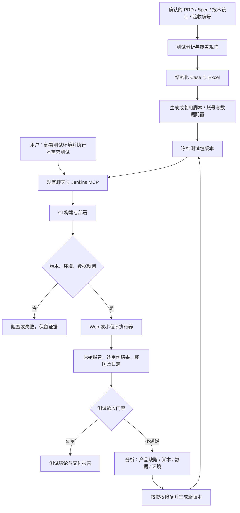

# SDD 驱动的测试执行闭环

日期：2026-09-23  
状态：待用户评审；仅方案，没有实施、安装依赖、执行测试或触发远程流水线。

## 1. 目标与本次范围

核心目标：用户通过现有聊天与 Jenkins MCP 发起 CI/CD，部署完成后依据已确认 SDD 执行真实自动化测试，产出可追溯证据，支持失败分析、修复和复测。

本方案取代同日《研发设计侧栏：部署与自动化测试》中“开发就绪后自动部署”的本期实施方向。保留聊天发布，不新增发布按钮，不做每次代码变更自动部署开关，不将扩展 Jenkins/GitLab MCP 作为先行项目。用户允许在必要时调整架构；本设计明确调整测试执行领域，不无理由改动启动和普通会话。

研发设计右侧用于配置测试目标和查看准备情况；自动测试阶段从“生成/上传用例”扩展为“用例准备、脚本准备、执行记录、失败分析”。现有 TAPD 附件交付和原生用例导入保留。

本轮遵循用户要求，不调用内置技能。本文借鉴官方框架的设计，不意味着已安装或运行其 Agent/技能。

## 2. 成熟方案依据与取舍

资料查阅日期为 2026-09-23。框架能力与本项目拟采用的策略分开描述；部署时按锁文件与执行镜像固定兼容版本，不照抄文档示例的旧最低版本。

| 参考 | 已核实的能力 | 本项目采用方式 |
| --- | --- | --- |
| [Playwright CI](https://playwright.dev/docs/ci) | 支持在 Jenkins 等 CI 中安装浏览器依赖并运行测试，提供容器示例 | Web 测试运行在 Jenkins agent，采用固定版本镜像和锁文件；初期单 worker |
| [Playwright Agents](https://playwright.dev/docs/test-agents) | planner、generator、healer 分别处理计划、脚本生成、失败脚本修复 | 借鉴职责划分，接入现有专家运行时；不另搭一套多 Agent 平台，也不把 healer 的跳过行为当验收通过 |
| [Playwright Reporters](https://playwright.dev/docs/test-reporters) | 提供 HTML、JSON、JUnit 等报告形式 | 框架原始报告保留，转换为统一运行摘要；不自行发明浏览器测试框架 |
| [Playwright Retries](https://playwright.dev/docs/test-retries) | 区分首次通过、重试通过的 flaky、持续失败 | 保留每次尝试；重试通过不能抹去不稳定结果 |
| [Playwright Authentication](https://playwright.dev/docs/auth) | 支持认证状态复用，提醒状态文件敏感性 | 凭据与认证文件仅在 runner 受控使用，不进入普通需求资产或 Git |
| [Jenkins 测试与产物](https://www.jenkins.io/doc/pipeline/tour/tests-and-artifacts/) | 使用 JUnit 报告和归档产物记录结果 | 测试进程结束后无论成功失败，都收集结果与证据 |
| [Jenkins Lockable Resources](https://www.jenkins.io/doc/pipeline/steps/lockable-resources/) | 提供流水线资源锁 | 共享环境和设备的互斥由 Jenkins 管理，不能靠客户端本地锁代替 |
| [微信小程序自动化快速开始](https://developers.weixin.qq.com/miniprogram/dev/devtools/auto/quick-start.html) | 官方 SDK 可启动开发者工具、打开项目并执行页面与元素操作；需要启用工具调用能力 | 微信开发者工具执行器采用 `miniprogram-automator`，具体版本组合先在试点验证 |

微信官方页面通过网页读取取得正文；已核实的是开发者工具基本执行路径，不据此承诺所有真机、系统弹窗、登录和支付能力均能无人值守。

方案比较：

1. 让 AI 每次现场看页面并临时点击：适合探索和定位问题，难形成稳定回归基线。
2. **AI 生成与维护脚本，成熟框架执行，CI 管理生命周期（推荐）**：可复现、可版本化、报告可检查，符合现有 Jenkins 条件。
3. 自建测试云和设备调度平台：后续多团队大规模使用可能有价值，当前运维成本过高。

不要求把所有校验都写成浏览器 E2E。纯逻辑复用已有单元测试，组件状态用已有组件测试，接口契约用 API 测试，关键用户旅程使用 E2E；视觉检查按明确设计基线单列。

## 3. 当前架构的可复用能力与缺口

源码核查入口：`RequirementChat.tsx`、`RequirementInputs.tsx`、`TestingDeliveryControls.tsx`、`src/domains/requirement/node/{inputs,assets,delivery,test_case_import}.ts`、`src/agent/mcp.ts`、`src/domains/automation/node/{coordinator,executor,store}.ts`。

| 当前能力 | 处理决定 |
| --- | --- |
| 需求空间、分阶段会话、固定资产版本、仓库引用 | 复用，作为需求和测试输入来源 |
| Excel 模板生成/校验、TAPD 用例与回执 | 保留，增加与脚本/执行的编号关联，不改变现有导入合同 |
| GitLab/Jenkins MCP，聊天能触发发布 | 保留，作为交互和能力通道 |
| 通用 automation 基于 `provider.prompt`，以会话 done 等条件判断任务完成 | 不能用来判定测试通过；新增测试运行领域，不把测试塞入定时聊天任务 |
| 通用 automation 恢复会处理本地未完成运行 | 不用于恢复仍在 Jenkins 运行的测试；测试运行须远端对账 |
| 当前需求产物提交与阶段完成 | 不作为测试通过证据，不用会话结束自动推动阶段 |
| 没有统一 TestRun、逐 Case 尝试、部署版本与报告合同 | 本次新增；这是必要的架构调整 |

主体关系：AI 负责解释、编写、分析；宿主校验范围、版本和状态；Jenkins 与 runner 负责执行并提交真实结果。模型文本中的“通过”不改变测试状态。

## 4. 整体流程



用例和脚本准备可与开发并行。部署前脚本尚未准备好时，只能完成部署并标记“测试待准备”，不能临时运行未版本化脚本后声称完整验收。

## 5. 一次性接入：测试目标配置

仓库用途（前端/后端/公共库）继续保留；一个仓库可关联多个 TestTarget，分别对应不同子应用或端。初期配置存需求空间，后续确有复用需求再提取项目模板。

| 配置项 | 内容 |
| --- | --- |
| 目标身份 | 名称、仓库、相对目录、平台 web/microfrontend/h5/wechat-mini/其他明确平台 |
| 运行入口 | Web URL 与路由；微前端宿主与子应用；小程序 AppID、项目目录、入口页 |
| 测试执行器 | Jenkins Job 与节点标签、框架、浏览器或工具/设备能力 |
| 环境与依赖 | 测试环境 ID、后端地址/版本引用、宿主版本、环境是否共享 |
| 认证和数据 | 测试角色、Jenkins credential 引用、数据准备与清理配置；不保存明文凭据 |
| 运行政策 | 允许操作的测试数据范围、超时、重试、门禁、允许的测试套件 |
| 版本证明 | CI 构建清单、部署清单、实际入口版本读取方式 |
| 报告 | 结果文件位置、原始报告和证据保留策略 |

配置校验分成“已保存、能力已核验、真实接入已验证”，避免填写了 URL 就显示可自动执行。未配置测试目标不影响普通需求讨论、开发或 Excel 交付。

## 6. SDD 转测试包

### 6.1 输入与独立预期

测试专家读取当前选定版本的 PRD、Spec、设计、用户确认决定、接口契约和代码变更。业务预期以确认的验收标准为准，代码只辅助找入口和影响范围，不能从错误实现反推预期。

每个验收编号必须映射到自动化用例、人工用例、不适用或阻塞项，标明理由。API、页面或权限缺少真实契约时，生成问题清单，不编造。

### 6.2 三种产物的一致性

- `cases.json`：测试定义的唯一编辑来源，保存稳定 TC ID、REQ/AC 引用、数据、步骤、断言、适用端和自动化状态。
- Excel：从 Case 导出，维持当前 11 列模板；TC ID 沿用现有标题编号/覆盖矩阵约定，不增加破坏模板的列。
- 脚本：实现 Case 的平台执行逻辑，引用 TC ID。Case、脚本、输入资产 hash 固定在测试包清单中。

外部或既有 Excel 先导入生成 Case 草案，保留来源 hash，再补齐结构化断言和执行信息。人工修改 Excel 不能静默反向覆盖 Case 或被当成脚本已更新；显示版本不一致并生成待核对变更。

不构造通用“Excel 解释器”实时运行任意自然语言步骤，也不自建跨平台测试 DSL。结构化 Case 管理业务语义，标准 TypeScript/JavaScript 测试文件负责真实操作与断言。

### 6.3 Case 示例（说明结构，非真实数据）

```json
{
  "id": "TC-VOC-001",
  "acceptanceIds": ["AC-VOC-001"],
  "title": "有权限账号查看详情中的明文手机号",
  "targetId": "marketing-web",
  "roleRef": "voc-reader",
  "fixtureRef": "voc-known-phone",
  "steps": [
    {"action": "打开固定测试记录详情", "expected": "手机号处于需求规定的初始状态"},
    {"action": "点击查看手机号", "expected": "显示测试数据中的准确号码"}
  ],
  "automation": {"kind": "web", "testId": "TC-VOC-001", "file": "tests/e2e/voc/phone.spec.ts"}
}
```

实际步骤的预期值由 fixture 和已确认需求提供，不能以“非空”替代“内容正确”。涉及权限拒绝时既验证页面也验证对应接口结果；需要证据支持的后端安全结论不能仅凭按钮隐藏推断。

### 6.4 脚本准备与版本冻结

优先复用目标仓库已有 runner、页面对象、fixtures、认证和报告配置；不存在时引入最小标准工程。新依赖放在被测仓库的测试开发依赖或独立 runner 工程，不把所有浏览器/开发者工具打进 Electron。

Agent 可在授权测试环境中探索真实页面，核实定位器后生成脚本。没有可运行页面时脚本标记“待运行校验”，静态检查不是已通过。

测试包包含：需求输入 hash、Case hash、测试仓库完整 SHA、脚本/配置路径、依赖锁文件、执行器版本、TC 到脚本映射。推荐脚本与业务代码同仓维护；跨仓时分别记录业务 SHA 和测试 SHA。CI 只读取已推送的明确版本，不能执行桌面端尚未提交的脚本副本。

## 7. Web 执行路径

默认采用 Playwright Test；已有成熟 Cypress/Selenium 套件的仓库先适配结果合同，不要求为接入平台重写所有测试。

执行步骤：领取环境 → 核验部署清单 → 验证实际版本及依赖 → 准备数据/认证 → 冒烟 → 验收用例 → 受影响回归 → 采集结果 → 清理本次数据并释放环境。

规则：

- 先覆盖核心浏览器，其他浏览器按产品支持范围配置；H5 视口模拟不等同真机或真实 App WebView。
- 优先 role/label/test-id 等稳定定位，按可观察状态等待，不依赖固定坐标或大量固定 sleep。
- 各 Case 数据隔离，使用 runId 命名或专属 fixture；同账号有服务端状态冲突时串行或分配独立账号。
- 真实联调用例使用测试后端；Mock 用例单独标记，不计入真实环境 E2E 覆盖。
- 保存失败步骤、期望/实际、截图、Trace 和必要脱敏网络信息；不在报告暴露 Cookie、Token、明文手机号等敏感测试数据。
- 视觉对比固定视口、字体、浏览器和动态内容处理，基线需对应设计版本；AI 不自动更新截图基线来消除失败。
- 微前端既测子应用逻辑，也测宿主入口、登录权限、路由和样式集成；记录两侧版本。

## 8. 小程序执行路径

统一的是 Case 与报告，不是浏览器驱动。目标需明确平台，微信作为第一种可接入的小程序类型；支付宝、其他平台单独进行能力准入，不能套用微信脚本。

### 8.1 微信开发者工具层

Jenkins 调度专用 Windows/macOS 执行节点，预装并固定开发者工具、Node、基础库与 SDK 兼容组合。使用官方 `miniprogram-automator` 配合目标仓库现有测试运行器（没有时选一个标准 JS runner）管理断言、fixture、超时和结果导出。

流程：取得本次明确构建目录/制品 → 核验产物 hash、AppID、后端环境 → 启动开发者工具自动化 → 打开指定页面 → 执行用例 → 截图与报告 → 关闭连接、清理数据并释放节点。

Taro/uni-app 项目需要对应平台编译产物，不直接把源码目录当可运行小程序。开发者工具测试的是本次指定工程/产物，不能声称验证了用户手机已经下载的体验包。

### 8.2 体验版与真机层

上传体验版、生成二维码和设备执行是不同步骤。真机验收需要已核验的设备执行适配器、账号登录、设备独占、版本证明与证据采集能力；没有这些条件就标记“待真机验证”。

真机优先验证开发者工具难以覆盖的原生授权、键盘、安全区、扫码及产品要求的设备差异。只在确认平台和设备支持后选用官方真机能力或合适设备驱动，不承诺 Appium 可无差别控制所有小程序内部节点。

测试期间不得通过直接写页面 data、跳过业务流程或模拟关键平台回调冒充真实用户旅程。确需注入的场景归类为模拟/组件测试。

## 9. 聊天 CI/CD 如何自动衔接测试

### 9.1 指令与授权

支持三类明确意图：

- “生成测试用例和脚本”：准备产物，不授权发布或执行有副作用的测试。
- “部署到测试环境，完成后执行本需求测试”：在已配置范围内授权一次部署加测试，无需分步再确认。
- “对构建 #123 执行本需求测试/复测失败项”：绑定已有部署，不再次发布。

仅说“发布”沿用当前发布行为；除非用户已保存明确的部署后测试约定，不自动扩大为测试。测试阶段“上传用例到 TAPD”继续表示用例管理，不解释成 CI/CD。

授权记录来自用户消息和选定配置，不能由模型自行提交 `confirmed=true` 替代。覆盖环境、目标、数据操作、套件及本次版本；不自动授权生产发布、合并、真实订单操作或代码修复。

### 9.2 推荐 Jenkins 内部衔接

让既有部署 Pipeline 在收到本次测试请求参数后，部署成功且版本就绪时调用测试阶段/测试 Job。客户端不需要保持对话才能触发后续步骤。

推荐参数语义：`requestId`、需求引用、目标引用、预期业务 SHA、测试 SHA/包 hash、套件、环境；实际参数名映射到真实 Job。只读校验后配置，不能要求用户已有 Job 天然支持这些参数。

同一个 Pipeline 管理共享环境的部署到测试全过程。若必须调用独立测试 Job，由父 Pipeline 持有环境锁并同步等待子 Job，子 Job不重复申请同一把锁，避免死锁。其他会修改该环境的 Job 也必须遵守同一锁；否则使用独立环境或把覆盖风险作为阻塞条件。

“普通流水线加一个测试阶段”优先于新建常驻测试服务。合并成独立服务只有在跨 CI 调度或大量设备管理确有需求时再考虑。

### 9.3 关联依据与 MCP 缺口处理

此前读取的 MCP 包缺少部分完整 SHA/队列参数信息，不影响当前交互式发布能执行。此次优先让流水线产生标准 `deployment-manifest.json` 和 `test-summary.json`，通过已有 Jenkins 制品读取能力取得，而不是先扩展一整套 MCP。

客户端拿到明确的 Job 与 build number 后读取该构建制品，核验 requestId、实际构建 SHA、部署版本及测试包 hash；禁止用 lastSuccessfulBuild 或短 SHA 猜测归属。若聊天 MCP 仅返回 queue URL，保存回执并等待可核验的构建关联；必要时由用户提供确切构建链接，但仍以清单校验，不能因此重发部署。

自动关联可以查询限定 Job 的近期构建清单并按 requestId 匹配。查询有界、限流，未找到显示“待关联/结果未知”，不能当作失败或重新触发。若试点无法提供清单或读取制品，明确列为接入缺口，之后只补最小只读接口，不伪造已接通。

流水线若只构建没有部署，不能进入环境 E2E；部署成功但没有测试能力，状态为“部署完成、测试阻塞”。

## 10. 执行与结果合同

### 10.1 流水线产物

`deployment-manifest.json`：schemaVersion、requestId、目标/环境、仓库及实际 SHA、构建号、产物 hash、实际部署版本、依赖版本、部署时间、版本证明来源。

`test-summary.json`：runId、requestId、测试包 hash、脚本 SHA、环境版本、runner 与模式（浏览器/开发者工具/真机/Mock）、开始结束时间、计划/发现/执行 Case 集合、逐项结果、退出码、证据引用及清理结果。

测试框架同时保留原始 JUnit/JSON/HTML 报告。summary 是聚合结果，不取代框架报告；TC ID 与执行用例数不一致、缺文件、解析失败时报告无效，不得默认通过。产物由配置的 Jenkins 流水线生成，经已认证来源读取；JSON 自称成功不能绕过来源和版本核验。

### 10.2 状态与门禁

运行生命周期：`created → waiting_deployment → checking → queued → running → collecting → finished`，另有 `blocked / cancelled / unknown`。测试结论单独保存 `passed / failed / flaky / incomplete / invalid`，不把进程结束等同通过。

逐 Case 保存 `passed / failed / error / timeout / skipped / blocked / not_run` 与 attempt 序号。部署、认证或设备故障先作为基础设施错误，不直接判成产品缺陷。

推荐默认门禁：

1. 部署与测试版本一致且证据有效。
2. 本次约定必测 Case 全部执行并通过，关键验收没有遗漏。
3. 零用例、全部跳过、required Case 未执行、结果丢失均不能通过。
4. 首次失败后重试成功标 flaky；关键用例 flaky 默认不满足交付门禁，例外必须显式记录。
5. 一期默认至多一次框架重试；会产生不可重复副作用的 Case 默认不重试，除非已有隔离/幂等数据设计。
6. 人工豁免单独显示，保留原失败与责任记录，不把原结果改成 passed。

同样版本和套件重复请求先返回已有活动运行；显式重测产生新 attempt。未知远端请求先对账，不盲目重复启动。

## 11. 失败分析与修复闭环

先保存报告和释放设备/测试会话资源，再启动 AI 分析。输入仅包括相关 Case、验收原文、失败步骤、版本差异、截图/Trace 和必要日志，不转交全部聊天记录。

| 分类 | 行为 |
| --- | --- |
| 业务实现偏离验收 | 给出代码证据，进入授权的开发修复；新代码部署后复测 |
| 定位器/脚本错误 | 修复脚本，保留业务断言和 Case ID，生成新测试包 |
| 环境/认证/设备 | 恢复条件后重跑，不修改业务代码 |
| 测试数据问题 | 修正 fixture，清理本次数据，保留失败原因 |
| 需求歧义 | 回到澄清，调整基线后重评受影响用例 |

默认自动分析，不自动修改代码。用户明确授权“修复并复测”时，绑定修改范围、目标环境和轮数；建议最多两轮修复，每轮保存改动与新版本，持续失败转人工处理。运行预算是产品配置提案，不是本次会话执行指令。

禁止以删除断言、降低预期、跳过失败 Case 或自动接受新视觉基线让结果变绿。修复脚本与修复业务代码要在报告中分开。

代码改变时生成新部署与运行；仅脚本改变时可对同一有效部署重测。复测包括失败项及相关回归，不能用一条修复成功替代全部受影响验收。旧运行只追加关联，不覆写。

## 12. 对当前架构的调整

### 12.1 新增测试执行领域

建议增加 `src/domains/testing/node/`，由以下职责组成：

- targets：平台、环境、runner 和 credential 引用配置。
- packages：Case、脚本、来源资产和包版本索引。
- runs：运行请求、幂等、状态、逐 Case 尝试与部署绑定。
- ci-adapter：Jenkins 回执、制品和结果查询的固定适配；不向模型开放任意 HTTP 请求。
- reports：框架报告转换、版本/覆盖门禁、资产引用和脱敏。

测试定义和脚本权威版本在目标 Git 仓库；运行事实在 Jenkins；客户端 SQLite 保存查询索引、授权、映射和已核验结果。明确三者职责，不维护两套可独立编辑的测试真相。

拟新增表：`test_targets`、`test_packages`、`test_runs`、`test_case_attempts`、`test_run_events`。归属按账号和需求空间校验，保存完整版本、远端 ID、父运行、状态与证据索引；敏感凭据不落表。

### 12.2 工具与 UI

宿主提供受需求范围约束的准备/执行/读取结果操作；Agent 可请求执行，但不能直接写入 passed 状态。读写经统一领域 API，按现有规范接入 IPC、preload 和认证后的 HTTP 边界。

研发设计右侧：“测试配置”页签，查看目标、环境、执行器、脚本准备和最近运行，不放发布按钮或自动部署开关。

自动测试阶段：保留现有用例提交/上传；增加“用例与覆盖、自动化脚本、执行记录”视图。用户可通过聊天生成、执行、复测，也可从记录查看报告或停止运行；两种交互走同一领域服务。

收到远端结果后后台更新记录，不强制切换当前会话或打断用户输入，不自动推进 TAPD 需求状态。测试专家读到的是明确运行引用，而非把别的会话最后一句话当报告。

### 12.3 生命周期与启动边界

不重用通用 automation 的“会话完成=任务完成”及重启即标超时逻辑。客户端退出后，Jenkins 内部已连接的部署与测试继续；再次打开需求/运行面板时按需对账。离线期间不要求云端回调到本机，也不增加启动时全量连接 MCP。

因此允许架构调整并不意味着需要改 Electron 启动。新增测试领域足以满足本期需求；未来确需推送提醒再独立设计公网服务。

## 13. 文件归档、TAPD 与权限

普通报告摘要作为版本化需求资产；原始 Trace、视频和完整 HTML 报告保留在 Jenkins/受控制品存储，客户端记录精确构建链接、hash、保留期限与失效状态，不绕过现有附件大小或会话路径限制。

建议默认成功证据保留 14 天、失败/不稳定证据 30 天，实际按企业策略配置；交付快照需要独立保留，不能依赖已清理的临时构建。

TAPD 用例仍通过当前 Excel/原生导入流程管理，运行不以“上传到 TAPD”为前置条件。首期保存 TC 与远端用例 ID 映射，不自动写执行次数、执行结果或创建缺陷；需要回写时另行核验真实接口和版本映射。

测试代码有真实执行能力：CI 使用隔离工作区、测试专用账号与最低权限凭据，不给未评审脚本生产密钥；测试操作范围在启动前确定。身份切换后旧账号运行不继续向新会话暴露结果。日志/截图中的秘密脱敏，认证状态不作为通用交付文件。

Windows/macOS 客户端使用平台路径与标准 IPC，不依赖 shell 拼接。Web runner 可选 Linux 镜像；微信 runner 的宿主、开发者工具和设备要求独立配置，不声称 Linux 浏览器容器也能直接运行微信开发者工具。

## 14. 交付次序与验收

### 第一期：一个 Web/微前端需求完成真实闭环

选择已有测试环境的低副作用需求，例如 VOC 详情展示。完成目标配置、Case/脚本、Jenkins 流水线测试步骤、部署清单、报告合同、客户端运行视图和失败复测。

验收必须包含：真实通过、刻意引入的可控失败、错误版本阻断、登录/数据阻塞、零用例拒绝、重复请求去重、客户端中断后恢复，以及现有 TAPD 用例交付不受影响。每项保留证据，不用单元测试或模拟 MCP 代替真实链路验收。

### 第二期：微信小程序开发者工具与真机分层

先固定平台及 runner 节点，在开发者工具上执行同版本用例并接入统一报告；再核验真机执行器，覆盖明确设备矩阵和平台交互。无法自动化的项保留人工验证，不承诺一次覆盖所有小程序平台。

### 第三期：持续维护与规模化

在已有数据隔离和稳定用例基础上增加并行、浏览器/设备矩阵、模块回归复用和受控自动修复。按需增加 TAPD 执行回写；不把这些作为首期前置。

关注指标：关键 AC 自动化覆盖、实际执行率、首次通过率、flaky 比例、环境阻塞率、失败定位与复测耗时。代码行数、用例 Excel 数量不作为闭环成功指标。

## 15. 实施前需核验的外部条件

方案评审不要求立即提供秘密信息。试点接入时核验：

1. 一个实际仓库和 Jenkins Job，能否增加测试阶段/调用测试 Job。
2. 已部署版本如何读取，能否归档部署与测试清单。
3. 测试环境是否共享，所有写入者能否遵守环境锁。
4. 测试账号、角色、数据准备和清理是否可重复。
5. 目标仓库已有测试框架、脚本目录、检查与执行授权规则。
6. 小程序的真实平台、框架、开发者工具节点和真机条件。

缺失时在接入检查中列明具体阻塞，不回退为让 AI 猜测成功。优先补流水线产物合同；只有现有 MCP 不能获取必要证据时才扩展最小查询能力。

## 16. 本轮验证与待确认决定

本轮仅阅读代码和官方资料、编写设计；未修改代码、依赖、专家包、Jenkins/GitLab 配置，未执行测试或部署。后续实现遵守项目测试授权规则；本文描述的测试执行是待建设产品能力，不是当前执行许可。

提请确认：采用“AI 准备与分析、Jenkins/成熟 runner 执行、独立测试领域管理事实”的架构；保留聊天发布；首期 Web/微前端，第二期微信小程序；允许必要的 Jenkins 流水线接入与新增测试领域，暂不启动 MCP 全面扩展和自动部署开关。


## 17. 首期代码落地状态（2026-09-23）

用户确认后已实现独立 testing 领域、需求右侧测试执行面板、当前需求 Agent 工具和 Jenkins 只读报告采集。目标支持 Web/微前端/H5；小程序可保存配置，执行器明确阻断。测试包读取完整 Git SHA 下的清单与脚本，并关联已提交 SDD 资产版本。运行保存目标、脚本与用例快照；采集核验请求、部署版本、执行前后版本、原始报告哈希及逐条结果。未执行、全部跳过、必测人工项和重试通过不会标记通过。

固定 BASE_URL、版本接口和版本字段由用户在目标中配置，不能由 AI 猜域名；动态预览 URL 尚未实现。聊天仍通过现有 Jenkins MCP 发起用户要求的流水线；本领域不新增发布按钮，不修改启动逻辑。构建关联后每 30 秒只读跟踪，停止应用不会取消远端构建；重新打开面板按记录恢复，24 小时后需手动核验。

接入资源见 `scripts/testing/README.md`、`run-web.mjs` 及 Jenkins/Playwright 模板。模板不是现成业务流水线，尚未修改任何真实 Job、安装测试依赖或运行业务测试。真实环境接入、业务脚本与 Windows 实机验证仍未完成。回归测试源码已补充，但按项目约束及用户最新要求不执行测试套件。

## 18. 已确认增量：测试专家生成脚本与本地微信执行

用户确认“生成用例、启动脚本”，并明确微信小程序使用本地执行。延续原架构，新增随应用交付的 stdio MCP 执行器，按需注册和连接，不改启动逻辑，不新增内置技能。Web 沿用 Jenkins；微信由本机 Node + 官方 miniprogram-automator + 微信开发者工具执行，使用 Node 原生 test 框架，明确结果为开发者工具模式，不能替代真机验收。

测试目标增加小程序项目相对目录、开发者工具 CLI 路径和 AppID；连接器名继续由目标配置。用户在面板登记本地连接器，不自动安装 SDK、打开开发者工具或执行脚本。真实启动仍由本轮显式选择的 MCP 工具发起。SDK 复用目标仓库依赖；无需新增宿主 npm 依赖。执行器提供环境检查、启动、状态/报告和停止，按 requestId 去重；进程中断后保留结果，无法证明仍在运行时标为未知，不重放启动。

测试专家每轮获得明确工作流，authoring 工具返回本轮已选 SDD/仓库、目标与运行资源内容，由现有文件工具生成真实脚本，不能模板冒充业务断言。只生成用例、只上传 Excel 和仅讨论请求不触发测试。执行要求登录、项目、依赖、用例、版本就绪；缺失时返回具体阻塞。生成源码不等于执行成功。

小程序首期要求测试脚本与业务代码在同一已提交版本，工作区干净。开发者工具打开项目路径可为编译输出目录；运行前后计算实际小程序目录哈希，记录本次被测构建并拒绝运行期间变更。该哈希不能证明编译产物来源，编译型项目仍须由受控构建生成对应版本。每个用例导出可执行函数，Node test 管理超时、结果与 hooks；清理失败、零执行、全跳过和缺少原始报告不可通过。

影响文件：testing 领域、需求专家上下文、右侧配置、scripts/testing、打包资源清单。风险：本机脚本具有当前用户权限、开发者工具登录与版本兼容、编译输出来源；沿用现有 MCP 选择和权限，不下载/执行第三方依赖作为配置校验。验证仅类型、语法和差异检查，真实小程序/Windows 实机和完整回归未授权运行。

## 19. 当前有效方案：全部本地执行，部署与测试解耦

用户再次确认：Web/H5/微应用配置测试域名与入口路径，本地 Playwright 直接执行并产出报告，不读取 Jenkins 测试报告。Jenkins 仅保留原有聊天构建发布能力。本节取代前文 Web 使用 Jenkins 执行及报告采集的描述；不保留双轨执行方式。

统一本地 stdio MCP 提供环境检查、启动、查询与停止，按目标类型分发 Playwright 或微信开发者工具。配置不再要求 Job 或构建编号；页面地址必填，入口路径选填，微应用可填写主应用地址加挂载路径。部署版本接口作为可选增强；未配置时允许页面测试，但报告必须明确“未核验部署版本”，不能用测试脚本 SHA 充当线上版本。配置版本接口时须提供预期完整 SHA 并校验前后版本。

报告、截图、Trace 保存在本机独立执行目录，沿用冻结请求、脚本提交和逐用例结果核验。只改代码并做静态检查，不安装依赖、启动浏览器或微信工具，不运行测试套件。
